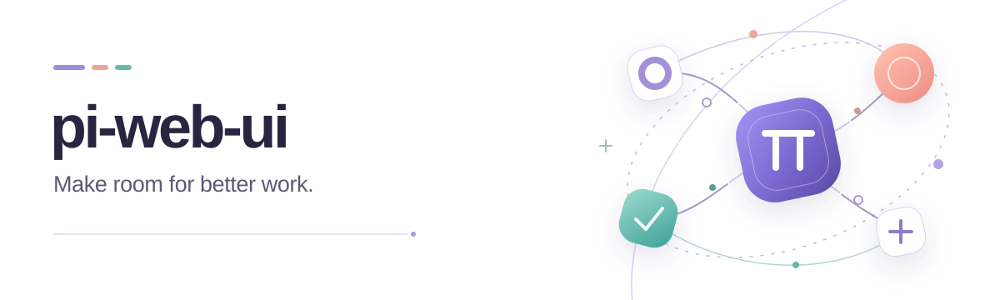
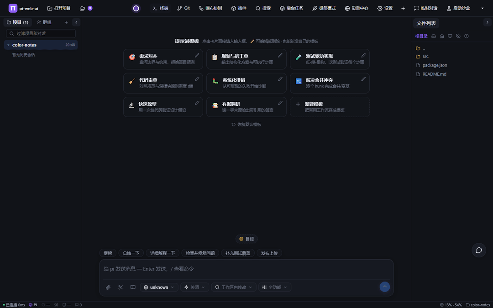
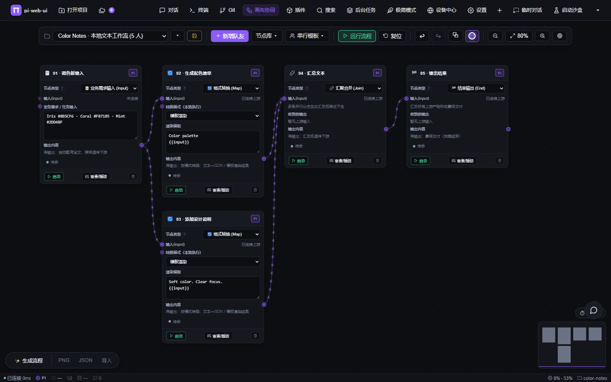

<p align="center">
  <picture>
    <source media="(prefers-color-scheme: dark)" srcset="./assets/readme/hero-dark.svg" />
    <source media="(prefers-color-scheme: light)" srcset="./assets/readme/hero.svg" />
    
  </picture>
</p>

<h1 align="center">A home for your AI coding work.</h1>

<p align="center">Conversations, tools, and collaboration in one browser or desktop workspace.</p>

**English** · [简体中文](./README.zh-CN.md) · [繁體中文](./README.zh-TW.md) · [Website](https://xing-shuyin.github.io/pi-web-ui-site/) · [Docs](https://xing-shuyin.github.io/pi-web-ui-site/docs.html) · [Downloads](https://github.com/xing-shuyin/pi-web-ui/releases)



[Watch the walkthrough · MP4](./assets/readme/showcase.mp4)

## Your project, within reach

| Keep your flow                                                                                                                      | Make room for more                                                                                              |
| ----------------------------------------------------------------------------------------------------------------------------------- | --------------------------------------------------------------------------------------------------------------- |
| **Conversations that stay organized.** Run parallel conversations, revisit history, and bring files and images into the discussion. | **A choice of engines.** Work with pi, DSH, Claude Code, and Codex, with capabilities specific to each engine.  |
| **Tools beside the conversation.** Browse and edit files, preview changes, open a terminal, and inspect Git status and diffs.       | **Collaboration you can follow.** Connect work on a canvas, coordinate Bot groups, and reach connected devices. |
| **A workspace that feels like yours.** Choose themes and languages, with layouts for desktop and mobile.                            | **Room to extend.** Add Skills, MCP servers, plugins, and UI extensions as your workflow grows.                 |

## Start in two commands

Requires **Node.js 22.19.0 or later**. Run these commands from your project directory.

```bash
npm install -g pi-web-ui@latest
pwu .
```

`pwu`, `piwebui`, and `pi-web-ui` are equivalent commands; all subcommands and options work with each. Use `pwu [directory]` to start in a project directory.

Open `http://127.0.0.1:8787` if the browser does not open automatically.
In workspace settings, configure a model provider and its credentials, select a model, and send your first task.

Prefer a packaged app? Choose an [Electron desktop build or Windows portable package](https://github.com/xing-shuyin/pi-web-ui/releases).

[Installation guide](https://xing-shuyin.github.io/pi-web-ui-site/docs.html#installation) · [Workspace documentation](https://xing-shuyin.github.io/pi-web-ui-site/docs.html)

## More than one way to work

Use chat for a focused task, parallel conversations for separate threads, and subagents for delegated work.
Plan mode, goal mode, and review delegation provide different ways to organize execution.
Tool approvals let you review tool actions as part of that workflow.

The workspace supports **pi, DSH, Claude Code, and Codex** through their respective integrations.
Session formats, configuration, tools, and available controls vary by engine.

In a pi-hosted workspace, native CLI conversations can also run local pi, Claude Code, Codex, or a configured DSH terminal profile.
These are interactive terminal sessions that use each CLI's own installation, login, and permissions; they do not inherit every chat feature.

[Execution modes](https://xing-shuyin.github.io/pi-web-ui-site/docs.html#modes-guide) · [Native CLI details](./docs/architecture-terminal.md#原生-cli-工作台)

## Give the work a canvas

Connect task steps, follow runs, and inspect logs and artifacts in a visual workflow.
Canvas collaboration brings handoffs and review into view, so the shape of a larger task stays readable.



Canvas supports execution tracking, approval branches, and reviewable artifacts.
Where Git isolation is enabled and supported, changes remain available for inspection and explicit adoption.

[Canvas architecture and behavior](./docs/architecture-canvas.md)

## Connect people, agents, and machines

Use the device center to work with connected machines and their supported remote desktop and file capabilities.
Bot groups bring device-backed agents into a shared conversation for coordination and task dispatch.

Extend the workspace with **Skills, MCP, and plugins**: add tools, reusable instructions, or your own interface contributions.
Browse the [community plugin directory](https://github.com/xing-shuyin/pi-web-ui-plugins), or start with the [plugin SDK](./plugin-sdk/README.md).

[Device center](./docs/device-center.md) · [Bot groups and collaboration](./docs/device-collaboration.md) · [MCP and browser tools](https://xing-shuyin.github.io/pi-web-ui-site/docs.html#mcp-and-browser)

## Pick your place to work

| Entry point                     | A good fit for                                                                   |
| ------------------------------- | -------------------------------------------------------------------------------- |
| **Web**                         | Opening the workspace in a browser, locally or through a configured service.     |
| **Electron desktop**            | A desktop application with a built-in browser and local workflow integration.    |
| **Windows portable**            | A packaged Windows entry point; check the release notes for included components. |
| **Background service / Docker** | Keeping the workspace available on your own machine or server.                   |

Model credentials are configured separately from the app installation.
For remote access, use the deployment guide to configure authentication and your network entry point.

[Background service](https://xing-shuyin.github.io/pi-web-ui-site/docs.html#daemon-service) · [Docker installation](https://xing-shuyin.github.io/pi-web-ui-site/docs.html#docker-source-install) · [Deployment guide](./docs/deployment.md) · [CLI and environment](https://xing-shuyin.github.io/pi-web-ui-site/docs.html#cli-and-env)

## Build with us

To run from source:

```bash
git clone https://github.com/xing-shuyin/pi-web-ui.git
cd pi-web-ui
npm ci
npm run dev
```

The default development frontend is `http://localhost:5173`.
See the [development guide](./docs/development.md) for checks, builds, and contribution conventions, or explore the [documentation index](./docs/README.md).

## Community

- **QQ group:** 1126050727
- **Bugs and feature requests:** [GitHub Issues](https://github.com/xing-shuyin/pi-web-ui/issues)
- **Questions and ideas:** [GitHub Discussions](https://github.com/xing-shuyin/pi-web-ui/discussions)
- **Releases:** [Downloads and release notes](https://github.com/xing-shuyin/pi-web-ui/releases)

Thanks to [pi](https://github.com/badlogic/pi-mono) and its contributors for the upstream coding-agent foundation.

Licensed under [MIT](./LICENSE).
