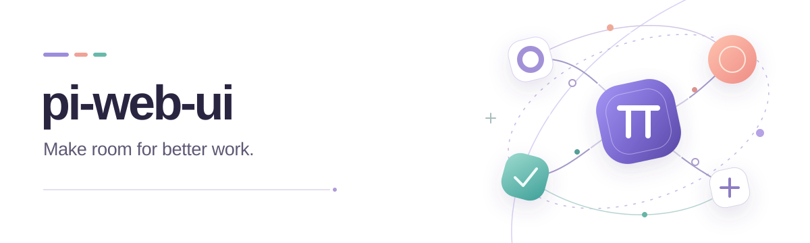
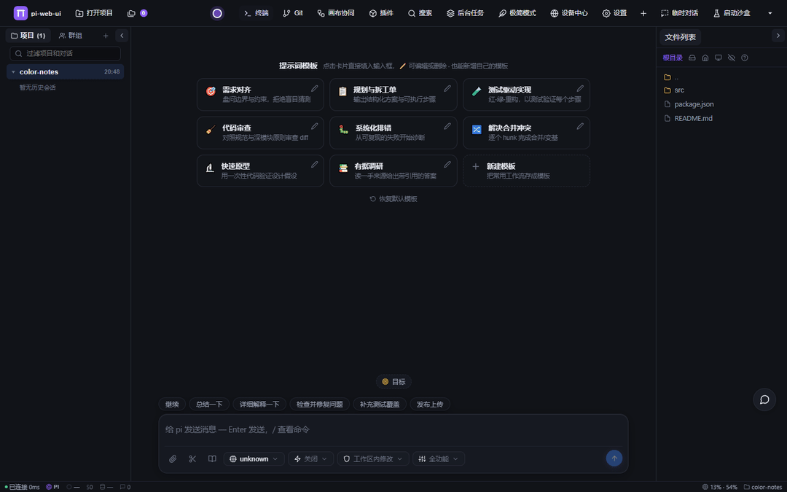
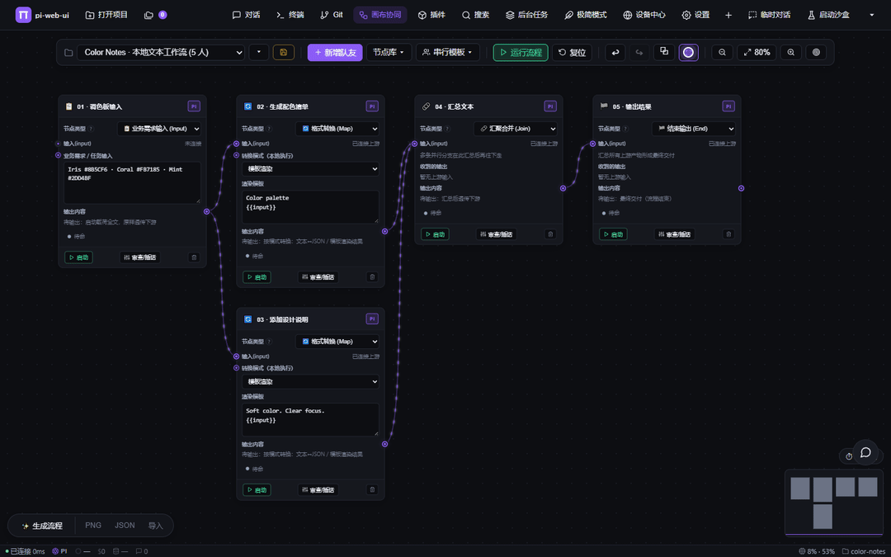

<p align="center">
  <picture>
    <source media="(prefers-color-scheme: dark)" srcset="./assets/readme/hero-dark.svg" />
    <source media="(prefers-color-scheme: light)" srcset="./assets/readme/hero.svg" />
    
  </picture>
</p>

<h1 align="center">把 AI 编码工作放在一起。</h1>

<p align="center">在浏览器或桌面里，串起对话、工具与协作。</p>

[English](./README.md) · **简体中文** · [繁體中文](./README.zh-TW.md) · [官网](https://xing-shuyin.github.io/pi-web-ui-site/) · [使用文档](https://xing-shuyin.github.io/pi-web-ui-site/docs.html) · [下载](https://github.com/xing-shuyin/pi-web-ui/releases)



[观看演示 · MP4](./assets/readme/showcase.mp4)

## 项目所需，就在手边

| 保持工作连贯                                                                 | 给更多可能留空间                                                                      |
| ---------------------------------------------------------------------------- | ------------------------------------------------------------------------------------- |
| **有条理的对话。** 并行推进多个对话，回看历史，把文件和图片带进讨论。        | **选择适合的引擎。** 使用 pi、DSH、Claude Code、Codex，各引擎保留自身能力与配置方式。 |
| **对话旁的工具。** 浏览和编辑文件、预览改动、打开终端、查看 Git 状态与差异。 | **看得见的协作。** 在画布上串联工作，通过 Bot 群组协调任务，连接远程设备。            |
| **顺手的工作区。** 可选主题与语言，适配桌面和移动端布局。                    | **按需扩展。** 用 Skills、MCP、插件与 UI 扩展补齐自己的工作流。                       |

## 两条命令开始

需要 **Node.js 22.19.0 或更高版本**。在你的项目目录中运行：

```bash
npm install -g pi-web-ui@latest
pwu .
```

`pwu`、`piwebui`、`pi-web-ui` 是等价命令，所有子命令和选项通用。用 `pwu [目录]` 即可在指定项目目录启动。

默认打开浏览器，地址为 `http://127.0.0.1:8787`。
首次使用，在设置中配置模型提供商、凭据与模型，即可开始对话。

偏好安装包？可以选择 [Electron 桌面版或 Windows 便携包](https://github.com/xing-shuyin/pi-web-ui/releases)。

[安装指南](https://xing-shuyin.github.io/pi-web-ui-site/docs.html#installation) · [工作台文档](https://xing-shuyin.github.io/pi-web-ui-site/docs.html)

## 不止一种工作方式

用单个对话处理眼前任务，用并行对话展开不同线索，用子代理委派工作。
计划模式、目标模式与审查委派，为不同规模的任务提供组织方式。
工具审批让你在执行过程中检查工具操作。

工作区通过各自的集成支持 **pi、DSH、Claude Code、Codex**。
不同引擎的会话格式、配置、工具和可用控制项有所区别。

在 pi 宿主工作区中，也可以创建原生 CLI 对话，运行本地 pi、Claude Code、Codex，或已配置的 DSH 终端 profile。
这类对话是交互式终端会话，使用 CLI 自身的安装、登录与权限配置；并非所有聊天功能都适用。

[运行模式](https://xing-shuyin.github.io/pi-web-ui-site/docs.html#modes-guide) · [原生 CLI 说明](./docs/architecture-terminal.md#原生-cli-工作台)

## 给复杂工作一张画布

串联任务步骤，跟踪运行，查看日志与产物。
画布协作把交接和审查放到可见的流程中，让较大任务的结构依然清楚。



画布支持执行跟踪、审批分支与可审查的产物。
在启用并支持 Git 隔离的场景中，可以检查工作区改动，再明确选择是否采纳。

[画布架构与行为说明](./docs/architecture-canvas.md)

## 连接人、代理与设备

通过设备中心连接其他机器，使用其支持的远程桌面与文件能力。
Bot 群组把设备上的代理带入共享对话，用于协调与任务派发。

通过 **Skills、MCP 与插件**扩展工作区：增加工具、复用指令，或添加自己的界面能力。
可以浏览[社区插件目录](https://github.com/xing-shuyin/pi-web-ui-plugins)，也可以从 [插件 SDK](./plugin-sdk/README.md) 开始。

[设备中心](./docs/device-center.md) · [Bot 群组与协作](./docs/device-collaboration.md) · [MCP 与浏览器工具](https://xing-shuyin.github.io/pi-web-ui-site/docs.html#mcp-and-browser)

## 在合适的地方打开

| 入口                  | 适合的场景                                          |
| --------------------- | --------------------------------------------------- |
| **Web**               | 在浏览器中打开本地工作区，或访问已配置的服务。      |
| **Electron 桌面版**   | 使用带内置浏览器和本地工作流集成的桌面应用。        |
| **Windows 便携版**    | 使用打包好的 Windows 入口；随包组件以发布说明为准。 |
| **后台服务 / Docker** | 在自己的机器或服务器上持续提供工作区。              |

安装应用后，仍需单独配置模型凭据。
远程访问的鉴权与网络入口设置，请按部署文档完成。

[后台服务](https://xing-shuyin.github.io/pi-web-ui-site/docs.html#daemon-service) · [Docker 安装](https://xing-shuyin.github.io/pi-web-ui-site/docs.html#docker-source-install) · [部署指南](./docs/deployment.md) · [CLI 与环境变量](https://xing-shuyin.github.io/pi-web-ui-site/docs.html#cli-and-env)

## 一起开发

从源码运行：

```bash
git clone https://github.com/xing-shuyin/pi-web-ui.git
cd pi-web-ui
npm ci
npm run dev
```

默认开发前端地址是 `http://localhost:5173`。
检查、构建和贡献约定见[开发指南](./docs/development.md)，其他主题见[文档索引](./docs/README.md)。

## 交流与反馈

- **QQ 交流群：**1126050727
- **Bug 与功能建议：**[GitHub Issues](https://github.com/xing-shuyin/pi-web-ui/issues)
- **问题与想法：**[GitHub Discussions](https://github.com/xing-shuyin/pi-web-ui/discussions)
- **版本更新：**[下载与发布说明](https://github.com/xing-shuyin/pi-web-ui/releases)

感谢上游 [pi](https://github.com/badlogic/pi-mono) 及其贡献者提供编码智能体基础。

采用 [MIT 许可证](./LICENSE)。
