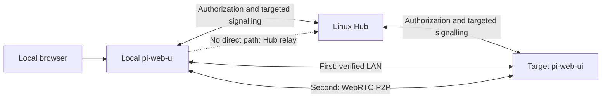

**English** · [简体中文](./README.md) · [繁體中文](./README.zh-TW.md)

# P2P access validation for Piercer and pi-web-ui

Status: **this directory keeps the original transport-feasibility prototype**. The production implementation lives in `native/device-p2p/` and `server/device-center/device-p2p.ts`, see [the access documentation](../../docs/device-center.en.md#p2p-device-access). The prototype never connects to a user's Hub, never reads device credentials and never starts real desktop capture; its two WebRTC PeerConnections live in one process and use loopback UDP candidates only. It validates protocol compatibility and the existing authorization boundary, not public-internet hole-punching success rates or full remote throughput.

## Verified

2026-11-12, Windows x64, Go 1.27.4, Pion v3.2.32:

- `go build ./...` succeeds at commit `0563e77472cbcf3768522cfdb2a9c652ab4763d6` of the original Piercer repository.
- The prototype actually establishes a Pion WebRTC `host → host / UDP` channel, and both ends' candidates were checked to be non-relay.
- pi-web-ui production code — `createDeviceLanServer` / `probeDeviceLan` — completes a TLS-PSK handshake, health probe, preview HTML request and 128 KiB upload over that channel without modification.
- Transfers concurrently: an 8 MiB HTTP download, 32 × 256 KiB simulated desktop binary messages and 32 chat WebSocket messages; every binary payload has the same SHA-256 and every text message matches one for one.
- Each connection uses its own DataChannel, 16 KiB chunks and a 512 KiB send high-water mark; the largest buffer observed was 540672 bytes, i.e. the high-water mark plus one chunk. The SCTP congestion window is still shared across channels, so channel separation is not absolute independence.
- The Authorization and Origin the controlled service receives are still injected by the existing gateway; a wrong PSK is rejected, and revoking authorization closes existing desktop/chat connections and refuses reconnection.

This concurrent transfer finished in about 442 ms on one machine, **which must not be converted into any public-internet throughput promise**. Nothing tested real desktop frame rate, cross-machine NAT, production Hub signalling, automatic fallback or running on macOS/Linux. The prototype's statistics cover a single run and are not a performance baseline.

## Which parts of Piercer are worth adopting

The reference code is pinned to the commit above so the README and the implementation cannot be confused:

| Part                                                                                                                        | Reality                                                                                                       | How to adopt                                                                                                                                                    |
| --------------------------------------------------------------------------------------------------------------------------- | ------------------------------------------------------------------------------------------------------------- | --------------------------------------------------------------------------------------------------------------------------------------------------------------- |
| [Pion / ICE config](https://github.com/xing-shuyin/piercer/blob/0563e77472cbcf3768522cfdb2a9c652ab4763d6/common/config.go)  | Uses Pion WebRTC, STUN, UDP/TCP ICE; the TURN config is commented out                                         | Keep the WebRTC direct-connection idea, decide the path from real candidates and connection state                                                               |
| [Signalling server](https://github.com/xing-shuyin/piercer/blob/0563e77472cbcf3768522cfdb2a9c652ab4763d6/signaling/main.go) | Single-room broadcast, no account auth, any Origin allowed                                                    | Use pi-web-ui's authenticated Hub connection for targeted signalling; do not copy the broadcast server                                                          |
| [Server connection](https://github.com/xing-shuyin/piercer/blob/0563e77472cbcf3768522cfdb2a9c652ab4763d6/server/main.go)    | A new offer replaces the old connection; aimed at file requests                                               | Maintain multiple sessions keyed by source device, target device and connection generation                                                                      |
| File sending                                                                                                                | Sends 64 MiB of fake data before the first request; the send loop ignores buffer backpressure and Send errors | Leave it out of the desktop path; bound the queue, handle errors, schedule control and bulk traffic separately                                                  |
| Port prediction                                                                                                             | Gets a mapping from a separate STUN socket, then generates nearby port candidates                             | The first version uses standard ICE; a separate socket's mapping need not equal the real ICE socket's mapping, so port prediction is not treated as a guarantee |
| Failure policy                                                                                                              | TURN is effectively disabled: no path, no transfer; differs from the README's automatic-relay claim           | Fall back to the existing Hub by default and label the current path explicitly in the UI                                                                        |

The prototype keeps Piercer's pinned Pion version to validate the same stack. Before a real release the dependency versions and supported platforms need a separate review; the old dependency versions in this directory are not a release choice.

## Plan for product integration

### Data path



The order is **LAN → P2P → Hub**. LAN reachability must be decided by a real TLS-PSK handshake, never guessed from IP prefixes; ICE tests candidate paths across networks. The Hub handles device discovery, authorization and signalling; once P2P is up, web assets, the remote conversation WebSocket, desktop preview and live desktop data bypass the Hub. STUN only helps discover addresses; it never relays frames.

Group message ordering, task ownership, approvals, leases and offline recovery are still stored by the Hub. A group member's 「打开设备」 (Open device) and 「远程桌面」 (Remote desktop) may use the direct path; keeping the group itself running while the Hub is offline needs separate consistency design, and this plan does not claim that capability.

### Step 1: channel between Node services

1. Ship a small Go helper with the app on every machine running pi-web-ui, with Node managing its lifecycle; users never install Go. The helper takes operations over controlled stdio and always connects to the currently authorized local gateway; it never accepts an arbitrary target address.
2. Trigger negotiation from the open-device flow in `server/device-center/local.ts`; add bounded targeted signalling in `relay.ts` / `connector.ts`. The Hub verifies the existing account and device permissions first, then binds source, target, random connection ID, device connection generation and expiry.
3. Wrap Pion in a connection pool that handles SDP, out-of-order candidate arrival, cancellation, timeouts, device disconnects and revocation. Candidate count, SDP size, connection count and queues are all bounded; a late response from the previous generation cannot revive an old connection.
4. Reuse the short-lived TLS-PSK authorization and path allowlist from `device-lan.ts`; extract the injectable connection-establishment capability and plug the P2P byte stream into it. The production implementation never gains a path by opening up the global `allowLoopback` or rewriting a user-supplied target address.
5. Reuse the isolated capability page, one-time ticket, CSP and header stripping from `device-lan-access.ts`. Extract a generic transport interface for LAN/P2P to share; any rename must keep existing URLs working.
6. Set a bounded hole-punching wait, and on failure keep using the original Hub ticket; when an established connection drops, re-authenticate and negotiate again. Never blindly replay unacknowledged POSTs, keyboard/mouse input or task commands — that duplicates operations; persistent conversations reconnect/restore snapshots with the original protocol.

This stage requires the local pi-web-ui service on both the controlling and the controlled side, which fits today's Mac npm → Windows npm scenario. **A browser that only opens the cloud Hub page does not automatically get this Node channel.** A pure-browser desktop could add a browser RTCPeerConnection talking to the target helper; a full remote web page also needs an HTTP/WS access story, so the device-to-device prototype does not mean every browser feature is already direct.

### Step 2: interface and desktop smoothness

- Keep using the thumbnail preview in the right pane, and operate after clicking to enlarge; the layout needs no rework just because the transport changed.
- Show 「局域网直连 / P2P 直连 / 服务器中转」 (LAN direct / P2P direct / server relay) from the actual connection state, and expose handshake time, round-trip latency, throughput, frame rate and fallback reason. Never show direct just because P2P is enabled in settings.
- Keep the bounded queues for low-frequency preview capture and the live stream; control messages win, file transfers are rate-limited. The first version may keep the JPEG protocol and evaluate native video capture, hardware encoding and adaptive bitrate separately later.
- The existing JPEG capture interval, resolution, encode time and ACK policy may still cap the frame rate. P2P bypasses Hub bandwidth and does not turn capture into 30/60 FPS by itself, nor does it grant system screen permission you were not given.

### Step 3: three-platform distribution and acceptance

A real release candidate must bundle Windows x64, macOS arm64/amd64 and Linux amd64/arm64 helpers, and verify signature or checksum, executable permission, service start and exit cleanup. Linux Hubs get the targeted-signalling update and take no part in desktop capture; a Hub must keep relaying for devices that were not upgraded.

Required on-hardware matrix:

| Scenario                                                  | Acceptance evidence                                                                                                                               |
| --------------------------------------------------------- | ------------------------------------------------------------------------------------------------------------------------------------------------- |
| Same LAN, Mac → Windows                                   | LAN label, successful authentication; Hub bulk-traffic counters do not grow                                                                       |
| Different networks, different carriers                    | Record real ICE candidate types, connection time, sustained transfer and keyboard/mouse round trips; measure CPU and uplink/downlink on both ends |
| Strict NAT / UDP blocked                                  | Fall back to the Hub within a bounded time, the page recovers; the fallback reason is shown explicitly                                            |
| Network drop and reconnect, re-login, device unbind       | The old channel dies and control stops after authorization is revoked; requests with side effects are not sent twice                              |
| Two or more devices concurrently                          | A new connection does not evict an old one; keyboard/mouse and conversations show no unbounded queue during a download                            |
| Old Hub / old device / missing helper                     | Falls back after capability negotiation; no fake P2P state                                                                                        |
| Active desktop, lock screen, macOS permission not granted | Shows the picture when capture works; reports the actual reason when it cannot                                                                    |

Cross-network speed is capped by sender uplink, receiver downlink, network path, packet loss and endpoint performance together. Report measured values; never use “P2P always runs at full speed” as an acceptance criterion.

## Reproducing the local validation

Run from the repository root, with the existing npm dev dependencies and Go ≥1.21. The test starts no production service and uses no production data directory; every listening port is allocated by the system and asserted to be ≥8900.

```sh
node scripts/safe-exec.mjs --timeout 180 --cwd dev/piercer-p2p -- go build -o ../../.safe-exec/piercer-proof.exe .
node scripts/safe-exec.mjs --timeout 90 -- node --import tsx dev/piercer-p2p/smoke.mjs ./.safe-exec/piercer-proof.exe
node scripts/safe-exec.mjs --timeout 120 --cwd dev/piercer-p2p -- go vet ./...
```

On macOS/Linux drop the `.exe` suffix from the output name; those platforms are not yet tested. If Go is not on PATH, use an absolute path instead of `go`. The helper lives at most 60 seconds and opens at most 16 streams, accepting only the fixed loopback test port; the test closes connections and processes on exit. This directory is not part of the npm `files` publish list.
