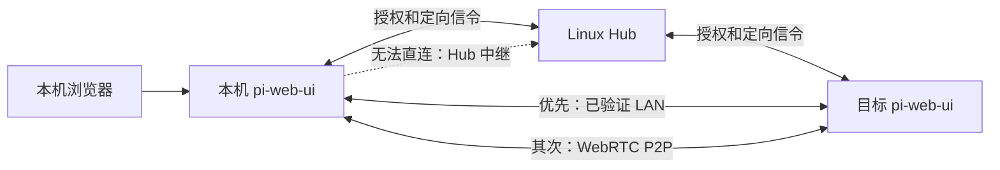

# Piercer 与 pi-web-ui 的 P2P 接入验证

状态：**本目录保留最初的传输可行性原型**。后续生产实现位于 `native/device-p2p/` 和 `server/device-center/device-p2p.ts`，见[接入文档](../../docs/device-center.md#p2p-设备访问)。原型不连接用户的 Hub，不读设备凭据，不启动真实桌面采集；两个 WebRTC PeerConnection 位于同一个进程，只使用回环 UDP 候选。它验证协议兼容性与既有授权边界，不证明公网打洞成功率或远程满速。

## 已验证

2026-11-12，Windows x64，Go 1.27.4，Pion v3.2.32：

- Piercer 原仓库提交 `0563e77472cbcf3768522cfdb2a9c652ab4763d6` 执行 `go build ./...` 成功。
- 原型实际建立 Pion WebRTC `host → host / UDP` 通道，检查两端候选均非 relay。
- pi-web-ui 的生产代码 `createDeviceLanServer` / `probeDeviceLan` 不修改即可在通道内完成 TLS-PSK 握手、健康探测、预览 HTML 请求和 128 KiB 上传。
- 同时传输 8 MiB HTTP 下载、32 个 256 KiB 模拟桌面二进制消息、32 条聊天 WebSocket 消息；所有二进制数据 SHA-256 相同，文本逐条相同。
- 每条连接单独使用 DataChannel，16 KiB 分块，512 KiB 发送高水位；观测到的最大缓冲为 540672 字节，即高水位加一个块。SCTP 拥塞窗口仍由各通道共享，通道分离不等于绝对互不影响。
- 被控服务收到的 Authorization 和 Origin 仍由现有网关注入；错误 PSK 被拒绝，撤销授权会关闭已有桌面/聊天连接并拒绝重连。

这次并发传输在本机约 442 ms 完成，**不可换算成公网吞吐承诺**。没有测试实际桌面帧率、跨机器 NAT、生产 Hub 信令、自动回退或 macOS/Linux 运行。原型的统计仅计算单次测试，不构成性能基准。

## Piercer 的哪些部分适合接入

参考代码固定到上述提交，避免 README 与实现混淆：

| 部分                                                                                                                     | 实际情况                                                             | 接入方式                                                                                       |
| ------------------------------------------------------------------------------------------------------------------------ | -------------------------------------------------------------------- | ---------------------------------------------------------------------------------------------- |
| [Pion / ICE 配置](https://github.com/xing-shuyin/piercer/blob/0563e77472cbcf3768522cfdb2a9c652ab4763d6/common/config.go) | 使用 Pion WebRTC、STUN、UDP/TCP ICE；TURN 配置被注释                 | 保留 WebRTC 直连思路，按真实候选和连接状态判断路径                                             |
| [信令服务器](https://github.com/xing-shuyin/piercer/blob/0563e77472cbcf3768522cfdb2a9c652ab4763d6/signaling/main.go)     | 单房间广播、无账号鉴权、允许任意 Origin                              | 使用 pi-web-ui 的已认证 Hub 连接做定向信令；不复制广播服务器                                   |
| [服务端连接](https://github.com/xing-shuyin/piercer/blob/0563e77472cbcf3768522cfdb2a9c652ab4763d6/server/main.go)        | 新 offer 替换旧连接；面向文件请求                                    | 改为按来源设备、目标设备、连接代次维护多个会话                                                 |
| 文件发送                                                                                                                 | 首次请求前发送 64 MiB 假数据；发送循环未按缓冲量等待，忽略 Send 错误 | 不带入桌面；限制队列、处理错误、分别调度控制与大流量                                           |
| 端口预测                                                                                                                 | 用独立 STUN socket 得到映射，再生成附近端口候选                      | 第一版使用标准 ICE；独立 socket 的映射不能保证等于实际 ICE socket 的映射，不将端口预测当成保证 |
| 失败策略                                                                                                                 | 实际关闭 TURN，打不通就不传；与 README 中自动中继的描述不同          | 默认回退现有 Hub，界面明确标出当前通路                                                         |

原型沿用 Piercer 锁定的 Pion 版本以验证同一技术栈。正式分发前还需单独审核依赖版本与支持平台，不把本目录旧版本依赖直接当成正式发布选择。

## 接入产品的方案

### 数据路径



顺序是 **LAN → P2P → Hub**。LAN 必须通过真实 TLS-PSK 握手判断可达，不根据 IP 前缀猜测；跨网由 ICE 测试候选路径。Hub 处理设备发现、授权和信令，P2P 建立后网页资源、远程对话 WebSocket、桌面预览和实时桌面数据不经过 Hub。STUN 只帮助发现地址，不转发画面。

群组消息排序、任务归属、审批、租约与离线恢复仍由 Hub 保存。群成员的「打开设备」「远程桌面」可以使用直连；若要求群组自身也在 Hub 离线时继续运行，需要另做一致性设计，本方案不声称具备该能力。

### 第一步：Node 服务之间的通道

1. 在每台运行 pi-web-ui 的电脑随包附带小型 Go helper，Node 管理其生命周期；用户无需安装 Go。helper 通过受控 stdio 接收操作，固定连接当前授权的本机网关，不能接受任意目标地址。
2. 从 `server/device-center/local.ts` 的打开设备流程触发协商；在 `relay.ts` / `connector.ts` 增加有界定向信令。Hub 先验证现有账号与设备权限，再绑定来源、目标、随机连接 ID、设备连接代次和过期时间。
3. 封装 Pion 的连接池，处理 SDP、候选到达顺序、取消、超时、设备断线和撤销。候选数量、SDP 大小、连接数与队列均有上限，迟到的上一代响应不能恢复旧连接。
4. 沿用 `device-lan.ts` 的短期 TLS-PSK 授权与路径白名单；把可注入的连接建立能力抽出，接入 P2P 字节流。生产实现不通过放开全局 `allowLoopback` 或改写用户提交的目标地址来获得通路。
5. 在 `device-lan-access.ts` 中复用隔离能力页、一次性票据、CSP 和头部清理。抽出通用传输接口，供 LAN/P2P 使用，名称迁移须兼容已有 URL。
6. 设置有限打洞等待，失败继续使用原 Hub 票据；已建立连接断线时重新鉴权协商。不能把未确认的 POST、键鼠输入或任务命令盲目重放，避免重复操作；持续对话使用原协议重连/快照恢复。

这一阶段要求控制端和被控端均运行本机 pi-web-ui 服务，适用于目前的 Mac npm → Windows npm 场景。**只打开云端 Hub 网页的浏览器不会自动获得该 Node 通道**。纯浏览器桌面可另加浏览器 RTCPeerConnection 与目标 helper 对接；完整远程网页还需适配 HTTP/WS 访问方式，不能把设备间原型等同于浏览器全部功能已经直连。

### 第二步：界面与桌面流畅度

- 继续使用右栏缩略预览，点击放大后操作；无需因传输改变而重做布局。
- 由实际连接状态显示「局域网直连 / P2P 直连 / 服务器中转」，连接信息展示握手耗时、往返延迟、吞吐、帧率和回退原因。不能只因设置启用了 P2P 就显示直连。
- 保留预览低频采集与实时流的有界排队；控制消息优先，文件传输限流。第一版可以保留 JPEG 协议，后续单独评估原生视频采集、硬件编码与自适应码率。
- 现有 JPEG 捕获间隔、分辨率、编码耗时和 ACK 策略仍可能限制帧率。P2P 绕过 Hub 带宽，不会自动把采集提升为 30/60 FPS，也不能获得未授予的系统屏幕权限。

### 第三步：三端分发和验收

正式候选包需同时包含 Windows x64、macOS arm64/amd64、Linux amd64/arm64 helper；验证签名或校验和、可执行权限、服务启动与退出清理。Linux Hub 更新定向信令，不承担桌面采集；Hub 应兼容未升级设备继续中继。

必须完成的实机矩阵：

| 场景                              | 验收证据                                                                 |
| --------------------------------- | ------------------------------------------------------------------------ |
| 同局域网 Mac → Windows            | LAN 标记、身份验证成功；Hub 大流量计数不增长                             |
| 不同网络、不同运营商              | 记录真实 ICE 候选类型、连接耗时、连续传输和键鼠往返；测量两端 CPU/上下行 |
| 严格 NAT / UDP 禁止               | 有限时间内回退 Hub，页面可恢复；明确显示回退原因                         |
| 断网重连、重新登录、设备解绑      | 旧通道失效，授权撤销后不能继续控制；不重复发送有副作用的请求             |
| 两台以上设备并发                  | 新连接不挤掉旧连接；下载期间键鼠与对话无无限队列                         |
| 旧 Hub / 旧设备 / 缺少 helper     | 能力协商后回退，不出现伪 P2P 状态                                        |
| 活动桌面、锁屏、未授予 macOS 权限 | 能捕获时显示画面；不可捕获时报告实际原因                                 |

跨网速度上限由发送端上行、接收端下行、网络路径、丢包与终端性能共同决定。应报告实测值，不使用“P2P 必定满速”作为验收标准。

## 复现本机验证

从仓库根目录运行，使用已有 npm 开发依赖以及 Go ≥1.21。测试不启动生产服务、不使用生产数据目录；各监听端口由系统分配并断言 ≥8900。

```sh
node scripts/safe-exec.mjs --timeout 180 --cwd dev/piercer-p2p -- go build -o ../../.safe-exec/piercer-proof.exe .
node scripts/safe-exec.mjs --timeout 90 -- node --import tsx dev/piercer-p2p/smoke.mjs ./.safe-exec/piercer-proof.exe
node scripts/safe-exec.mjs --timeout 120 --cwd dev/piercer-p2p -- go vet ./...
```

macOS/Linux 可去掉输出文件名的 `.exe` 后缀；上述平台尚未实测。Go 不在 PATH 时把 `go` 换成绝对路径。helper 最长存活 60 秒、最多建立 16 条流，只接受固定回环目标测试端口；测试退出时关闭连接和进程。本目录不在 npm `files` 发布列表内。
