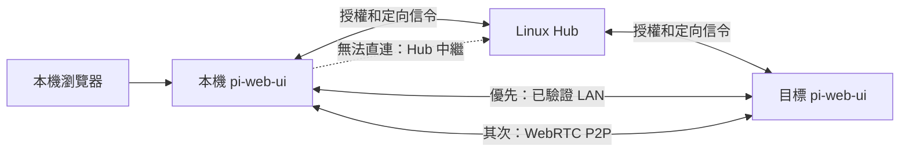

[English](./README.en.md) · [简体中文](./README.md) · **繁體中文**

# Piercer 與 pi-web-ui 的 P2P 接入驗證

狀態：**本目錄保留最初的傳輸可行性原型**。後續生產實現位於 `native/device-p2p/` 和 `server/device-center/device-p2p.ts`，見[接入文件](../../docs/device-center.zh-TW.md#p2p-裝置訪問)。原型不連線使用者的 Hub，不讀裝置憑據，不啟動真實桌面採集；兩個 WebRTC PeerConnection 位於同一個程序，只使用迴環 UDP 候選。它驗證協議相容性與既有授權邊界，不證明公網打洞成功率或遠端滿速。

## 已驗證

2026-11-12，Windows x64，Go 1.27.4，Pion v3.2.32：

- Piercer 原倉庫提交 `0563e77472cbcf3768522cfdb2a9c652ab4763d6` 執行 `go build ./...` 成功。
- 原型實際建立 Pion WebRTC `host → host / UDP` 通道，檢查兩端候選均非 relay。
- pi-web-ui 的生產程式碼 `createDeviceLanServer` / `probeDeviceLan` 不修改即可在通道內完成 TLS-PSK 握手、健康探測、預覽 HTML 請求和 128 KiB 上傳。
- 同時傳輸 8 MiB HTTP 下載、32 個 256 KiB 模擬桌面二進位制訊息、32 條聊天 WebSocket 訊息；所有二進位制資料 SHA-256 相同，文本逐條相同。
- 每條連線單獨使用 DataChannel，16 KiB 分塊，512 KiB 傳送高水位；觀測到的最大緩衝為 540672 位元組，即高水位加一個塊。SCTP 擁塞視窗仍由各通道共享，通道分離不等於絕對互不影響。
- 被控服務收到的 Authorization 和 Origin 仍由現有網關注入；錯誤 PSK 被拒絕，撤銷授權會關閉已有桌面/聊天連線並拒絕重連。

這次併發傳輸在本機約 442 ms 完成，**不可換算成公網吞吐承諾**。沒有測試實際桌面幀率、跨機器 NAT、生產 Hub 信令、自動回退或 macOS/Linux 執行。原型的統計僅計算單次測試，不構成效能基準。

## Piercer 的哪些部分適合接入

參考程式碼固定到上述提交，避免 README 與實現混淆：

| 部分                                                                                                                     | 實際情況                                                             | 接入方式                                                                                     |
| ------------------------------------------------------------------------------------------------------------------------ | -------------------------------------------------------------------- | -------------------------------------------------------------------------------------------- |
| [Pion / ICE 配置](https://github.com/xing-shuyin/piercer/blob/0563e77472cbcf3768522cfdb2a9c652ab4763d6/common/config.go) | 使用 Pion WebRTC、STUN、UDP/TCP ICE；TURN 配置被註釋                 | 保留 WebRTC 直連思路，按真實候選和連線狀態判斷路徑                                           |
| [信令伺服器](https://github.com/xing-shuyin/piercer/blob/0563e77472cbcf3768522cfdb2a9c652ab4763d6/signaling/main.go)     | 單房間廣播、無賬號鑑權、允許任意 Origin                              | 使用 pi-web-ui 的已認證 Hub 連線做定向信令；不復制廣播伺服器                                 |
| [服務端連線](https://github.com/xing-shuyin/piercer/blob/0563e77472cbcf3768522cfdb2a9c652ab4763d6/server/main.go)        | 新 offer 替換舊連線；面向檔案請求                                    | 改為按來源裝置、目標裝置、連線代次維護多個會話                                               |
| 檔案傳送                                                                                                                 | 首次請求前傳送 64 MiB 假資料；傳送迴圈未按緩衝量等待，忽略 Send 錯誤 | 不帶入桌面；限制佇列、處理錯誤、分別排程控制與大流量                                         |
| 埠預測                                                                                                                   | 用獨立 STUN socket 得到對映，再生成附近埠候選                        | 第一版使用標準 ICE；獨立 socket 的對映不能保證等於實際 ICE socket 的對映，不將埠預測當成保證 |
| 失敗策略                                                                                                                 | 實際關閉 TURN，打不通就不傳；與 README 中自動中繼的描述不同          | 預設回退現有 Hub，介面明確標出當前通路                                                       |

原型沿用 Piercer 鎖定的 Pion 版本以驗證同一技術棧。正式分發前還需單獨稽核依賴版本與支援平臺，不把本目錄舊版本依賴直接當成正式釋出選擇。

## 接入產品的方案

### 資料路徑



順序是 **LAN → P2P → Hub**。LAN 必須通過真實 TLS-PSK 握手判斷可達，不根據 IP 字首猜測；跨網由 ICE 測試候選路徑。Hub 處理裝置發現、授權和信令，P2P 建立後網頁資源、遠端對話 WebSocket、桌面預覽和即時桌面資料不經過 Hub。STUN 只幫助發現地址，不轉發畫面。

群組訊息排序、任務歸屬、審批、租約與離線恢復仍由 Hub 儲存。群成員的「開啟裝置」「遠端桌面」可以使用直連；若要求群組自身也在 Hub 離線時繼續執行，需要另做一致性設計，本方案不聲稱具備該能力。

### 第一步：Node 服務之間的通道

1. 在每臺執行 pi-web-ui 的電腦隨包附帶小型 Go helper，Node 管理其生命週期；使用者無需安裝 Go。helper 通過受控 stdio 接收操作，固定連線當前授權的本機閘道器，不能接受任意目標地址。
2. 從 `server/device-center/local.ts` 的開啟裝置流程觸發協商；在 `relay.ts` / `connector.ts` 增加有界定向信令。Hub 先驗證現有賬號與裝置許可權，再繫結來源、目標、隨機連線 ID、裝置連線代次和過期時間。
3. 封裝 Pion 的連線池，處理 SDP、候選到達順序、取消、超時、裝置斷線和撤銷。候選數量、SDP 大小、連線數與佇列均有上限，遲到的上一代響應不能恢復舊連線。
4. 沿用 `device-lan.ts` 的短期 TLS-PSK 授權與路徑白名單；把可注入的連線建立能力抽出，接入 P2P 位元組流。生產實現不通過放開全域性 `allowLoopback` 或改寫使用者提交的目標地址來獲得通路。
5. 在 `device-lan-access.ts` 中複用隔離能力頁、一次性票據、CSP 和頭部清理。抽出通用傳輸介面，供 LAN/P2P 使用，名稱遷移須相容已有 URL。
6. 設定有限打洞等待，失敗繼續使用原 Hub 票據；已建立連線斷線時重新鑑權協商。不能把未確認的 POST、鍵鼠輸入或任務命令盲目重放，避免重複操作；持續對話使用原協議重連/快照恢復。

這一階段要求控制端和被控端均執行本機 pi-web-ui 服務，適用於目前的 Mac npm → Windows npm 場景。**只打開雲端 Hub 網頁的瀏覽器不會自動獲得該 Node 通道**。純瀏覽器桌面可另加瀏覽器 RTCPeerConnection 與目標 helper 對接；完整遠端網頁還需適配 HTTP/WS 訪問方式，不能把裝置間原型等同於瀏覽器全部功能已經直連。

### 第二步：介面與桌面流暢度

- 繼續使用右欄縮略預覽，點選放大後操作；無需因傳輸改變而重做佈局。
- 由實際連線狀態顯示「區域網直連 / P2P 直連 / 伺服器中轉」，連線資訊展示握手耗時、往返延遲、吞吐、幀率和回退原因。不能只因設定啟用了 P2P 就顯示直連。
- 保留預覽低頻採集與即時流的有界排隊；控制訊息優先，檔案傳輸限流。第一版可以保留 JPEG 協議，後續單獨評估原生影片採集、硬體編碼與自適應位元速率。
- 現有 JPEG 捕獲間隔、解析度、編碼耗時和 ACK 策略仍可能限制幀率。P2P 繞過 Hub 頻寬，不會自動把採集提升為 30/60 FPS，也不能獲得未授予的系統螢幕許可權。

### 第三步：三端分發和驗收

正式候選包需同時包含 Windows x64、macOS arm64/amd64、Linux amd64/arm64 helper；驗證簽名或校驗和、可執行許可權、服務啟動與退出清理。Linux Hub 更新定向信令，不承擔桌面採集；Hub 應相容未升級裝置繼續中繼。

必須完成的實機矩陣：

| 場景                                | 驗收證據                                                                 |
| ----------------------------------- | ------------------------------------------------------------------------ |
| 同區域網 Mac → Windows              | LAN 標記、身份驗證成功；Hub 大流量計數不增長                             |
| 不同網路、不同運營商                | 記錄真實 ICE 候選型別、連線耗時、連續傳輸和鍵鼠往返；測量兩端 CPU/上下行 |
| 嚴格 NAT / UDP 禁止                 | 有限時間內回退 Hub，頁面可恢復；明確顯示回退原因                         |
| 斷網重連、重新登入、裝置解綁        | 舊通道失效，授權撤銷後不能繼續控制；不重複傳送有副作用的請求             |
| 兩臺以上裝置併發                    | 新連線不擠掉舊連線；下載期間鍵鼠與對話無無限佇列                         |
| 舊 Hub / 舊裝置 / 缺少 helper       | 能力協商後回退，不出現偽 P2P 狀態                                        |
| 活動桌面、鎖屏、未授予 macOS 許可權 | 能捕獲時顯示畫面；不可捕獲時報告實際原因                                 |

跨網速度上限由傳送端上行、接收端下行、網路路徑、丟包與終端效能共同決定。應報告實測值，不使用“P2P 必定滿速”作為驗收標準。

## 復現本機驗證

從倉庫根目錄執行，使用已有 npm 開發依賴以及 Go ≥1.21。測試不啟動生產服務、不使用生產資料目錄；各監聽埠由系統分配並斷言 ≥8900。

```sh
node scripts/safe-exec.mjs --timeout 180 --cwd dev/piercer-p2p -- go build -o ../../.safe-exec/piercer-proof.exe .
node scripts/safe-exec.mjs --timeout 90 -- node --import tsx dev/piercer-p2p/smoke.mjs ./.safe-exec/piercer-proof.exe
node scripts/safe-exec.mjs --timeout 120 --cwd dev/piercer-p2p -- go vet ./...
```

macOS/Linux 可去掉輸出檔名的 `.exe` 字尾；上述平臺尚未實測。Go 不在 PATH 時把 `go` 換成絕對路徑。helper 最長存活 60 秒、最多建立 16 條流，只接受固定迴環目標測試埠；測試退出時關閉連線和程序。本目錄不在 npm `files` 釋出列表內。
