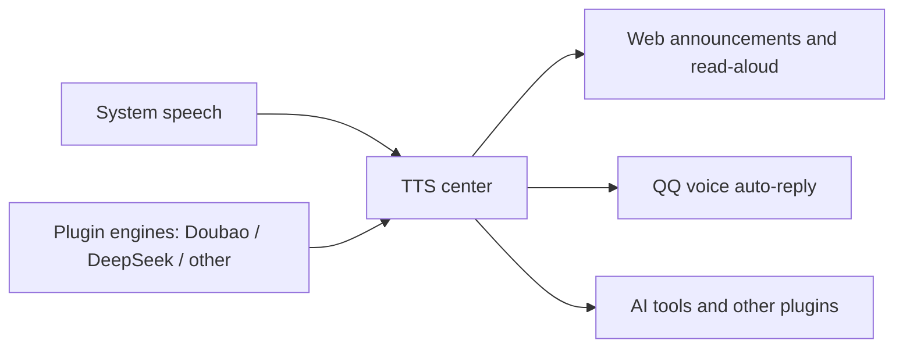

**English** · [简体中文](./architecture-tts.md) · [繁體中文](./architecture-tts.zh-TW.md)

# Unified TTS center

TTS engines are registered only on the server, in `server/tts-service.ts`. System announcements, plugins, QQ auto-replies and AI voice tools share one engine and voice catalog, and all audio synthesis goes through the center. The browser only selects, fetches audio and plays it; it keeps no writable engine registry and no longer calls Web Speech directly.



## Source of truth

| Responsibility                                                                | File                                                     |
| ----------------------------------------------------------------------------- | -------------------------------------------------------- |
| Single engine registry, catalog, synthesis queue, validation and cancellation | `server/tts-service.ts`                                  |
| Server system voices and WAV export                                           | `server/tts-system.ts`                                   |
| Web engine, voice and audio APIs                                              | `server/tts-routes.ts`                                   |
| Plugin server `host.tts` and unload cleanup                                   | `server/plugins.ts`, `plugin-sdk/index.d.ts`             |
| Browser catalog reading and audio playback adaptation                         | `web/src/tts-client.ts`                                  |
| Announcement settings, sentence queue and playback state                      | `web/src/tts.ts`, `web/src/components/SoundSettings.tsx` |
| Doubao and DeepSeek engine implementations and credentials                    | `plugins/tts/index.mjs`                                  |
| QQ reply routing and voice encoding                                           | `plugins/qq/index.mjs`, `plugins/qq/voice.mjs`           |

## Registration and calls

A plugin calls `host.tts.registerEngine(engine)` while it is active on the server. An engine with the same name may not override another; the returned unsubscribe function revokes only that registration, and the host also cleans up automatically and cancels in-flight and queued calls for that engine when the plugin is unloaded, disabled or hot-reloaded. Engines do not depend on a browser page being open.

```js
const unregister = host.tts.registerEngine({
	id: "my-voice-engine",
	label: "我的语音引擎",
	getVoices: async ({ signal }) => [{ id: "voice-1", label: "音色一", lang: "zh-CN" }],
	synthesize: async ({ text, voice, rate, signal }) => {
		const buffer = await synthesizeAudio({ text, voice, rate, signal });
		return { buffer, format: "wav" };
	},
});

const engines = host.tts.listEngines();
const voices = await host.tts.listVoices("my-voice-engine");
const audio = await host.tts.synthesize({
	engine: "my-voice-engine",
	text: "你好",
	voice: "voice-1",
	rate: 1,
	signal,
});
```

Engines return `Uint8Array` / `Buffer` plus a format; `wav`, `mp3`, `aac`, `ogg`, `pcm` and `silk` are supported, and PCM must carry `sampleRate`. Engines used by the browser should output a browser-playable format. The speed range is 0.5–2; a fixed-speed engine declares `supportsRate: false`, the center uses 1× speed, and the settings page disables speed adjustment.

The center synthesizes serially per engine, and different engines may run in parallel. Text is capped at 6000 characters, audio at 16 MiB, total synthesis time at 90 seconds and voice lookup at 15 seconds. Caller cancellation and engine unload signals are passed to the provider and stop late results from being delivered. Providers must forward the signal to network requests or system processes.

## System speech

`builtin` is always registered by the host; no TTS plugin is needed. Voices come from **the machine the server runs on**: Windows uses `System.Speech`, macOS uses `say`, Linux uses `espeak-ng` / `espeak`. Windows, macOS and Linux can all enumerate installed voices; with no system speech program installed a diagnosable error is returned. System synthesis outputs WAV and never plays through the server's speakers.

Old web settings hold a browser `voiceURI` for `builtin` that is incompatible with server voice IDs, so the old ID is cleared when the new channel first loads; later saves carry `voiceCatalog: "server"`. The plugin engine IDs `doubao-tts`, `deepseek-tts` and the existing voice keys stay compatible. Voice settings are still stored per browser; QQ stores its reply mode plus chosen engine and voice separately.

## HTTP and the web page

These routes sit behind the existing authentication and Origin checks:

| Method and path                   | Content                                                                                                                                      |
| --------------------------------- | -------------------------------------------------------------------------------------------------------------------------------------------- |
| `GET /api/tts/engines`            | `{ engines: [{ id, label, labelEn?, supportsRate? }] }`                                                                                      |
| `GET /api/tts/voices?engine=<id>` | `{ voices: [{ id, label, lang? }] }`                                                                                                         |
| `POST /api/tts/synthesize`        | Input `{ text, engine?, voice?, rate? }`, returns audio bytes; the response carries `Content-Type`, `X-TTS-Format`, and caching is forbidden |

All browser requests go through `appUrl()`, which works with subpaths, device relay and mobile authentication. Stopping playback cancels generation and releases the Blob URL; an aborted HTTP response also cancels server-side synthesis. When the selected engine is unavailable an error is returned instead of silently switching voice. The settings page reads the center's catalog; once settings are open the catalog refreshes periodically to reflect plugin enable/disable.

Browser host API v16's `ttsProviders.list()` is only a read-only compatibility entry point onto the center's catalog, and `ttsProviders.register()` is gone; old plugins must migrate to the server-side `host.tts.registerEngine()`.

## TTS plugins and AI tools

The TTS plugin registers `doubao-tts` and `deepseek-tts` and keeps holding the existing Doubao Cookie / API Key and DeepSeek token. Its audition, the compatible `/plugins-api/tts/speak` endpoint and the AI `tts` tool all call the center. The AI tool's `action: "list"` lists every engine, and with `engine` lists voices; synthesis can pick `builtin` or an engine registered by another plugin. The old `doubao` / `deepseek` arguments map to the original engine IDs.

The AI `tts` tool is provided by the TTS plugin; other plugins can always use the system engine through the host's `host.tts` without depending on the TTS plugin.

## QQ automatic voice replies

QQ workspace → 「机器人凭证与高级设置」 (Bot credentials and advanced settings) offers the reply mode: text, voice, voice and text; the engine, all registered voices and the speeds the engine supports can be picked from the center. Text replies stay the default, and `voiceEngine` defaults to `builtin`.

Final AI answers for one-to-one and group chats, and the synchronized answers of bound web sessions, all go through the same reply entry point. Command acknowledgements, task progress and channel notifications stay text. Channels have no local voice sending capability and always use text.

Voice text strips Markdown and code; a long reply reads the beginning and points to the full text, with the full answer kept alongside the voice; short replies are sent according to the selected mode. If any step fails — synthesis, credentials, dependencies, transcoding, QQ upload — the original full text is sent automatically and the reason is recorded in `lastVoiceError` and the logs. Voice must not exceed 60 seconds.

QQ converts to SILK with `silk-wasm@3.7.1`, uploads with `file_type: 3` and replies with `msg_type: 7`; compressed input such as AAC is decoded to mono PCM with `ffmpeg-static@5.3.0` as needed. Dependencies are installed by `host.ensureDeps` into the QQ plugin directory the first time they are needed; system WAV needs no ffmpeg. After a plugin uninstall, bot stop, session reset or binding change, the delivery guard checks again after synthesis and upload, so a late voice clip is never sent into a new session.

## Verification

Core regression covers `tts-service`, `tts-routes`, `tts-system`, `tts-client`, `tts-audio`, `tts`, `tts-pipeline`, `qq-voice`, `qq-features`, `qq-media`, plus the plugin host and SDK mocks. When runtime behaviour changes, verify native system WAV export and the real WAV/AAC → SILK encoding chain; live QQ delivery needs a usable bot account and platform authorization, while offline tests use an isolated QQ API mock.
