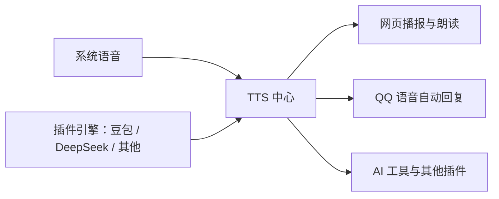

# 统一 TTS 中心

TTS 引擎只在服务端 `server/tts-service.ts` 注册。系统播报、插件、QQ 自动回复和 AI 语音工具共用同一份引擎与音色目录，所有音频合成都经过中心。浏览器只负责选择、取音频和播放，不再维护可写的引擎注册表，也不再直接调用 Web Speech。



## 事实源

| 职责                                       | 文件                                                     |
| ------------------------------------------ | -------------------------------------------------------- |
| 引擎唯一注册表、目录、合成队列、校验与取消 | `server/tts-service.ts`                                  |
| 服务器系统语音音色与 WAV 导出              | `server/tts-system.ts`                                   |
| 网页引擎、音色和音频 API                   | `server/tts-routes.ts`                                   |
| 插件服务端 `host.tts` 与卸载清理           | `server/plugins.ts`、`plugin-sdk/index.d.ts`             |
| 浏览器目录读取与音频播放适配               | `web/src/tts-client.ts`                                  |
| 播报设置、句子队列与播放状态               | `web/src/tts.ts`、`web/src/components/SoundSettings.tsx` |
| 豆包、DeepSeek 引擎实现与凭据              | `plugins/tts/index.mjs`                                  |
| QQ 回复路由与语音编码                      | `plugins/qq/index.mjs`、`plugins/qq/voice.mjs`           |

## 注册与调用

插件在服务端激活期间调用 `host.tts.registerEngine(engine)`。同名引擎不允许覆盖；返回的取消函数只撤销该次注册，宿主卸载、禁用或热重载插件时也会自动清理并取消该引擎进行中和排队的调用。引擎不依赖浏览器页面打开。

```js
const unregister = host.tts.registerEngine({
	id: "my-voice-engine",
	label: "我的语音引擎",
	getVoices: async ({ signal }) => [{ id: "voice-1", label: "音色一", lang: "zh-CN" }],
	synthesize: async ({ text, voice, rate, signal }) => {
		const buffer = await synthesizeAudio({ text, voice, rate, signal });
		return { buffer, format: "wav" };
	},
});

const engines = host.tts.listEngines();
const voices = await host.tts.listVoices("my-voice-engine");
const audio = await host.tts.synthesize({
	engine: "my-voice-engine",
	text: "你好",
	voice: "voice-1",
	rate: 1,
	signal,
});
```

引擎返回 `Uint8Array` / `Buffer` 与格式；支持 `wav`、`mp3`、`aac`、`ogg`、`pcm`、`silk`，PCM 必须带 `sampleRate`。供浏览器使用的引擎应输出浏览器可播放的格式。语速范围为 0.5–2；固定语速引擎声明 `supportsRate: false`，中心使用 1 倍速，设置页禁用语速调节。

中心按引擎串行合成，不同引擎可并行。正文限制 6000 字符，音频限制 16 MiB，合成总时限 90 秒，音色查询时限 15 秒。调用方取消和引擎卸载信号传给提供方，并阻止迟到的结果继续交付。提供方必须将信号传给网络请求或系统进程。

## 系统语音

`builtin` 总是由宿主注册，不需要 TTS 插件。音色来自**服务器所在设备**：Windows 使用 `System.Speech`，macOS 使用 `say`，Linux 使用 `espeak-ng` / `espeak`。Windows、macOS、Linux 均可枚举已安装音色；没有系统语音程序时返回可诊断错误。系统合成输出 WAV，不向服务器扬声器播放。

旧网页设置中 `builtin` 的浏览器 `voiceURI` 与服务器音色 ID 不兼容，首次载入新通道时清除旧 ID；后续保存带 `voiceCatalog: "server"`。插件引擎 ID `doubao-tts`、`deepseek-tts` 和原有音色 key 保持兼容。语音设置仍按浏览器保存，QQ 独立保存回复方式及所选引擎、音色。

## HTTP 与网页

这些路由位于现有认证与 Origin 校验之后：

| 方法与路径                        | 内容                                                                                                       |
| --------------------------------- | ---------------------------------------------------------------------------------------------------------- |
| `GET /api/tts/engines`            | `{ engines: [{ id, label, labelEn?, supportsRate? }] }`                                                    |
| `GET /api/tts/voices?engine=<id>` | `{ voices: [{ id, label, lang? }] }`                                                                       |
| `POST /api/tts/synthesize`        | 输入 `{ text, engine?, voice?, rate? }`，返回音频二进制；响应包含 `Content-Type`、`X-TTS-Format`，禁止缓存 |

浏览器所有请求通过 `appUrl()`，兼容子路径、设备中继及移动端认证。停止播放会取消生成并释放 Blob URL，断开 HTTP 响应也会取消服务端合成。所选引擎不可用时返回错误，不暗中切换音色。设置页读取中心目录；打开设置后目录定期刷新，以反映插件启停。

浏览器宿主 API v16 的 `ttsProviders.list()` 仅是中心目录的只读兼容入口，移除了 `ttsProviders.register()`；旧插件需迁移至服务端 `host.tts.registerEngine()`。

## TTS 插件与 AI 工具

TTS 插件注册 `doubao-tts` 和 `deepseek-tts`，继续保管已有豆包 Cookie / API Key 与 DeepSeek token。其试听、兼容的 `/plugins-api/tts/speak` 接口、以及 AI `tts` 工具都调用中心。AI 工具 `action: "list"` 列出全部引擎，带 `engine` 时列出音色；合成时可以选择 `builtin` 或其他插件注册的引擎。旧 `doubao` / `deepseek` 参数映射到原有引擎 ID。

AI `tts` 工具由 TTS 插件提供；其他插件始终可以通过宿主的 `host.tts` 使用系统引擎，不需要依赖 TTS 插件。

## QQ 自动语音回复

QQ 工作台 →「机器人凭证与高级设置」提供回复方式：文字、语音、语音和文字；可从中心选择引擎、全部已注册音色以及引擎支持的语速。默认维持文字回复，`voiceEngine` 默认为 `builtin`。

单聊和群聊的 AI 最终回答、已绑定网页会话同步回答，都会经过同一回复入口。指令回执、任务进度与频道通知继续使用文字。频道没有本地语音发送能力，始终使用文字。

语音正文剥离 Markdown 和代码，长回复朗读开头并提示查看完整文字，完整回答随语音保留；短回复按所选模式发送。合成、凭据、依赖、转码、QQ 上传等任一步失败，自动发送原始完整文字，并将原因记录到 `lastVoiceError` 和日志。语音须不超过 60 秒。

QQ 通过 `silk-wasm@3.7.1` 转成 SILK，按 `file_type: 3` 上传并用 `msg_type: 7` 回复；AAC 等压缩输入按需用 `ffmpeg-static@5.3.0` 解码为单声道 PCM。依赖由 `host.ensureDeps` 在首次需要时安装到 QQ 插件目录，系统 WAV 不需要 ffmpeg。插件卸载、机器人停止、会话重置或绑定变更后，交付守卫会在合成和上传之后再次检查，避免将迟到语音发到新会话。

## 验证

核心回归覆盖 `tts-service`、`tts-routes`、`tts-system`、`tts-client`、`tts-audio`、`tts`、`tts-pipeline`、`qq-voice`、`qq-features`、`qq-media`，以及插件宿主和 SDK mock。涉及运行态修改时验证原生系统 WAV 导出与 WAV/AAC → SILK 的真实编码链路；QQ 线上投递需要可用机器人账号与平台授权，离线测试使用隔离的 QQ API mock。
