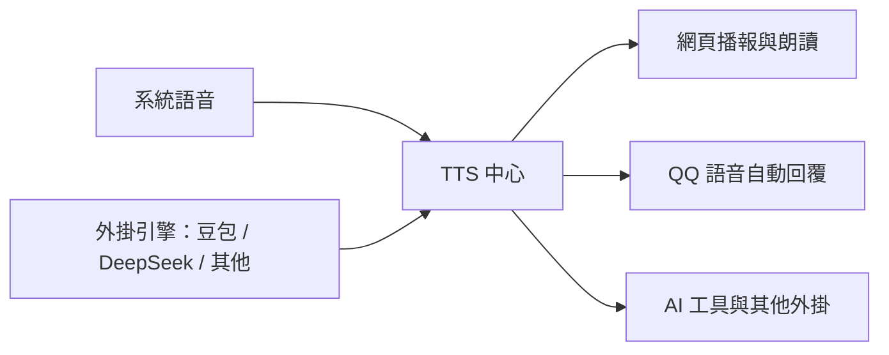

[English](./architecture-tts.en.md) · [简体中文](./architecture-tts.md) · **繁體中文**

# 統一 TTS 中心

TTS 引擎只在服務端 `server/tts-service.ts` 註冊。系統播報、外掛、QQ 自動回覆和 AI 語音工具共用同一份引擎與音色目錄，所有音訊合成都經過中心。瀏覽器只負責選擇、取音訊和播放，不再維護可寫的引擎登錄檔，也不再直接呼叫 Web Speech。



## 事實源

| 職責                                       | 檔案                                                     |
| ------------------------------------------ | -------------------------------------------------------- |
| 引擎唯一登錄檔、目錄、合成佇列、校驗與取消 | `server/tts-service.ts`                                  |
| 伺服器系統語音音色與 WAV 匯出              | `server/tts-system.ts`                                   |
| 網頁引擎、音色和音訊 API                   | `server/tts-routes.ts`                                   |
| 外掛服務端 `host.tts` 與解除安裝清理       | `server/plugins.ts`、`plugin-sdk/index.d.ts`             |
| 瀏覽器目錄讀取與音訊播放適配               | `web/src/tts-client.ts`                                  |
| 播報設定、句子佇列與播放狀態               | `web/src/tts.ts`、`web/src/components/SoundSettings.tsx` |
| 豆包、DeepSeek 引擎實現與憑據              | `plugins/tts/index.mjs`                                  |
| QQ 回覆路由與語音編碼                      | `plugins/qq/index.mjs`、`plugins/qq/voice.mjs`           |

## 註冊與呼叫

外掛在服務端啟用期間呼叫 `host.tts.registerEngine(engine)`。同名引擎不允許覆蓋；返回的取消函式只撤銷該次註冊，宿主解除安裝、停用或熱過載外掛時也會自動清理並取消該引擎進行中和排隊的呼叫。引擎不依賴瀏覽器頁面開啟。

```js
const unregister = host.tts.registerEngine({
	id: "my-voice-engine",
	label: "我的語音引擎",
	getVoices: async ({ signal }) => [{ id: "voice-1", label: "音色一", lang: "zh-CN" }],
	synthesize: async ({ text, voice, rate, signal }) => {
		const buffer = await synthesizeAudio({ text, voice, rate, signal });
		return { buffer, format: "wav" };
	},
});

const engines = host.tts.listEngines();
const voices = await host.tts.listVoices("my-voice-engine");
const audio = await host.tts.synthesize({
	engine: "my-voice-engine",
	text: "你好",
	voice: "voice-1",
	rate: 1,
	signal,
});
```

引擎返回 `Uint8Array` / `Buffer` 與格式；支援 `wav`、`mp3`、`aac`、`ogg`、`pcm`、`silk`，PCM 必須帶 `sampleRate`。供瀏覽器使用的引擎應輸出瀏覽器可播放的格式。語速範圍為 0.5–2；固定語速引擎宣告 `supportsRate: false`，中心使用 1 倍速，設定頁停用語速調節。

中心按引擎序列合成，不同引擎可並行。正文限制 6000 字元，音訊限制 16 MiB，合成總時限 90 秒，音色查詢時限 15 秒。呼叫方取消和引擎解除安裝訊號傳給提供方，並阻止遲到的結果繼續交付。提供方必須將訊號傳給網路請求或系統程序。

## 系統語音

`builtin` 總是由宿主註冊，不需要 TTS 外掛。音色來自**伺服器所在裝置**：Windows 使用 `System.Speech`，macOS 使用 `say`，Linux 使用 `espeak-ng` / `espeak`。Windows、macOS、Linux 均可列舉已安裝音色；沒有系統語音程式時返回可診斷錯誤。系統合成輸出 WAV，不向伺服器揚聲器播放。

舊網頁設定中 `builtin` 的瀏覽器 `voiceURI` 與伺服器音色 ID 不相容，首次載入新通道時清除舊 ID；後續儲存帶 `voiceCatalog: "server"`。外掛引擎 ID `doubao-tts`、`deepseek-tts` 和原有音色 key 保持相容。語音設定仍按瀏覽器儲存，QQ 獨立儲存回覆方式及所選引擎、音色。

## HTTP 與網頁

這些路由位於現有認證與 Origin 校驗之後：

| 方法與路徑                        | 內容                                                                                                         |
| --------------------------------- | ------------------------------------------------------------------------------------------------------------ |
| `GET /api/tts/engines`            | `{ engines: [{ id, label, labelEn?, supportsRate? }] }`                                                      |
| `GET /api/tts/voices?engine=<id>` | `{ voices: [{ id, label, lang? }] }`                                                                         |
| `POST /api/tts/synthesize`        | 輸入 `{ text, engine?, voice?, rate? }`，返回音訊二進位制；響應包含 `Content-Type`、`X-TTS-Format`，禁止快取 |

瀏覽器所有請求通過 `appUrl()`，相容子路徑、裝置中繼及移動端認證。停止播放會取消生成並釋放 Blob URL，斷開 HTTP 響應也會取消服務端合成。所選引擎不可用時返回錯誤，不暗中切換音色。設定頁讀取中心目錄；開啟設定後目錄定期重新整理，以反映外掛啟停。

瀏覽器宿主 API v16 的 `ttsProviders.list()` 僅是中心目錄的只讀相容入口，移除了 `ttsProviders.register()`；舊外掛需遷移至服務端 `host.tts.registerEngine()`。

## TTS 外掛與 AI 工具

TTS 外掛註冊 `doubao-tts` 和 `deepseek-tts`，繼續保管已有豆包 Cookie / API Key 與 DeepSeek token。其試聽、相容的 `/plugins-api/tts/speak` 介面、以及 AI `tts` 工具都呼叫中心。AI 工具 `action: "list"` 列出全部引擎，帶 `engine` 時列出音色；合成時可以選擇 `builtin` 或其他外掛註冊的引擎。舊 `doubao` / `deepseek` 引數對映到原有引擎 ID。

AI `tts` 工具由 TTS 外掛提供；其他外掛始終可以通過宿主的 `host.tts` 使用系統引擎，不需要依賴 TTS 外掛。

## QQ 自動語音回覆

QQ 工作臺 →「機器人憑證與進階設定」提供回覆方式：文字、語音、語音和文字；可從中心選擇引擎、全部已註冊音色以及引擎支援的語速。預設維持文字回覆，`voiceEngine` 預設為 `builtin`。

單聊和群聊的 AI 最終回答、已繫結網頁會話同步回答，都會經過同一回覆入口。指令回執、任務進度與頻道通知繼續使用文字。頻道沒有本地語音傳送能力，始終使用文字。

語音正文剝離 Markdown 和程式碼，長回覆朗讀開頭並提示檢視完整文字，完整回答隨語音保留；短回覆按所選模式傳送。合成、憑據、依賴、轉碼、QQ 上傳等任一步失敗，自動傳送原始完整文字，並將原因記錄到 `lastVoiceError` 和日誌。語音須不超過 60 秒。

QQ 通過 `silk-wasm@3.7.1` 轉成 SILK，按 `file_type: 3` 上傳並用 `msg_type: 7` 回覆；AAC 等壓縮輸入按需用 `ffmpeg-static@5.3.0` 解碼為單聲道 PCM。依賴由 `host.ensureDeps` 在首次需要時安裝到 QQ 外掛目錄，系統 WAV 不需要 ffmpeg。外掛解除安裝、機器人停止、會話重置或繫結變更後，交付守衛會在合成和上傳之後再次檢查，避免將遲到語音發到新會話。

## 驗證

核心迴歸覆蓋 `tts-service`、`tts-routes`、`tts-system`、`tts-client`、`tts-audio`、`tts`、`tts-pipeline`、`qq-voice`、`qq-features`、`qq-media`，以及外掛宿主和 SDK mock。涉及執行態修改時驗證原生系統 WAV 匯出與 WAV/AAC → SILK 的真實編碼鏈路；QQ 線上投遞需要可用機器人賬號與平臺授權，離線測試使用隔離的 QQ API mock。
