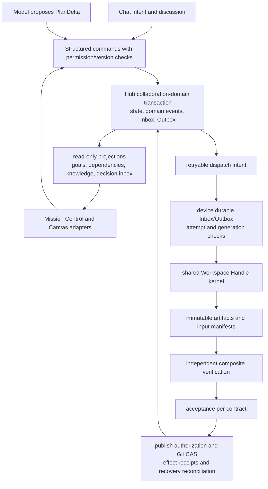

**English** · [简体中文](./device-group-2.0-feasibility-review.md) · [繁體中文](./device-group-2.0-feasibility-review.zh-TW.md)

# Group Collaboration 2.0 Feasibility Review and Proposed Architecture

Review baseline: HEAD was `b1af613e` when the main session read it; the conclusions come from a static review of the current workspace. The workspace also contains uncommitted changes from other sessions, so this is not a complete verification report against a fixed commit. This round, three read-only subagents reviewed execution and publishing, scheduling and recovery, and memory and interaction respectively; only this report is added, no runtime implementation is modified, and no project-level build or test is executed.

**Conclusion: the direction is feasible; converge the implementation scope and change the order.**

"Goal—contract—evidence—deliverable" fits as the core model for the collaboration domain. The most valuable change is to move success away from model reports, chat text and end-of-reasoning onto versioned delivery and verification records.

But the current proposal introduces full event sourcing, worktree execution, HTN, Contract-Net, vector memory and unified multi-view execution all at once, widening the system boundary that must be proven correct in one shot. A safer plan: **build a transactional collaboration kernel under a single Hub authority and close one recoverable delivery loop first; dynamic planning then proposes constrained changes on top of that loop.**

What can be made deterministic here is permission checking, state transitions, evidence binding and side-effect commit rules; model output, test stability and arbitrary external operations do not thereby gain determinism or exactly-once guarantees.

**I. Existing capabilities and the gaps to close first**

Paths below are relative to the repo root. Line numbers locate the implementation read this round and may shift with later changes.

| Topic                                                           | Confirmed implementation facts                                                                                                                                                                                                                    | Impact on the refactor                                                                                                                                                                                         |
| --------------------------------------------------------------- | ------------------------------------------------------------------------------------------------------------------------------------------------------------------------------------------------------------------------------------------------- | -------------------------------------------------------------------------------------------------------------------------------------------------------------------------------------------------------------- |
| Delivery, review and integration are already separate           | `server/protocol.ts` already has `DeviceDelivery`, `DeviceReview`, `DeviceIntegration`; `server/device-center/hub-integration.ts` manages integration operations                                                                                  | Extend the existing domain objects and identity references instead of building a second, parallel Delivery system                                                                                              |
| The Canvas workspace is reusable                                | `server/canvas/canvas-workspace.ts` has detached worktrees, patch hashing, upstream patch stacking and artifact capture; cleanup checks workspace ownership and undelivered changes                                                               | Extract the low-level capabilities that do not depend on graph/node; Canvas and group tasks keep their own adapters                                                                                            |
| Publish protection exists, but the evidence chain is not closed | `server/device-center/device-integration.ts:699` compares the index tree against `preparedTreeSha`, around `:739` validates the merge commit's two-parent chain, and from `:755` executes the CAS                                                 | Keep the existing mechanisms; add an explicit binding between the final commit tree and the verification record, plus environment fingerprints and failure recovery — do not claim all of this is already done |
| Verification is not a hard gate today                           | `server/device-center/hub-integration.ts:416` lets `prepared`, `verified` and `failed` enter confirmed publishing, and separately checks for an accepted review                                                                                   | The new contract must define the verification policy; publishing is forbidden when required verification fails. If the product allows exceptions, store an independent manual waiver and its rationale         |
| Hub transaction wrapping still spans files                      | `server/device-center/store.ts:457` writes the index first, then commits the messages/tasks/transcripts logs one by one; the index itself does not retain these collections                                                                       | An atomic rename of a single file cannot make the whole domain commit atomic; state, events and outbox should share a local transaction                                                                        |
| Orphan recovery has a double-crash window                       | `server/device-center/task-recovery.ts:260` clears the lease first, `:262` then writes the interrupted Outbox                                                                                                                                     | A crash between the two steps loses the only recovery record; fix this commit boundary before adding scheduling capabilities                                                                                   |
| Terminal-state and identity constraints are still incomplete    | `server/device-center/hub.ts:3071` onward verifies task/attempt and similar identities, but the terminal-state entry points do not fully use the lease token/generation; `:3104` accepts late terminal states for interrupted rather loosely      | Separate recovery acceptance from current execution eligibility so stopped tasks cannot advance dependencies again                                                                                             |
| Dependency release semantics are inconsistent                   | `server/device-center/hub.ts:2401` decides whether to wait when creating a downstream task solely by whether the predecessor is terminal; `:2890` wakes existing waiting tasks only on completed and copies at most 2000 characters of the report | A failed predecessor may count as releasable on the create path while existing downstream tasks keep waiting. Unify this into evidence predicates and idempotent settlement                                    |
| Steering ACK is not proof of consumption                        | `server/device-center/executor.ts:775` returns success after calling send; `runtime.ts:847` passes only taskId on the last hop                                                                                                                    | A successful acknowledgement cannot currently be shown as consumed by the model. The last hop should bind the attempt; this round did not reproduce cross-attempt injection                                    |
| The blackboard still has representation and budget problems     | `web/src/components/GroupBlackboardView.tsx:117` derives the ID from the title; `hub.ts:951` writes all replaceable sections; `group-context.ts:206` in the over-limit loop only deletes historical messages                                      | Stabilize ID, version and provenance first; a large blackboard can exceed the budget on its own, so adding a memory layer will not fix it                                                                      |

Extra confirmation: a device terminal-state Outbox already exists, but `task-recovery.ts:470` can overwrite a different result under the same key; ACK also does not yet fully prove that what the Hub durably accepted matches the Outbox content. Immutable results, content digests and conflict rejection are needed. The existing Outbox is not a general Hub command Outbox.

Both specified scaffold tests exist. They cover initial dispatch, partitioning and parsing behavior, and are not yet proof that the versioned evidence loop, crash recovery or publish races are correct.

**II. Key design changes**

1. **Make the four proof types independent records instead of one linear task status.**

   Execution can fail yet leave a reviewable patch; one artifact can be verified several times; a human can approve a plan first and then wait for composite verification; an accepted artifact may lose its current applicability when the contract is revised.

   So `ExecutionCompleted`, `ArtifactProduced`, `VerificationPassed` and `DeliveryAccepted` are facts about different subjects and cannot be a single status that keeps overwriting itself. Execution state, artifact availability, verification state, acceptance decision and publish state are stored separately; the presentation layer composes progress from them.

   An existing acceptance is never deleted or rewritten as never having happened; instead record the older contract it applied to and why it lapsed. An old artifact that should serve a new contract must be explicitly re-verified or approved for adoption.

2. **Close the collaboration-domain transaction first; do not turn the whole application into event sourcing.**

   A single Hub holding the write authority for each Mission is recommended. Collaboration state, version updates, domain events, Inbox deduplication and Outbox intents commit in one local database transaction; SQLite is a reasonable candidate. Devices still need their own durable Inbox/Outbox connected to the Hub over an idempotent protocol; there is no cross-device SQLite transaction.

   The first version can recover from a transactional state table and drive projections and auditing from same-transaction domain events; it need not rebuild every state from full history. This is an explicitly incremental design, not full event sourcing. If complete replay is needed later, add event schema versions, snapshots, retention policy and deterministic reducers; the existing bounded event window cannot carry that responsibility.

   High-frequency tool logs and private conversation transcripts stay in separate storage, linked by immutable references and digests. The Outbox is responsible for at-least-once sending; the receiver achieves idempotent processing via operation ID and content digest. Replaying domain events must not invoke Git, models or the network again.

3. **Worktrees isolate physical changes; the security boundary stays with the executor.**

   A detached worktree still shares the Git object database and part of the configuration, and the same system user can usually reach other directories, processes and the network. It reduces concurrent overwrites but cannot satisfy a security sandbox claim on its own. Tool permissions, reachable paths, device capabilities and process lifetime are still validated by the execution layer; hook into the existing sandbox boundary when system-level isolation is required.

   Extract the shared Workspace Handle operations first: create, apply inputs, capture artifacts, verify, release. A handle binds the repo, baseline, owner, attempt and generation; do not merely rename Canvas functions and let group tasks depend on graphId/nodeId.

   "Destroy the worktree on failure" should tighten as well: confirm the process has stopped first, preserve or capture the artifacts and logs that are needed, and verify handle ownership. A failed state read must not authorize deletion; follow the existing conservative cleanup constraints in `docs/root-cause-boundaries.md`.

4. **Artifacts must be transferable, verifiable and retainable.**

   A commit/tree SHA is an identifier; it does not mean another device already has the Git objects. Cross-device dependencies also need authorized transfer and local integrity checks, with an explicit repository identity, whether the baseline exists, patch/bundle/blob format, and size and path constraints. A local path on a remote device cannot be a consumable artifact.

   A detached commit needs a retained ref or equivalent content storage so that deleting the worktree does not let GC reclaim it; GC computes reachability from active contracts, deliveries pending acceptance, publish operations and the audit retention period.

   Artifact types should allow code, documents and reports; not every chat or research step needs to produce a Git commit.

5. **Verification binds the actual inputs, the composite candidate and the environment; publishing gets its own recoverable protocol.**

   Downstream reads a pinned input set, not whatever artifact "most recently passed verification" at execution time. Multiple artifacts are combined into a candidate tree by an explicit order or strategy and then the composite result is verified; passing unit tests separately does not prove the combination holds.

   Publishing requires at least: the current contract applies, the required verification passed, the acceptance policy is satisfied, the verified candidate tree matches the final commit tree, and the CAS on the target branch succeeds. Identical trees still do not mean identical environments, so verification must record command specifications, toolchain/dependency fingerprints, exit codes and full log references. "Tests passed" text from a model or Bot cannot produce a trustworthy `VerificationPassed`.

   Git CAS and the database update are not one transaction. Persist a `PublishIntent` and the candidate commit, execute the CAS, then persist the effect receipt; on recovery, query the repository-side evidence and reconcile. Both windows must be covered: "CAS succeeded but the local receipt was not saved" and "the device succeeded but the Hub did not receive it". If the outcome cannot be decided, enter a pending-verification state and never treat an unknown result as an ordinary failure to retry automatically.

   The CAS on Git HEAD also cannot resolve contract-revocation races. Define a linearization point for publish authorization: for example, once authorization is reserved and the commit has started, affected contract revisions are held back until the operation explicitly completes or aborts. Checking the contract version, then allowing the revision to take effect, and then running the CAS of the old authorization is not acceptable.

6. **Fix the steering lifecycle into a state machine with branches, and represent observation results separately.**

   Proposed main flow: `requested → accepted → enqueued → consumed`; the request can be rejected, withdrawn or expire before consumption. If the contract is found changed after `consumed`, record the consumption fact under the old version and the follow-up correction separately; never rewrite it as "never consumed".

   A requester timeout only proves the acknowledgement was not observed. Unless the execution side also enforces the deadline, there is no proof the message was neither enqueued nor consumed. Keep both the execution lifecycle and the transport observation state; a late acknowledgement can update the audit but cannot regain effective eligibility on the current attempt.

   Every hop binds steeringId, attemptId, contract version and execution generation. Intent correction and safety stop are two commands; the latter also needs cancellation confirmation and side-effect constraints. When the SDK has no consumption hook, display the farthest provable state; never synthesize consumed.

7. **Move ContextManifest earlier; layer the three memory tiers logically first.**

   The first isolated execution should already capture an immutable input manifest: contract and version, code baseline, input artifacts and their digests, the knowledge versions selected, prompt/tool policy versions, budget and deadline. Otherwise the verification evidence produced by the first stages still lacks an input basis.

   ContextManifest provides input auditing and re-inspection; it cannot guarantee that a stochastic model's reasoning reproduces exactly. Keep large bodies in the content store, hold references and digests in the manifest, and stay under the existing access permissions.

   Facts reference verifiable evidence; Beliefs hold assumptions and open items; Commitments bind an owner, a deadline and release conditions; Decisions record the decider, the rationale and the alternatives. Each object is independently versioned, with source and supersession relations kept. Whether knowledge has lapsed follows from its scope and dependencies; a repo HEAD change must not invalidate all knowledge every time.

   Retrieve with stable IDs, code symbols/paths, keywords and source filters first; inject a catalog and the relevant snippets by default, and read full text on demand. Vector search is a rebuildable index; add it once there is a measurable recall gap. Retrieval similarity must not turn stale knowledge into fact.

8. **Ship a constrained PlanDelta and deterministic routing before deciding whether full HTN/bidding is needed.**

   The first PlanDelta allows only a few explicit operations, for example adding a work item, adjusting dependencies, requesting replanning. It carries operationId, expectedPlanRevision and rationale/evidence references; the control plane validates that the DAG is acyclic, permissions do not widen, a running contract is not silently replaced, budget can be reserved atomically, and branches and depth stay under limits.

   A constrained Mesh should separate the "discussable communication graph" from the "evidence-awaiting dependency graph". Communication may go back and forth; work-item dependencies must be decidable and convergent; rework produces a new version or a new attempt so a cyclic conversation is never treated directly as an execution DAG.

   Start with explicit owner assignment, then filter by hard capability, repo/baseline reachability, load and fairness. Historical acceptance rates must be interpreted by task category, sample size and verification policy; never lock routing in on a single success rate. Only open budgeted bidding to a small set of high-value tasks once a single route is observed to lose. Only the awardee starts executing.

   "No new evidence" must be defined as a checkable change in the evidence set/digest; rewriting an explanation cannot reset the circuit breaker. Dispatch, rework, discussion, duration and cost still have hard caps in aggregate.

**III. Recommended core objects and authority relations**

Reuse or extend existing objects first; add new ones only where a responsibility is genuinely missing. The following is a conceptual model, not an implemented protocol.

| Object                      | Primary responsibility and required bindings                                                                                   |
| --------------------------- | ------------------------------------------------------------------------------------------------------------------------------ |
| Mission                     | Human intent, scope, acceptance policy, budget, version and termination conditions                                             |
| WorkItem / ContractRevision | Stable work-item identity, immutable contract revision, owner, input requirements, acceptance rules                            |
| ExecutionAttempt            | Independent execution identity, device/Bot revision, lease generation, workspace handle, ContextManifest                       |
| Artifact                    | Type, source attempt, baseline, content digest, Git object/patch/blob reference and availability                               |
| VerificationRun             | The exact verified inputs/candidate tree, verification specification and environment, results and log digests                  |
| Acceptance                  | The accepted contract version and artifacts, the verifications relied on, decider and authority, rationale or waiver           |
| DependencyBinding           | Explicit upstream work item, contract version, artifact selection and required release evidence; inputs are pinned at dispatch |
| PublishOperation            | Target repo/branch, expectedTargetSha, candidate commit/tree, publish authorization and effect receipt                         |
| MemoryRecord                | fact/belief/commitment/decision, independent version, source, scope and supersession relations                                 |

Terminal states, evidence and external-effect commits verify at least account/group ownership, workItem, contractRevision, attempt, lease/execution generation and input manifest digest. Results from old attempts can enter the historical audit but cannot advance the current contract, unlock downstream work or earn publish rights.

Make dependency readiness a single computation: **the pinned input version is available + the required proof holds and still applies + the current work item is not cancelled/lapsed + permissions and budget are valid**. Use the same computation at creation, after events and during crash recovery, so three entry points do not each grow their own judgment.

What is shared is the collaborative domain identity and state. Chat text, Bot private reasoning transcripts, Canvas editing documents and tool logs need not become the same record, nor be losslessly interconvertible in the first version. Canvas can keep its own topology and run generation and join incrementally through stable graph/node/run references to workItem/attempt.

**IV. The revised six stages and exit gates**

| Stage                                            | Proposed delivery scope                                                                                                                                              | Gate to the next stage                                                                                                                                      |
| ------------------------------------------------ | -------------------------------------------------------------------------------------------------------------------------------------------------------------------- | ----------------------------------------------------------------------------------------------------------------------------------------------------------- |
| 1. Transaction and identity kernel               | Fix domain invariants; a single transaction for the collaboration domain; Hub/device Inbox-Outbox; attempt/lease fencing; unified failure and recovery settlement    | Killing processes and duplicate/late results lose no terminal state, take no double effect, and never release a failed predecessor as success               |
| 2. Minimal isolated delivery loop                | One code contract from creation through isolated execution, Artifact, ContextManifest, real verification and acceptance; extract the minimal shared Workspace Handle | Two concurrent tasks do not overwrite each other; the end of execution cannot fabricate delivery; old evidence cannot auto-accept after a contract revision |
| 3. Artifact dependencies and reliable publishing | Multi-input pinning, composite tree verification, mandatory evidence gate, CAS, PublishIntent and effect recovery                                                    | A failed combination or a moved target branch always blocks; a crash after CAS is identified as already effective or explicitly enters pending verification |
| 4. Working memory and a usable board             | Stable knowledge IDs/sources/versions; in-budget context snippets; first Mission Control with Diff/pending-decision entry points                                     | Users can trace a blocker to the exact evidence and act on it; no view grows a second copy of task state                                                    |
| 5. Rolling planning and capability routing       | Constrained PlanDelta, version CAS, budget reservation, deterministic routing, rework and no-progress circuit breaker                                                | Concurrent proposals cannot exceed budget or form cycles; discussion without new evidence cannot dispatch forever; models cannot widen permissions          |
| 6. Full takeover and view integration            | Work-item/contract/execution/mission takeover; Canvas/Pipeline share domain commands and read models; advanced retrieval/bidding decided by data                     | All views share the same authorization and version rules and measurably cut the time and interventions humans spend on blockers                             |

A read-only progress projection can ship incrementally alongside stages 1–3; users need not wait until the end to see the new evidence model. Immutable Diffs and pending-decision entry points come before elaborate graphics and heavy configuration.

**V. Tests should center on commit boundaries, not just one success path**

All six failure scenarios raised by the user are kept, refined into the following fault-injectable breakpoints. Scenarios involving real Git and process crashes are integration tests; mock return values must not stand in for system verification.

| Scenario                                                                                                                 | Required observable outcome                                                                                                                                 |
| ------------------------------------------------------------------------------------------------------------------------ | ----------------------------------------------------------------------------------------------------------------------------------------------------------- |
| Crash after the predecessor evidence commits and before the downstream send                                              | The recovery scan finds ready items and produces/recovers the same dispatch intent; duplicate sends are durably deduplicated                                |
| Predecessor already failed when the downstream is created, plus predecessor failure/cancellation/rejection while waiting | Both entry points apply the same block/lapse policy; descendants never queue blindly                                                                        |
| Second crash at every durable commit point on the Hub/device                                                             | The lease, result and dispatch intent each retain at least one recoverable record; never a new index with no matching task records                          |
| Old attempt/old lease arrives late, task already stopped                                                                 | The historical fact can be stored, but it cannot advance a new attempt, release resources it does not own or publish artifacts                              |
| Same result sent twice vs. conflicting content under the same idempotency key                                            | Identical content returns the already-committed ACK; different content reports an explicit conflict and never overwrites the existing terminal state        |
| Steering timeout, disconnect, late acknowledgement, attempt switch                                                       | Transport-unknown and execution state stay distinguishable; old instructions do not take effect across versions and consumed is never fabricated            |
| Contract revised while running, acceptance withdrawn or superseded afterward                                             | Old evidence stays traceable but no longer satisfies the new contract; a publish authorization in flight is handled explicitly                              |
| Two artifacts pass separately but their combined interface conflicts                                                     | Verifying the composite candidate fails and the publish entry point refuses; two independent passes are not enough                                          |
| Candidate modified after verification, or the final commit tree differs                                                  | Evidence no longer matches and publishing is refused; covers the index, workspace and final commit boundaries                                               |
| Confirm-publish called directly after a failed verification                                                              | The required verification policy is enforced server-side; refuse without an explicit, valid waiver                                                          |
| Target branch moves after the check and before the CAS                                                                   | The CAS refuses; rebuild the candidate and re-verify; never reuse the old composite verification                                                            |
| Crash after CAS success and before the receipt or the Hub acknowledgement                                                | Effect reconciliation identifies it as already published; with insufficient evidence enter pending verification instead of repeating the external effect    |
| Two PlanDeltas contend for the same version and budget                                                                   | Only one succeeds; the losing proposal re-reads the version and cannot over-reserve or silently overwrite                                                   |
| Large blackboard, memory supersession, evidence log retention expiry                                                     | Context stays within budget; applicability stays correct; evidence referenced by valid knowledge does not go missing because ordinary messages were evicted |

Follow the existing async-subprocess, permission, URL and test-isolation rules when implementing. Acceptance covers at least the repo-required Prettier, five TypeScript configs, the related unit tests, and the sync child process and style guard tests; these are gates for the implementation stage and do not mean this static review ran or passed them.

**VI. Migration and scope control**

Choose exactly one write path (old or new) per Mission/room, back up before migrating, and keep explicit schema and policy versions. Mark historical snapshot imports as imported state; never fabricate verification, acceptance or consumption events that never happened — in particular, do not bulk-convert old `completed` into `verified`.

A compatibility layer can project new domain records into the fields the old UI needs, but it must not independently update two sets of state. Existing long-running tasks use an identifiable legacy policy; new tasks enter the contract loop incrementally. Rollback needs version compatibility or an export/restore path; flipping a switch so the old service silently drops new evidence is not acceptable.

The first batch of implementation should form one demonstrable, crash-recoverable vertical slice, then extend to other task types and views. Full event replay, complete HTN, vector indexes and automatic bidding stay as capabilities with verifiable payoff later; they are not prerequisites for a reliable delivery loop.
