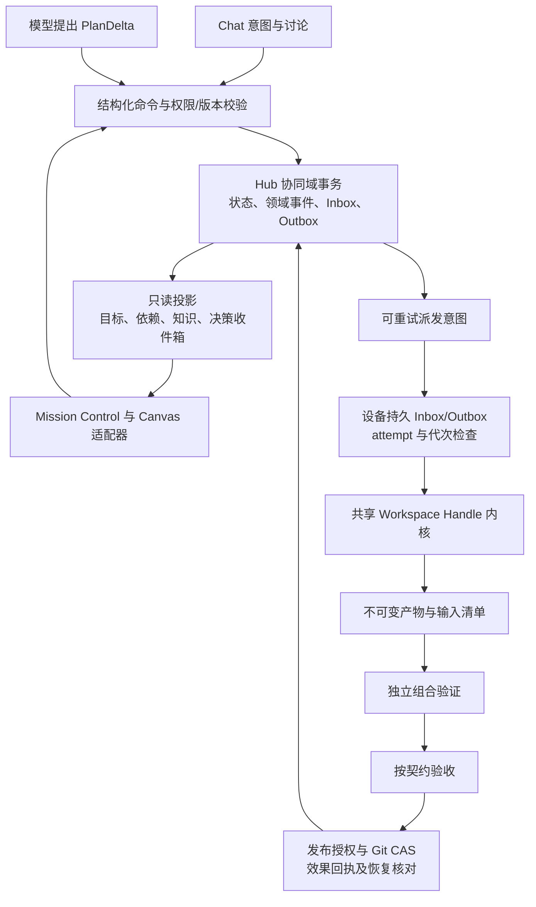

# 群组协同 2.0 可行性审查与建议架构

审查基线：主会话读取时 HEAD 为 `b1af613e`；结论来自当前工作区的静态审查。工作区同时存在其他会话的未提交修改，因此这不是对固定提交的完整验证报告。本轮由三个只读子代理分别审查执行与发布、调度与恢复、记忆与交互；只新增本报告，不修改运行实现，不执行项目级构建或测试。

**结论：方向可行，建议收敛实施范围并调整顺序。**

“目标—契约—证据—交付物”适合作为协同域的核心模型。最有价值的变化，是把成功与否从模型报告、聊天文本和推理结束，转移到版本明确的交付与验证记录上。

但目前的方案同时引入全量事件溯源、工作树执行、HTN、Contract-Net、向量记忆和多视图统一执行，扩张了需要一次证明正确的系统边界。更稳妥的方案是：**建立单一 Hub 权威下的事务协同内核，先完成一个可恢复的交付闭环；动态规划在这个闭环上提出受约束的变更。**

这里能获得确定性的是权限校验、状态转换、证据绑定和副作用提交规则；模型输出、测试稳定性及任意外部操作不能因此获得确定性或 exactly-once 保证。

**一、已有能力与应优先解决的缺口**

以下路径相对仓库根目录。行号用于定位本轮读取的实现，后续修改可能使其变化。

| 主题                           | 已确认的实现事实                                                                                                                                      | 对重构的影响                                                                                          |
| ------------------------------ | ----------------------------------------------------------------------------------------------------------------------------------------------------- | ----------------------------------------------------------------------------------------------------- |
| 交付、审查、集成已分开         | `server/protocol.ts` 已有 `DeviceDelivery`、`DeviceReview`、`DeviceIntegration`；`server/device-center/hub-integration.ts` 管理集成操作               | 应扩展现有领域对象与身份引用，避免建立另一套平行 Delivery 系统                                        |
| Canvas 工作区可复用            | `server/canvas/canvas-workspace.ts` 有 detached worktree、patch 散列、上游 patch 叠加与产物捕获；清理检查工作区归属及未交付改动                       | 提取不依赖 graph/node 的底层能力；Canvas 与群任务保留各自适配器                                       |
| 已有发布保护，但证据链尚未闭合 | `server/device-center/device-integration.ts:699` 比较索引 Tree 与 `preparedTreeSha`，`:739` 附近校验 merge commit 双父链，`:755` 起执行 CAS           | 保留已有机制；补上最终 commit Tree 与验证记录的显式绑定、环境指纹及故障恢复，不能宣称这些全部已经完成 |
| 验证目前不是硬闸门             | `server/device-center/hub-integration.ts:416` 允许 `prepared`、`verified`、`failed` 进入确认发布，另有 accepted review 校验                           | 新契约必须明确验证策略；必需验证失败时禁止发布。若产品允许例外，应保存独立的人工豁免及理由            |
| Hub 事务封装仍跨文件           | `server/device-center/store.ts:457` 先写索引，再逐份提交 messages/tasks/transcripts 日志；索引自身不保留这些集合                                      | 原子 rename 单个文件不能保证整个领域提交原子；state、事件、outbox 应共用本地事务                      |
| 孤儿恢复有二次崩溃窗口         | `server/device-center/task-recovery.ts:260` 先清租约，`:262` 再写 interrupted Outbox                                                                  | 两步之间崩溃会丢失唯一恢复记录；先修这个提交边界，再增加调度能力                                      |
| 终态与身份约束还不完整         | `server/device-center/hub.ts:3071` 起核验 task/attempt 等身份，但终态入口未完整使用 lease token/generation；`:3104` 对 interrupted 的迟到终态接纳较宽 | 需要把恢复接纳与当前执行资格分开，避免已停止任务重新推进依赖                                          |
| 依赖放行语义不一致             | `server/device-center/hub.ts:2401` 创建下游时只按前驱是否终态判断等待；`:2890` 只按 completed 唤醒既有等待任务，并复制最多 2000 字报告                | 失败前驱可能在新建路径被视作可放行，既有下游却继续等待。应统一为证据谓词和幂等 settlement             |
| Steering ACK 不是消费证明      | `server/device-center/executor.ts:775` 调用发送后返回成功；`runtime.ts:847` 最后一跳只传 taskId                                                       | 当前不能将成功回执显示为模型已经消费。最后一跳应绑定 attempt；本轮未复现跨 attempt 注入               |
| 黑板仍有表示与预算问题         | `web/src/components/GroupBlackboardView.tsx:117` 从标题推导 ID；`hub.ts:951` 全量写可替换 sections；`group-context.ts:206` 超限循环只删除历史消息     | 先稳定 ID、版本和来源；大黑板自身就可能超过预算，不能依靠增加记忆层解决                               |

额外确认：设备终态 Outbox 已经存在，但 `task-recovery.ts:470` 对同键不同结果可以覆盖；ACK 也尚未完整证明 Hub 持久接受的内容与 Outbox 内容一致。需要不可变结果、内容摘要及冲突拒绝。现有 Outbox 不等于通用的 Hub 命令 Outbox。

指定的两份脚手架测试均存在。它们覆盖初步派发、分区和解析行为，尚不能作为版本证据闭环、崩溃恢复或发布竞争已经正确的证明。

**二、建议修改的关键设计**

1. **把四类证明建成独立记录，避免一条线性任务状态。**

   执行可以失败但留下可审查 patch；同一个 artifact 可以有多次验证；人类可以先认可方案，再等待组合验证；已经验收的产物也可能因契约修订失去当前适用性。

   因此 `ExecutionCompleted`、`ArtifactProduced`、`VerificationPassed`、`DeliveryAccepted` 是不同主体上的事实，不能作为一个不断向前覆盖的 status。执行状态、产物可用性、验证状态、验收决策、发布状态分别保存；展示层组合计算进度。

   已存在的 acceptance 不删除、不改写为从未发生，而是记录它适用的旧契约和失效原因。旧 artifact 想用于新契约，必须显式重新验证或批准采用。

2. **先完成协同域事务，不把整个应用改成事件溯源。**

   推荐由单一 Hub 持有每个 Mission 的写入权威。协同状态、版本更新、领域事件、Inbox 去重、Outbox 意图在同一本地数据库事务提交；SQLite 是合理候选。设备端仍需要自己的持久 Inbox/Outbox，与 Hub 之间通过幂等协议连接，不存在跨设备 SQLite 事务。

   第一版可以用事务状态表恢复，用同事务的领域事件驱动投影和审计；暂不要求靠完整历史重建所有状态。这是明确的渐进设计，并非完整事件溯源。若未来需要完整回放，再补事件 schema 版本、快照、保留策略和确定性 reducer；现有有界事件窗口不能直接承担该职责。

   高频工具日志与私有会话转录继续独立存储，以不可变引用和摘要关联。Outbox 负责至少一次发送；接收端通过操作 ID 和内容摘要实现幂等处理。重放领域事件不得重新调用 Git、模型或网络。

3. **工作树负责物理改动隔离，安全边界由执行器承担。**

   detached worktree 仍共享 Git 对象库和部分配置，同一系统用户通常可以访问其他目录、进程和网络。它能降低并发覆盖，不能单独满足安全沙盒承诺。工具权限、可访问路径、设备能力和进程生命周期仍由执行层校验；需要系统级隔离时接入既有沙盒边界。

   建议先抽取共享 Workspace Handle 操作：创建、应用输入、捕获产物、校验、释放。句柄绑定仓库、基线、所有者、attempt 和代次；不要仅把 Canvas 函数改名后让群任务依赖 graphId/nodeId。

   “失败直接销毁工作树”也应收紧：先确认进程已经停止，保留或捕获必要产物及日志，校验句柄归属。状态读取失败不能授权删除；遵守 `docs/root-cause-boundaries.md` 现有保守清理约束。

4. **产物必须可传输、可验证、可保留。**

   Commit/Tree SHA 是标识，不等于另一设备已经拥有 Git 对象。跨设备依赖还需受权传输与本地完整性检查，明确 repository identity、基线是否存在、patch/bundle/blob 格式、尺寸和路径约束。远端设备上的本地路径不能直接作为可消费产物。

   detached commit 需要有被保留的引用或等效内容存储，避免工作树删除后被 GC 回收；GC 按活跃契约、待验收交付、发布操作和审计保留期计算可达性。

   产物类型应允许代码、文档和报告，不能要求每次聊天或研究步骤都生成 Git commit。

5. **验证绑定实际输入、组合候选与环境；发布另建可恢复协议。**

   下游读取的是锁定版本的输入集合，不是每次执行时查“最新通过验证”的产物。多个产物需按明确顺序或组合策略构造候选 Tree，再验证组合结果；分别通过单测不证明组合成立。

   发布至少要求：当前契约适用、所需验证通过、验收策略满足、验证的候选 Tree 与最终 commit Tree 一致，以及目标分支 CAS 成功。Tree 相同仍不能代表环境相同，因此验证需记录命令规范、工具链/依赖指纹、退出码和完整日志引用。模型或 Bot 的“测试通过”文本不能生成可信 `VerificationPassed`。

   Git CAS 与数据库更新不是同一个事务。持久 `PublishIntent` 与候选 commit 后执行 CAS，随后持久效果回执；恢复时查询仓库侧证据进行 reconciliation。要覆盖“CAS 成功但本地 receipt 未保存”及“设备已成功但 Hub 未收到”两种窗口。若无法判定，进入待核实状态，禁止把未知结果当作普通失败自动重做。

   Git HEAD 的 CAS 也不能解决契约撤销竞争。必须定义发布授权的线性化点：例如授权已预留并开始提交后，受影响契约修订暂缓生效，等待该操作明确完成或中止。不能先检查契约版本、随后允许修订生效、最后继续执行旧授权的 CAS。

6. **Steering 生命周期修正为带分支的状态机，并独立表示观察结果。**

   建议主流程为 `requested → accepted → enqueued → consumed`；在消费前可以拒绝、撤销或过期。`consumed` 后若发现契约已变，应另记旧版本消费事实及后续纠偏，不能回写成“从未消费”。

   请求方超时只能证明未观察到回执。除非执行端也强制校验截止时间，否则无法证明消息没有入队或消费。保留执行生命周期与传输观察状态，迟到回执可更新审计，但不能重新获得当前 attempt 的生效资格。

   每一跳绑定 steeringId、attemptId、契约版本和执行代次。意图纠偏与安全停止是两个命令；后者还需要取消确认和副作用约束。SDK 没有消费钩子时，应显示可证明的最远状态，不能合成 consumed。

7. **ContextManifest 应前移；三层记忆先做逻辑分层。**

   第一次隔离执行就应捕获不可变输入清单：契约与版本、代码基线、输入产物及摘要、选取的知识版本、提示词/工具策略版本、预算和截止时间。否则前几个阶段产生的验证证据仍缺输入依据。

   ContextManifest 提供输入审计与复查，不能保证随机模型的推理完全重现。大正文放内容存储，清单保留引用和摘要，并受原有访问权限约束。

   Facts 引用可核验的证据；Beliefs 保存假设与待验证项；Commitments 绑定负责者、期限和解除条件；Decisions 记录决策者、依据和替代方案。各对象独立版本，并保存来源与替代关系。知识是否失效应根据其适用范围和依赖判断，不能每次仓库 HEAD 变化就使全部知识作废。

   检索先用稳定 ID、代码符号/路径、关键词和来源过滤；默认注入目录及相关片段，全文按需读取。向量检索是可重建索引，等出现可衡量的漏召回问题再加；检索相似不能把过期知识变成事实。

8. **先做受约束 PlanDelta 与确定性路由，再决定是否需要完整 HTN/竞标。**

   第一版 PlanDelta 只允许少量明确操作，例如新增工作项、调整依赖、请求重新规划。携带 operationId、expectedPlanRevision 和理由/证据引用；控制面校验 DAG 无环、权限不扩张、运行中契约不被静默替换、预算可原子预留、分支与深度不超限。

   受约束 Mesh 应区分“可讨论的通信图”和“等待证据的依赖图”。通信可以往返，工作项依赖必须可判定、可收敛；返工生成新版本或新 attempt，避免把有环对话直接当执行 DAG。

   首先沿用显式指定负责者，再按硬能力、仓库/基线可达性、负载和公平性筛选。历史验收率要按任务类别、样本量和验证策略解释，不能用单一成功率固化路由。只有观察到单一路由确有损失时，才对少量高价值任务开放有预算的竞标；仅授标者开始执行。

   “无新增证据”需定义为可核查的证据集合/摘要变化，改写一段解释不能重置熔断。累计派发、返工、讨论、时长和成本仍有硬上限。

**三、推荐的核心对象与权威关系**

建议首先复用或扩展现有对象，只在职责确实缺失时新增。下面是概念模型，不是已实现的协议。

| 对象                        | 主要职责与不可缺少的绑定                                               |
| --------------------------- | ---------------------------------------------------------------------- |
| Mission                     | 人类意图、范围、验收策略、预算、版本及终止条件                         |
| WorkItem / ContractRevision | 稳定工作项身份、不可变契约修订、负责者、输入要求、验收规则             |
| ExecutionAttempt            | 独立执行身份、设备/Bot revision、租约代次、工作区句柄、ContextManifest |
| Artifact                    | 类型、来源 attempt、基线、内容摘要、Git 对象/patch/blob 引用及可用性   |
| VerificationRun             | 被验证的准确输入/候选 Tree、验证规范与环境、结果及日志摘要             |
| Acceptance                  | 被接受的契约版本与产物、所依赖验证、决策者与权限、理由或豁免           |
| DependencyBinding           | 明确上游工作项、契约版本、产物选择及所需放行证据；派发时锁定输入       |
| PublishOperation            | 目标仓库/分支、expectedTargetSha、候选 commit/Tree、发布授权及效果回执 |
| MemoryRecord                | fact/belief/commitment/decision、独立版本、来源、适用范围与替代关系    |

终态、证据与外部效果提交至少核验账户/群组归属、workItem、contractRevision、attempt、租约/执行代次及输入清单摘要。旧 attempt 的结果可以进入历史审计，不能推进当前契约、解锁下游或获得发布权。

依赖就绪判断应统一为：**指定版本输入可用 + 所需证明成立且仍适用 + 当前工作项未被取消/失效 + 权限与预算有效**。创建时、事件后和崩溃恢复时使用相同计算，避免三个入口各写一套判断。

同源的是协作领域身份和状态。Chat 文本、Bot 私有推理转录、Canvas 编辑文档和工具日志不必变成同一种记录，也不必第一版无损互转。Canvas 可以保留自己的拓扑和运行代次，通过稳定 graph/node/run 与 workItem/attempt 引用逐步接入。

**四、调整后的六阶段与退出门槛**

| 阶段                  | 建议交付范围                                                                                            | 进入下一阶段的门槛                                                       |
| --------------------- | ------------------------------------------------------------------------------------------------------- | ------------------------------------------------------------------------ |
| 1. 事务与身份内核     | 固定领域不变量；协同域单一事务；Hub/设备 Inbox-Outbox；attempt/lease fencing；统一失败与恢复 settlement | 杀进程和重复/迟到结果不会丢终态、重复生效或把失败前驱当成功放行          |
| 2. 最小隔离交付闭环   | 一个代码契约从创建到隔离执行、Artifact、ContextManifest、真实验证与验收；抽取最小共享 Workspace Handle  | 两个任务并行互不覆盖；执行结束不会伪造交付；契约修订后旧证据不能自动验收 |
| 3. 产物依赖与可靠发布 | 多输入锁定、组合 Tree 验证、强制证据闸门、CAS、PublishIntent 与效果恢复                                 | 组合失败或目标分支移动必定阻断；CAS 后崩溃能识别已生效或明确进入待核实   |
| 4. 工作记忆与可用看板 | 稳定知识 ID/来源/版本；预算内上下文片段；Mission Control 首版与 Diff/待决策入口                         | 用户可从阻塞原因定位准确证据并处理；视图不会自己生成第二套任务状态       |
| 5. 滚动规划与能力路由 | 受限 PlanDelta、版本 CAS、预算预留、确定性路由、返工与无进展熔断                                        | 并发提案不会超预算或成环；无新证据讨论不能无限派发；模型不能扩大权限     |
| 6. 完整接管与视图集成 | 工作项/契约/执行/使命接管；Canvas/Pipeline 共用领域命令和读模型；按数据决定高级检索/竞标                | 所有视图共享同一授权与版本规则，实际减少人类处理阻塞的时间与干预次数     |

首版只读进度投影可随阶段 1–3 增量提供，不必等到最后才让用户看到新证据模型。不可变 Diff 和待决策入口优先于复杂图形和大量配置。

**五、测试应围绕提交边界，而不只覆盖一条成功链**

用户提出的六类失败场景全部保留，建议进一步精确为以下可故障注入的断点。涉及真实 Git 和进程崩溃的场景属于集成测试，不能仅用 mock 返回值冒充系统验证。

| 场景                                                 | 必须观察到的结果                                                               |
| ---------------------------------------------------- | ------------------------------------------------------------------------------ |
| 前驱证据提交后、下游发送前崩溃                       | 恢复扫描就绪项并生成/恢复同一派发意图；重复发送被持久去重                      |
| 新建下游时前驱已经失败，以及等待中前驱失败/取消/拒收 | 两条入口采用相同的阻塞/失效策略，后代不会盲目排队                              |
| Hub/设备在每个持久提交点二次崩溃                     | 租约、结果和派发意图至少保留一份可恢复记录；不出现只剩新索引、没有对应任务记录 |
| 旧 attempt/旧租约迟到、任务已被停止                  | 可保存历史事实，但不能推进新 attempt、释放不属于自己的资源或发布产物           |
| 相同结果重复发送与同幂等键冲突内容                   | 相同内容返回已提交 ACK；不同内容明确冲突，不能覆盖既有终态                     |
| Steering 超时、断连、晚到回执、attempt 切换          | 传输未知与执行状态可区分，旧指令不跨版本生效，不能伪造 consumed                |
| 运行中修订契约、验收后撤销或替代                     | 旧证据保留可追溯性，但不再满足新契约；明确处理正在提交的发布授权               |
| 两产物单独通过但组合接口冲突                         | 验证组合候选失败，发布入口拒绝；不能只检查两份独立 passed                      |
| 验证后候选被修改或最终 commit Tree 不同              | 证据不再匹配，发布拒绝；覆盖索引、工作区及最终 commit 的边界                   |
| 验证失败后直接调用确认发布                           | 必需验证策略在服务端执行；没有显式、有效豁免则拒绝                             |
| 目标分支在检查后、CAS 前移动                         | CAS 拒绝，重新构造候选并复验；不重用旧组合验证                                 |
| CAS 成功后、receipt 或 Hub 回执前崩溃                | 通过效果核对识别已发布；证据不足时进入待核实，不重复执行外部效果               |
| 两个 PlanDelta 竞争同一版本和预算                    | 仅一个通过；失败提案重读版本，不能超额预留或悄悄覆盖                           |
| 大黑板、记忆替代、证据日志保留期到期                 | 上下文仍在预算内；适用性正确；被有效知识引用的证据不会因普通消息淘汰而失联     |

实施时遵守既有异步子进程、权限、URL 和测试隔离规范。验收至少覆盖仓库要求的 Prettier、五个 TypeScript 配置、相关单测、同步子进程与样式守卫；这些是实现阶段的门槛，不代表本次静态审查已执行或通过。

**六、迁移与范围控制**

按 Mission/room 选择唯一的新旧写入路径，迁移前备份，并保留明确的 schema 与策略版本。历史快照导入标记为 imported state；不能伪造过去不存在的验证、验收或消费事件，尤其不能把旧 `completed` 批量转换成 `verified`。

兼容层可把新领域记录投影为旧 UI 所需字段，但不得同时独立更新两套状态。已有长任务采用可识别的 legacy 策略；新任务逐步进入契约闭环。回滚需要版本兼容或导出恢复方案，不能简单切开关后让旧服务静默丢弃新证据。

第一批实现应形成一个可演示、可故障恢复的纵向切片，再扩展其他任务类型和多视图。全量事件回放、完整 HTN、向量索引及自动竞标保留为后续可验证收益的能力，不作为可靠交付闭环的前置依赖。
