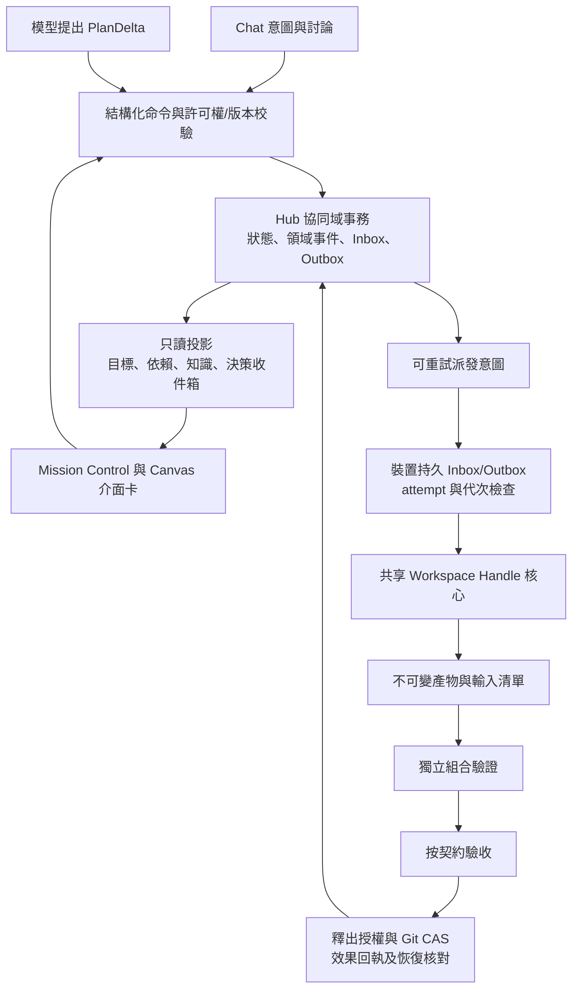

[English](./device-group-2.0-feasibility-review.en.md) · [简体中文](./device-group-2.0-feasibility-review.md) · **繁體中文**

# 群組協同 2.0 可行性審查與建議架構

審查基線：主會話讀取時 HEAD 為 `b1af613e`；結論來自當前工作區的靜態審查。工作區同時存在其他會話的未提交修改，因此這不是對固定提交的完整驗證報告。本輪由三個只讀子代理分別審查執行與釋出、排程與恢復、記憶與互動；只新增本報告，不修改執行實現，不執行專案級構建或測試。

**結論：方向可行，建議收斂實施範圍並調整順序。**

“目標—契約—證據—交付物”適合作為協同域的核心模型。最有價值的變化，是把成功與否從模型報告、聊天文本和推理結束，轉移到版本明確的交付與驗證記錄上。

但目前的方案同時引入全量事件溯源、工作樹執行、HTN、Contract-Net、向量記憶和多檢視統一執行，擴張了需要一次證明正確的系統邊界。更穩妥的方案是：**建立單一 Hub 權威下的事務協同核心，先完成一個可恢復的交付閉環；動態規劃在這個閉環上提出受約束的變更。**

這裡能獲得確定性的是許可權校驗、狀態轉換、證據繫結和副作用提交規則；模型輸出、測試穩定性及任意外部操作不能因此獲得確定性或 exactly-once 保證。

**一、已有能力與應優先解決的缺口**

以下路徑相對倉庫根目錄。行號用於定位本輪讀取的實現，後續修改可能使其變化。

| 主題                           | 已確認的實現事實                                                                                                                                      | 對重構的影響                                                                                          |
| ------------------------------ | ----------------------------------------------------------------------------------------------------------------------------------------------------- | ----------------------------------------------------------------------------------------------------- |
| 交付、審查、整合已分開         | `server/protocol.ts` 已有 `DeviceDelivery`、`DeviceReview`、`DeviceIntegration`；`server/device-center/hub-integration.ts` 管理整合操作               | 應擴充套件現有領域物件與身份引用，避免建立另一套平行 Delivery 系統                                    |
| Canvas 工作區可複用            | `server/canvas/canvas-workspace.ts` 有 detached worktree、patch 雜湊、上游 patch 疊加與產物捕獲；清理檢查工作區歸屬及未交付改動                       | 提取不依賴 graph/node 的底層能力；Canvas 與群任務保留各自適配器                                       |
| 已有釋出保護，但證據鏈尚未閉合 | `server/device-center/device-integration.ts:699` 比較索引 Tree 與 `preparedTreeSha`，`:739` 附近校驗 merge commit 雙父鏈，`:755` 起執行 CAS           | 保留已有機制；補上最終 commit Tree 與驗證記錄的顯式繫結、環境指紋及故障恢復，不能宣稱這些全部已經完成 |
| 驗證目前不是硬閘門             | `server/device-center/hub-integration.ts:416` 允許 `prepared`、`verified`、`failed` 進入確認釋出，另有 accepted review 校驗                           | 新契約必須明確驗證策略；必需驗證失敗時禁止釋出。若產品允許例外，應儲存獨立的人工豁免及理由            |
| Hub 事務封裝仍跨檔案           | `server/device-center/store.ts:457` 先寫索引，再逐份提交 messages/tasks/transcripts 日誌；索引自身不保留這些集合                                      | 原子 rename 單個檔案不能保證整個領域提交原子；state、事件、outbox 應共用本地事務                      |
| 孤兒恢復有二次崩潰視窗         | `server/device-center/task-recovery.ts:260` 先清租約，`:262` 再寫 interrupted Outbox                                                                  | 兩步之間崩潰會丟失唯一恢復記錄；先修這個提交邊界，再增加排程能力                                      |
| 終態與身份約束還不完整         | `server/device-center/hub.ts:3071` 起核驗 task/attempt 等身份，但終態入口未完整使用 lease token/generation；`:3104` 對 interrupted 的遲到終態接納較寬 | 需要把恢復接納與當前執行資格分開，避免已停止任務重新推進依賴                                          |
| 依賴放行語義不一致             | `server/device-center/hub.ts:2401` 建立下游時只按前驅是否終態判斷等待；`:2890` 只按 completed 喚醒既有等待任務，並複製最多 2000 字報告                | 失敗前驅可能在新建路徑被視作可放行，既有下游卻繼續等待。應統一為證據謂詞和冪等 settlement             |
| Steering ACK 不是消費證明      | `server/device-center/executor.ts:775` 呼叫傳送後返回成功；`runtime.ts:847` 最後一跳只傳 taskId                                                       | 當前不能將成功回執顯示為模型已經消費。最後一跳應繫結 attempt；本輪未復現跨 attempt 注入               |
| 黑板仍有表示與預算問題         | `web/src/components/GroupBlackboardView.tsx:117` 從標題推導 ID；`hub.ts:951` 全量寫可替換 sections；`group-context.ts:206` 超限迴圈只刪除歷史訊息     | 先穩定 ID、版本和來源；大黑板自身就可能超過預算，不能依靠增加記憶層解決                               |

額外確認：裝置終態 Outbox 已經存在，但 `task-recovery.ts:470` 對同鍵不同結果可以覆蓋；ACK 也尚未完整證明 Hub 持久接受的內容與 Outbox 內容一致。需要不可變結果、內容摘要及衝突拒絕。現有 Outbox 不等於通用的 Hub 命令 Outbox。

指定的兩份腳手架測試均存在。它們覆蓋初步派發、分割槽和解析行為，尚不能作為版本證據閉環、崩潰恢復或釋出競爭已經正確的證明。

**二、建議修改的關鍵設計**

1. **把四類證明建成獨立記錄，避免一條線性任務狀態。**

   執行可以失敗但留下可審查 patch；同一個 artifact 可以有多次驗證；人類可以先認可方案，再等待組合驗證；已經驗收的產物也可能因契約修訂失去當前適用性。

   因此 `ExecutionCompleted`、`ArtifactProduced`、`VerificationPassed`、`DeliveryAccepted` 是不同主體上的事實，不能作為一個不斷向前覆蓋的 status。執行狀態、產物可用性、驗證狀態、驗收決策、釋出狀態分別儲存；展示層組合計算進度。

   已存在的 acceptance 不刪除、不改寫為從未發生，而是記錄它適用的舊契約和失效原因。舊 artifact 想用於新契約，必須顯式重新驗證或批准採用。

2. **先完成協同域事務，不把整個應用改成事件溯源。**

   推薦由單一 Hub 持有每個 Mission 的寫入權威。協同狀態、版本更新、領域事件、Inbox 去重、Outbox 意圖在同一本地資料庫事務提交；SQLite 是合理候選。裝置端仍需要自己的持久 Inbox/Outbox，與 Hub 之間通過冪等協議連線，不存在跨裝置 SQLite 事務。

   第一版可以用事務狀態表恢復，用同事務的領域事件驅動投影和審計；暫不要求靠完整歷史重建所有狀態。這是明確的漸進設計，並非完整事件溯源。若未來需要完整回放，再補事件 schema 版本、快照、保留策略和確定性 reducer；現有有界事件視窗不能直接承擔該職責。

   高頻工具日誌與私有會話轉錄繼續獨立儲存，以不可變引用和摘要關聯。Outbox 負責至少一次傳送；接收端通過操作 ID 和內容摘要實現冪等處理。重放領域事件不得重新呼叫 Git、模型或網路。

3. **工作樹負責物理改動隔離，安全邊界由執行器承擔。**

   detached worktree 仍共享 Git 物件庫和部分配置，同一系統使用者通常可以訪問其他目錄、程序和網路。它能降低併發覆蓋，不能單獨滿足安全沙盒承諾。工具許可權、可訪問路徑、裝置能力和程序生命週期仍由執行層校驗；需要系統級隔離時接入既有沙盒邊界。

   建議先抽取共享 Workspace Handle 操作：建立、應用輸入、捕獲產物、校驗、釋放。控制代碼繫結倉庫、基線、所有者、attempt 和代次；不要僅把 Canvas 函式改名後讓群任務依賴 graphId/nodeId。

   “失敗直接銷燬工作樹”也應收緊：先確認程序已經停止，保留或捕獲必要產物及日誌，校驗控制代碼歸屬。狀態讀取失敗不能授權刪除；遵守 `docs/root-cause-boundaries.md` 現有保守清理約束。

4. **產物必須可傳輸、可驗證、可保留。**

   Commit/Tree SHA 是標識，不等於另一裝置已經擁有 Git 物件。跨裝置依賴還需受權傳輸與本地完整性檢查，明確 repository identity、基線是否存在、patch/bundle/blob 格式、尺寸和路徑約束。遠端裝置上的本地路徑不能直接作為可消費產物。

   detached commit 需要有被保留的引用或等效內容儲存，避免工作樹刪除後被 GC 回收；GC 按活躍契約、待驗收交付、釋出操作和審計保留期計算可達性。

   產物型別應允許程式碼、文件和報告，不能要求每次聊天或研究步驟都生成 Git commit。

5. **驗證繫結實際輸入、組合候選與環境；釋出另建可恢復協議。**

   下游讀取的是鎖定版本的輸入集合，不是每次執行時查“最新通過驗證”的產物。多個產物需按明確順序或組合策略構造候選 Tree，再驗證組合結果；分別通過單測不證明組合成立。

   釋出至少要求：當前契約適用、所需驗證通過、驗收策略滿足、驗證的候選 Tree 與最終 commit Tree 一致，以及目標分支 CAS 成功。Tree 相同仍不能代表環境相同，因此驗證需記錄命令規範、工具鏈/依賴指紋、退出碼和完整日誌引用。模型或 Bot 的“測試通過”文本不能生成可信 `VerificationPassed`。

   Git CAS 與資料庫更新不是同一個事務。持久 `PublishIntent` 與候選 commit 後執行 CAS，隨後持久效果回執；恢復時查詢倉庫側證據進行 reconciliation。要覆蓋“CAS 成功但本地 receipt 未儲存”及“裝置已成功但 Hub 未收到”兩種視窗。若無法判定，進入待核實狀態，禁止把未知結果當作普通失敗自動重做。

   Git HEAD 的 CAS 也不能解決契約撤銷競爭。必須定義釋出授權的線性化點：例如授權已預留並開始提交後，受影響契約修訂暫緩生效，等待該操作明確完成或中止。不能先檢查契約版本、隨後允許修訂生效、最後繼續執行舊授權的 CAS。

6. **Steering 生命週期修正為帶分支的狀態機，並獨立表示觀察結果。**

   建議主流程為 `requested → accepted → enqueued → consumed`；在消費前可以拒絕、撤銷或過期。`consumed` 後若發現契約已變，應另記舊版本消費事實及後續糾偏，不能回寫成“從未消費”。

   請求方超時只能證明未觀察到回執。除非執行端也強制校驗截止時間，否則無法證明訊息沒有入隊或消費。保留執行生命週期與傳輸觀察狀態，遲到回執可更新審計，但不能重新獲得當前 attempt 的生效資格。

   每一跳繫結 steeringId、attemptId、契約版本和執行代次。意圖糾偏與安全停止是兩個命令；後者還需要取消確認和副作用約束。SDK 沒有消費鉤子時，應顯示可證明的最遠狀態，不能合成 consumed。

7. **ContextManifest 應前移；三層記憶先做邏輯分層。**

   第一次隔離執行就應捕獲不可變輸入清單：契約與版本、程式碼基線、輸入產物及摘要、選取的知識版本、提示詞/工具策略版本、預算和截止時間。否則前幾個階段產生的驗證證據仍缺輸入依據。

   ContextManifest 提供輸入審計與複查，不能保證隨機模型的推理完全重現。大正文放內容儲存，清單保留引用和摘要，並受原有訪問許可權約束。

   Facts 引用可核驗的證據；Beliefs 儲存假設與待驗證項；Commitments 繫結負責者、期限和解除條件；Decisions 記錄決策者、依據和替代方案。各物件獨立版本，並儲存來源與替代關係。知識是否失效應根據其適用範圍和依賴判斷，不能每次倉庫 HEAD 變化就使全部知識作廢。

   檢索先用穩定 ID、程式碼符號/路徑、關鍵詞和來源過濾；預設注入目錄及相關片段，全文按需讀取。向量檢索是可重建索引，等出現可衡量的漏召回問題再加；檢索相似不能把過期知識變成事實。

8. **先做受約束 PlanDelta 與確定性路由，再決定是否需要完整 HTN/競標。**

   第一版 PlanDelta 只允許少量明確操作，例如新增工作項、調整依賴、請求重新規劃。攜帶 operationId、expectedPlanRevision 和理由/證據引用；控制面校驗 DAG 無環、許可權不擴張、執行中契約不被靜默替換、預算可原子預留、分支與深度不超限。

   受約束 Mesh 應區分“可討論的通訊圖”和“等待證據的依賴圖”。通訊可以往返，工作項依賴必須可判定、可收斂；返工生成新版本或新 attempt，避免把有環對話直接當執行 DAG。

   首先沿用顯式指定負責者，再按硬能力、倉庫/基線可達性、負載和公平性篩選。歷史驗收率要按任務類別、樣本量和驗證策略解釋，不能用單一成功率固化路由。只有觀察到單一路由確有損失時，才對少量高價值任務開放有預算的競標；僅授標者開始執行。

   “無新增證據”需定義為可核查的證據集合/摘要變化，改寫一段解釋不能重置熔斷。累計派發、返工、討論、時長和成本仍有硬上限。

**三、推薦的核心物件與權威關係**

建議首先複用或擴充套件現有物件，只在職責確實缺失時新增。下面是概念模型，不是已實現的協議。

| 物件                        | 主要職責與不可缺少的繫結                                                   |
| --------------------------- | -------------------------------------------------------------------------- |
| Mission                     | 人類意圖、範圍、驗收策略、預算、版本及終止條件                             |
| WorkItem / ContractRevision | 穩定工作項身份、不可變契約修訂、負責者、輸入要求、驗收規則                 |
| ExecutionAttempt            | 獨立執行身份、裝置/Bot revision、租約代次、工作區控制代碼、ContextManifest |
| Artifact                    | 型別、來源 attempt、基線、內容摘要、Git 物件/patch/blob 引用及可用性       |
| VerificationRun             | 被驗證的準確輸入/候選 Tree、驗證規範與環境、結果及日誌摘要                 |
| Acceptance                  | 被接受的契約版本與產物、所依賴驗證、決策者與許可權、理由或豁免             |
| DependencyBinding           | 明確上游工作項、契約版本、產物選擇及所需放行證據；派發時鎖定輸入           |
| PublishOperation            | 目標倉庫/分支、expectedTargetSha、候選 commit/Tree、釋出授權及效果回執     |
| MemoryRecord                | fact/belief/commitment/decision、獨立版本、來源、適用範圍與替代關係        |

終態、證據與外部效果提交至少核驗賬戶/群組歸屬、workItem、contractRevision、attempt、租約/執行代次及輸入清單摘要。舊 attempt 的結果可以進入歷史審計，不能推進當前契約、解鎖下游或獲得釋出權。

依賴就緒判斷應統一為：**指定版本輸入可用 + 所需證明成立且仍適用 + 當前工作項未被取消/失效 + 許可權與預算有效**。建立時、事件後和崩潰恢復時使用相同計算，避免三個入口各寫一套判斷。

同源的是協作領域身份和狀態。Chat 文本、Bot 私有推理轉錄、Canvas 編輯文件和工具日誌不必變成同一種記錄，也不必第一版無損互轉。Canvas 可以保留自己的拓撲和執行代次，通過穩定 graph/node/run 與 workItem/attempt 引用逐步接入。

**四、調整後的六階段與退出門檻**

| 階段                  | 建議交付範圍                                                                                             | 進入下一階段的門檻                                                       |
| --------------------- | -------------------------------------------------------------------------------------------------------- | ------------------------------------------------------------------------ |
| 1. 事務與身份核心     | 固定領域不變數；協同域單一事務；Hub/裝置 Inbox-Outbox；attempt/lease fencing；統一失敗與恢復 settlement  | 殺程序和重複/遲到結果不會丟終態、重複生效或把失敗前驅當成功放行          |
| 2. 最小隔離交付閉環   | 一個程式碼契約從建立到隔離執行、Artifact、ContextManifest、真實驗證與驗收；抽取最小共享 Workspace Handle | 兩個任務並行互不覆蓋；執行結束不會偽造交付；契約修訂後舊證據不能自動驗收 |
| 3. 產物依賴與可靠釋出 | 多輸入鎖定、組合 Tree 驗證、強制證據閘門、CAS、PublishIntent 與效果恢復                                  | 組合失敗或目標分支移動必定阻斷；CAS 後崩潰能識別已生效或明確進入待核實   |
| 4. 工作記憶與可用看板 | 穩定知識 ID/來源/版本；預算內上下文片段；Mission Control 首版與 Diff/待決策入口                          | 使用者可從阻塞原因定位準確證據並處理；檢視不會自己生成第二套任務狀態     |
| 5. 滾動規劃與能力路由 | 受限 PlanDelta、版本 CAS、預算預留、確定性路由、返工與無進展熔斷                                         | 併發提案不會超預算或成環；無新證據討論不能無限派發；模型不能擴大許可權   |
| 6. 完整接管與檢視整合 | 工作項/契約/執行/使命接管；Canvas/Pipeline 共用領域命令和讀模型；按資料決定高階檢索/競標                 | 所有檢視共享同一授權與版本規則，實際減少人類處理阻塞的時間與干預次數     |

首版只讀進度投影可隨階段 1–3 增量提供，不必等到最後才讓使用者看到新證據模型。不可變 Diff 和待決策入口優先於複雜圖形和大量配置。

**五、測試應圍繞提交邊界，而不只覆蓋一條成功鏈**

使用者提出的六類失敗場景全部保留，建議進一步精確為以下可故障注入的斷點。涉及真實 Git 和程序崩潰的場景屬於整合測試，不能僅用 mock 返回值冒充系統驗證。

| 場景                                                 | 必須觀察到的結果                                                               |
| ---------------------------------------------------- | ------------------------------------------------------------------------------ |
| 前驅證據提交後、下游傳送前崩潰                       | 恢復掃描就緒項並生成/恢復同一派發意圖；重複傳送被持久去重                      |
| 新建下游時前驅已經失敗，以及等待中前驅失敗/取消/拒收 | 兩條入口採用相同的阻塞/失效策略，後代不會盲目排隊                              |
| Hub/裝置在每個持久提交點二次崩潰                     | 租約、結果和派發意圖至少保留一份可恢復記錄；不出現只剩新索引、沒有對應任務記錄 |
| 舊 attempt/舊租約遲到、任務已被停止                  | 可儲存歷史事實，但不能推進新 attempt、釋放不屬於自己的資源或釋出產物           |
| 相同結果重複傳送與同冪等鍵衝突內容                   | 相同內容返回已提交 ACK；不同內容明確衝突，不能覆蓋既有終態                     |
| Steering 超時、斷連、晚到回執、attempt 切換          | 傳輸未知與執行狀態可區分，舊指令不跨版本生效，不能偽造 consumed                |
| 執行中修訂契約、驗收後撤銷或替代                     | 舊證據保留可追溯性，但不再滿足新契約；明確處理正在提交的釋出授權               |
| 兩產物單獨通過但組合介面衝突                         | 驗證組合候選失敗，釋出入口拒絕；不能只檢查兩份獨立 passed                      |
| 驗證後候選被修改或最終 commit Tree 不同              | 證據不再匹配，釋出拒絕；覆蓋索引、工作區及最終 commit 的邊界                   |
| 驗證失敗後直接呼叫確認釋出                           | 必需驗證策略在服務端執行；沒有顯式、有效豁免則拒絕                             |
| 目標分支在檢查後、CAS 前移動                         | CAS 拒絕，重新構造候選並複驗；不重用舊組合驗證                                 |
| CAS 成功後、receipt 或 Hub 回執前崩潰                | 通過效果核對識別已釋出；證據不足時進入待核實，不重複執行外部效果               |
| 兩個 PlanDelta 競爭同一版本和預算                    | 僅一個通過；失敗提案重讀版本，不能超額預留或悄悄覆蓋                           |
| 大黑板、記憶替代、證據日誌保留期到期                 | 上下文仍在預算內；適用性正確；被有效知識引用的證據不會因普通訊息淘汰而失聯     |

實施時遵守既有非同步子程序、許可權、URL 和測試隔離規範。驗收至少覆蓋倉庫要求的 Prettier、五個 TypeScript 配置、相關單測、同步子程序與樣式守衛；這些是實現階段的門檻，不代表本次靜態審查已執行或通過。

**六、遷移與範圍控制**

按 Mission/room 選擇唯一的新舊寫入路徑，遷移前備份，並保留明確的 schema 與策略版本。歷史快照匯入標記為 imported state；不能偽造過去不存在的驗證、驗收或消費事件，尤其不能把舊 `completed` 批次轉換成 `verified`。

相容層可把新領域記錄投影為舊 UI 所需欄位，但不得同時獨立更新兩套狀態。已有長任務採用可識別的 legacy 策略；新任務逐步進入契約閉環。回滾需要版本相容或匯出恢復方案，不能簡單切開關後讓舊服務靜默丟棄新證據。

第一批實現應形成一個可演示、可故障恢復的縱向切片，再擴充套件其他任務型別和多檢視。全量事件回放、完整 HTN、向量索引及自動競標保留為後續可驗證收益的能力，不作為可靠交付閉環的前置依賴。
