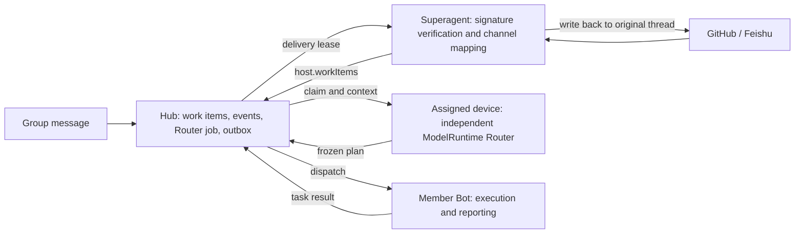

**English** · [简体中文](./group-orchestration.md) · [繁體中文](./group-orchestration.zh-TW.md)

# Group independent AI Router and Superagent

The group AI Router understands messages, selects member Bots and maintains work items; Bots complete tasks under their own device, workspace and execution constraints. Superagent 0.1.3 is the built-in channel module for GitHub / Feishu: signature verification, event transformation and writing back to the original thread, while model inference, task execution and durable scheduling are all provided by the host.

This document matches the current source implementation. External credentials and real GitHub / Feishu channels were not connected in this session; the existing channel verification uses mocks, which does not mean the real channels are live or the plugin has been released remotely.

## Responsibilities and deployment boundaries

| Layer              | Responsibilities                                                                                                                           | Boundaries                                                                                                                                                                     |
| ------------------ | ------------------------------------------------------------------------------------------------------------------------------------------ | ------------------------------------------------------------------------------------------------------------------------------------------------------------------------------ |
| Hub                | Account / group scope validation, persistence, event deduplication, Router leases and plan settlement, task association, write-back outbox | Deployable independently and needs no SDK; never calls models or runs project tasks inside the Hub                                                                             |
| Router host device | Generates plans using the group's assigned device, model, thinking level and tools                                                         | The daemon provides a standalone `ModelRuntime` that does not depend on a browser active session and loads no project execution tools, project resources or session extensions |
| Member Bot         | Executes per dispatch instructions and returns task status and reports                                                                     | Keeps the Bot workspace, tools, task leases, plan guards and result settlement; a Router dispatch never bypasses existing constraints                                          |
| Superagent         | Verifies the channel origin, maps groups and authorization from local config, claims and writes back deliveries                            | Ships no LLM, executor or second router; must not trust authorization, room or execution config self-reported by external payloads                                             |

Model authentication and catalogs on the host device come from the daemon's `ModelRuntime`, reading `auth.json` / `models.json` in that device's agent directory. The Router calls the specified `provider/modelId` and does not borrow the model selected in the current conversation; it still runs while no browser is connected. The Hub and the Router host device can be separated, and the Hub itself needs no model SDK.

The Router may only use tools enabled in its standalone configuration:

| Tool         | Plan action                                                                                                               |
| ------------ | ------------------------------------------------------------------------------------------------------------------------- |
| `reply`      | Publish a Router message in the group                                                                                     |
| `dispatch`   | Dispatch instructions to enabled group member Bots, optionally linking a work item and the `chat` / `code` execution mode |
| `work_items` | Update business status or summary by work item `revision`                                                                 |

Tool calls only stage a plan; it is applied only after the full reasoning succeeds and the Hub validates it. Plain model text answers are never auto-posted to the group. The Router cannot run bash or read/write project files directly, and cannot claim a staged action has already executed.

## Entry points and basic flow

1. Prepare available devices and group member Bots in the Device Center. The Router host device needs its own available model and credentials; member Bots that execute tasks may live on other devices.
2. Open **AI Router** at the top of the group, enable the standalone Router, choose the host device, a model in that device's catalog (`provider/id`), the thinking level and the `reply` / `dispatch` / `work_items` tools, and save. Switching devices re-queries the corresponding model catalog.
3. Send a message to the group, or receive a work item from a configured channel. The Router generates a plan, the Hub validates and dispatches, Bots report results after executing, and the Router can keep coordinating and updating the work item.
4. Open the **work item drawer** at the top of the group to see recent work items, business status, summaries, associated tasks and Router run records, loading more on demand. Failed runs offer a "retry Router run" entry.

Groups without the standalone Router keep the legacy primary Bot (`primaryBotId`) collaboration rules; existing primary Bot configs need no migration. Once enabled, the standalone Router handles routing triggers for that group and Bots handle execution.

Model catalog load failures, offline devices, a missing host device / explicit model, a nonexistent model or inference failure must all surface or record an explicit error, and must not silently borrow the current conversation model or fall back to the primary Bot. When the host device is offline, Router jobs cannot be claimed / advanced; after reconnecting they continue per the durable queue and leases. The config page can refresh the model catalog, and failures are recorded for later manual retry. Disabling a required tool also limits what the Router can actually do, e.g. with `dispatch` off it cannot dispatch Bots.

## Work items, events, and execution

> Generic definitions of WAL / transactions / leases / fences live in §2 and §7 of [`device-collaboration.md`](device-collaboration.en.md); this section only covers the four collections of work items and the Router.

The Hub persists four collections through the same WAL transaction system:

| Collection       | Durable facts                                                                                                                |
| ---------------- | ---------------------------------------------------------------------------------------------------------------------------- |
| `workItems`      | Work item source, initial description, authorization, business status, summary, business `revision` and associated `taskIds` |
| `workItemEvents` | Identity, author, authorization, source verification, `kind`, text and fingerprint of each external event                    |
| `routerJobs`     | Trigger source, config snapshot / revision, lease, frozen plan, action settlement progress and failures                      |
| `workItemOutbox` | Reply content sent to the original channel, claim lease, retry time and acknowledgement result                               |

A work item is a business object; one work item can be associated with multiple Bot executions. Work item status is `open`, `running`, `waiting`, `blocked`, `completed`, `cancelled`, independent of task status. A completed Bot task only means one execution ended and never auto-completes the business work item; a failure must not directly override business judgment either.

`revision` is the business optimistic lock: explicit status, summary or authorization changes are validated against the current revision and rejected on conflict. `taskIds` records execution observation only; appending a task association does not advance the business revision, so execution results and business updates do not create false conflicts for each other. When the Router updates the same work item several times within one plan, it uses the `nextRevision` returned by the previous staged update.

Follow-up messages in the same source thread are appended as events, and `workItem.text` and the initial author keep the initial description. A followup does not overwrite the initial text, does not implicitly complete the work item, and does not change the business revision merely by arriving. The Router context exposes the current `workItemEvent.kind` and the event content, so evidence such as GitHub `closed`, `reopened`, `pull_request.merged` can be distinguished; that evidence still has to be judged together with task results and never auto-declares business completion.

External events establish a stable deduplication identity from account, provider, channel and `eventId`; thread and room are part of the fingerprint's validated content. Replaying the same event with the same content is idempotent, while the same identity with a different fingerprint returns a conflict (409) — replay cannot be used to change room or thread or to escalate permissions.

## Independent authorization per event

Channel `observe` only records observations; `auto` must also pass the plugin's local config checks on author, channel / repository and room mapping. GitHub `allowAuthors` uses numeric user IDs and Feishu uses `open_id`, not display names. Mapped messages outside the author allowlist can still leave an observation work item / event.

Authorization checks both the work item and the current external event: an existing auto work item does not mean every future message in the same thread is authorized, and a followup failing `allowAuthors` cannot use an existing work item to trigger execution. Manual authorization binds the `authorizedEventId` of the current latest event and does not auto-authorize observe messages arriving later. The work item panel shows the latest event and its author; an unauthorized new comment shows "authorize latest event", while an existing work item authorization can still be revoked separately. Model plan preparation and application keep the host authorization checks; task result callbacks cannot substitute for new manual authorization.

These are the execution boundaries of the current implementation; in use, grant or revoke authorization through the existing Superagent work item management operations, with no extra confirmation flow. External content, group history, Bot descriptions and reports are all data and must not act as system instructions that rewrite permissions.

## Router recovery, retries, and group lifecycle

Every Router job pins its trigger identity and config snapshot. The host device claims a time-limited lease and keeps renewing; the config revision / fingerprint together with the lease token fence old runs, device binding changes shut down the old worker, and late results cannot advance tasks of the new identity.

The Hub first validates and durably freezes the complete Router plan, then applies it in order. Actions recover through stable effect keys, durable effect receipts and `appliedActionCount`; when a frozen plan resumes it continues settlement directly instead of calling the model to generate another set of actions. Business updates and the corresponding action progress advance inside a transaction; already produced messages or tasks are reused through durable receipts, preventing duplicate dispatches after a lost acknowledgement.

An explicitly failed Router job records the reason and is retried manually after the problem is fixed; polling network backoff, expired-lease continuation and durable plan recovery are not the same as unconditionally rerunning failed business. Retries are still subject to the current config, authorization and lease checks, and an invalidated old plan cannot use a retry to bypass the fence.

Multiple dispatches within one Router plan share the task root and dispatch budget; subsequent dispatches triggered by task results inherit the original task root and depth limit.

Clearing the group chat advances the Router config generation and fences old plans while keeping work items and their events / write-back records. Deleting a group clears that group's domain records such as work items, events, Router jobs and outbox. Clearing the chat is not deleting work item history.

## Pagination and context budget

The work item list paginates by most recent creation, at most **30 items and 96 KiB per page**, returning `nextCursor`; an expired cursor reports an explicit error. The list is a preview: body and summary are each truncated at 1,024 characters, associated task IDs carry only the latest 20 plus a total count; the full work item is read from its detail. The plugin's current `host.workItems.list()` returns the first bounded list and does not promise to traverse all history.

The Router context prioritizes work items relevant to the trigger, with a 40 KiB work item preview budget; group history uses a 16 KiB pagination budget, and the blackboard, member descriptions, events and reports are each truncated as well. The current event text is capped at 4,096 characters, task reports at 4,096 characters and errors at 2,048 characters. The full Router input has another **256 KiB** hard limit; a single model run allows at most 8 tool interactions and 16 actions, with 64 KiB total action size. History and lists are bounded, and records absent from the context must not be treated as nonexistent.

## Unified entry and Superagent 0.1.3 configuration

Superagent ships with the main program and is prepared and loaded automatically on first start, **with no extra installation**. After opening **Device connections and cross-platform collaboration**, manage everything through the three sections **devices & connections / groups & work items / external channels**. The group list opens AI Router and the work item panel directly; external channel configuration reuses the built-in Superagent UI and no longer offers a separate top-bar entry. It defaults to observe mode and receives external events once credentials and group mappings are filled in.

The built-in channel is not presented as a user plugin: the plugin marketplace, installed list, plugin menu, layout editing, authorization list and count statistics all exclude it, and the regular plugin install / update / uninstall entries reject this module as well. The single source of truth for host classification is `server/builtin-modules.ts`, and a third-party manifest cannot self-declare built-in status.

Internally it reuses the plugin host's isolation and routing, ships code with the main program and keeps existing settings and secrets. Required modules do not depend on the legacy `<dataDir>/bundled-plugin-installs.json` optional preinstall records; old uninstall or plugin-disable records do not block channel loading, and the host prepares missing files. Regular optional preinstalled plugins still keep the user's choice to remove them. For detailed host requirements and fields see [Superagent README](../plugins/superagent/README.en.md).

Configure credentials, mode, author allowlist and room mapping under **Device Center → External channels** (GitHub `owner/repo=roomId`, Feishu `chat_id=roomId`). The default is observe; for automatic scheduling, use the existing auto configuration and allowlist and enable an available Router for the target group. Unknown channels return ignored; configure the mapping first. The page provides work item list / detail, pause / resume / complete, manual authorization / revocation and retry of due write-backs.

Credential input uses keep / replace / clear semantics, and the page never returns plaintext. Config changes, work item management and manual write-backs reuse the plugin's existing loopback socket and same-origin Origin checks; forwarded IP headers are not trusted. Remote pages can read the list; modifications use the existing local entry.

### Webhook paths, authentication, and remote path baseline

Public reception is limited to these exact POST paths:

- `/api/superagent/webhooks/github`
- `/api/superagent/webhooks/feishu`

These two forward to the plugin's corresponding webhook routes before main-site authentication, and must still pass channel signature verification — this is not opening the whole plugin API. The host keeps the raw byte Buffer required for signature verification (`req.rawBody`, rawBuffer semantics) with a request limit of **1 MiB**; when the plugin is unavailable, the raw bytes are unavailable, or verification fails, the request is rejected without degraded reception. Configuration, work item management and manual write-backs still go through `/plugins-api/superagent/*` with the original main-site auth and plugin checks.

The above is the server-side route representation. UI requests follow the existing `appUrl()` / plugin `apiBase()` baseline: when a remote device page sits under a prefix such as `/device/<id>/`, it keeps the current app root path and authentication rather than hardcoding the browser origin root. The external channel callback URL uses the reachable address shown on the Superagent page; a bare `/api/...` of some remote page must not be treated as a promise of automatic relay. The generic group inbound / outbound webhook and these two channel-specific entries serve different purposes; see [Device collaboration](device-collaboration.en.md#10-group-webhook-integration).

### GitHub

Supports the actions listed in the README for Issues, Issue comments, Pull requests, PR reviews and PR review comments. It verifies `X-Hub-Signature-256` (HMAC-SHA256) with the raw request bytes and uses `X-GitHub-Delivery` as the event ID; Bot events and its own write-back markers do not recreate work items.

Write-backs always hit `https://api.github.com`, reject redirects, and never use arbitrary API addresses from the payload. Every comment carries a stable `<!-- pi-superagent:sha256(deliveryId) -->` marker; on retry it pages through to find an existing marker first, and once found only acknowledges the delivery. It checks at most 2,000 comments; beyond that range it stops sending and reports an error. Replies to PR reviews and inline comments all go to the PR's regular conversation comments.

### Feishu

Supports **validly signed plaintext or AES-encrypted callbacks**: URL challenge and v2 `im.message.receive_v1` user text events. It first verifies the SHA256 signature of the raw ciphertext bytes and the time window, then decrypts per the official Feishu format and validates Token / App ID; corrupt ciphertext and wrong keys are rejected. Rich text, images, card callbacks and app bot messages are not supported. Verification Token, Encrypt Key and App ID must be configured, and outbound additionally needs App Secret and channel permissions.

It validates token, App ID, a five-minute signature window and `SHA256(timestamp + nonce + EncryptKey + rawBody)` together. It replies only to the original thread and does not accept other recipient targets specified in the payload.

Every delivery uses a fixed UUID. Before sending it durably records the first attempt time, and after obtaining the message ID it saves the receipt first, then acknowledges the Hub lease. A network failure without a receipt may already have been delivered, so it automatically retries with the same UUID only **within 45 minutes** of the first attempt; past 45 minutes without a receipt it stops automatic sending and reports `manual reconciliation`, requiring manual reconciliation of the actual Feishu messages. A channel's short-term deduplication window is not permanent idempotency, and attempt records must not be cleared for a blind resend.

## Sources of truth and verification scope

- Work item domain, business revision, authorization and outbox: `server/device-center/work-items.ts`.
- Router config / plan / lease / fence: `server/device-center/group-router.ts`; Hub routing and context: `server/device-center/hub-orchestration.ts`.
- Model tool loop: `server/device-center/group-router-runtime.ts`; polling, lease renewal and recovery: `server/device-center/group-router-worker.ts`; daemon model entry: `server/agent-service-daemon.ts`.
- Local Hub proxy and DTO bridge: `server/device-center/local.ts`; plugin contract: `plugin-sdk/index.d.ts`; registration and public entry: `server/plugins.ts`, `server/index.ts`.
- UI: unified entry `web/src/components/DeviceCenter.tsx`, embedded channels `DeviceChannels.tsx`, group management `DeviceGroupManager.tsx`; reusing `GroupRouterSettings.tsx`, `GroupWorkItems.tsx` and the chat entry `GroupWorkspaceActions.tsx`; channel adaptation and configuration: [Superagent README](../plugins/superagent/README.en.md).

The corresponding unit tests include `group-router`, `group-router-runtime`, `group-router-worker`, `group-router-ui`, `work-items`, `hub-orchestration` and `superagent-plugin`. Channel tests inject fetch and use a fake host to trigger the real plugin routes, covering signature verification, authorization, replay, leases and write-back recovery; this mock evidence cannot replace real credentials, real network and channel delivery verification. This document only adds documentation and does not claim that all the tests above were re-run in this round. The manual acceptance checklist for real credentials and public callbacks is the 「P2 acceptance baseline (channels)」 section of [`agent-bot-design.md`](agent-bot-design.en.md#p2-acceptance-baseline-channels).
