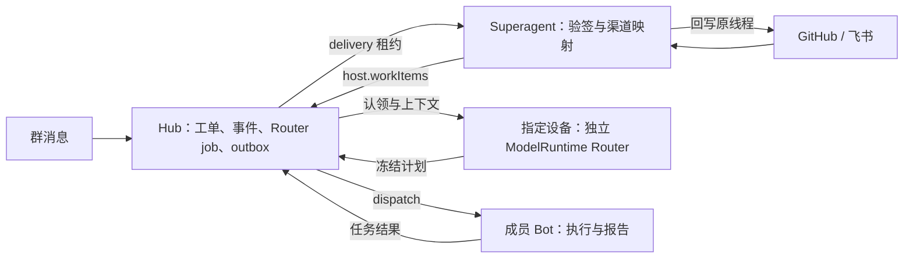

# 群组独立 AI Router 与 Superagent

群组 AI Router 负责理解消息、选择成员 Bot 和维护工单；Bot 负责在自己的设备、工作区和执行约束下完成任务。Superagent 0.1.3 是 GitHub / 飞书的内置渠道模块：验签、转换事件和回写原线程，模型推理、任务执行和持久调度均由宿主提供。

本文对应当前源码实现。外部凭据和真实 GitHub / 飞书渠道未在本轮会话联通，现有渠道验证使用 mock，不代表真实渠道已上线或插件已远端发布。

## 职责与部署边界

| 层              | 负责的事情                                                                        | 边界                                                                                                |
| --------------- | --------------------------------------------------------------------------------- | --------------------------------------------------------------------------------------------------- |
| Hub             | 账号 / 群范围校验、持久化、事件去重、Router 租约与计划结算、任务关联、回写 outbox | 可独立部署且无须 SDK；不在 Hub 内调用模型或执行项目任务                                             |
| Router 运行设备 | 使用该群指定的设备、模型、思考级别和工具生成计划                                  | daemon 提供独立 `ModelRuntime`，不依附浏览器 active session，不加载项目执行工具、项目资源或会话扩展 |
| 成员 Bot        | 按 dispatch 指令执行，返回任务状态和报告                                          | 沿用 Bot 工作区、工具、任务租约、计划守卫和结果结算；不会因 Router 派发绕过既有约束                 |
| Superagent      | 验证渠道来源，按本地配置映射群组和授权，领取并回写 delivery                       | 不自带 LLM、执行器或第二套路由器；不能相信外部 payload 自报的授权、房间或执行配置                   |

运行设备的模型认证与目录由 daemon 的 `ModelRuntime` 提供，读取该设备 agent 目录中的 `auth.json` / `models.json`。Router 调用指定 `provider/modelId`，不借用当前对话选择的模型；浏览器未连接时仍可运行。Hub 与 Router 运行设备可以分离，Hub 本身无须安装模型 SDK。

Router 只可使用独立配置中启用的工具：

| 工具         | 计划动作                                                           |
| ------------ | ------------------------------------------------------------------ |
| `reply`      | 在群内发布 Router 消息                                             |
| `dispatch`   | 给启用的群成员 Bot 派发指令，可关联工单及 `chat` / `code` 执行模式 |
| `work_items` | 按工单 `revision` 更新业务状态或摘要                               |

工具调用只暂存计划，完整推理成功并由 Hub 校验后才应用。模型普通文本回答不会自动发到群内。Router 不能直接运行 bash、读写项目文件，也不能声称暂存动作已经执行。

## 使用入口与基本流程

1. 在设备中心准备可用设备与群成员 Bot。Router 运行设备需要自己的可用模型和凭据；执行任务的成员 Bot 可以位于其他设备。
2. 打开群组顶部 **AI Router**，启用独立 Router，选择运行设备、该设备目录中的模型（`provider/id`）、思考级别及 `reply` / `dispatch` / `work_items` 工具并保存。切换设备会重新查询对应模型目录。
3. 向群组发送消息，或由已配置渠道接收工单。Router 生成计划，Hub 校验和派发，Bot 执行后上报结果，Router 可继续协调及更新工单。
4. 打开群组顶部的**工单抽屉**，查看最近工单、业务状态、摘要、关联任务和 Router 运行记录，按需加载更多。失败运行提供“重试 Router 运行”入口。

未启用独立 Router 的群组沿用 legacy 主 Bot（`primaryBotId`）协作规则；已有主 Bot 配置无需迁移。启用后由独立 Router 处理该群的路由触发，Bot 承担执行。

模型目录加载失败、设备离线、缺少运行设备 / 明确模型、模型不存在或推理失败均应显示或记录明确错误，不静默借用当前对话模型或切回主 Bot。运行设备离线时无法领取 / 推进 Router job；恢复连接后按持久队列和租约继续。配置页可刷新模型目录，失败记录用于定位后人工重试。禁用所需工具也会限制 Router 的实际能力，例如关闭 `dispatch` 后不能派发 Bot。

## 工单、事件和执行的关系

Hub 通过同一 WAL 事务体系持久化四个集合：

| 集合             | 持久事实                                                                   |
| ---------------- | -------------------------------------------------------------------------- |
| `workItems`      | 工单来源、初始描述、授权、业务状态、摘要、业务 `revision` 与关联 `taskIds` |
| `workItemEvents` | 外部每次事件的身份、作者、授权、来源验证、`kind`、文本和 fingerprint       |
| `routerJobs`     | 触发源、配置快照 / revision、租约、冻结计划、动作结算进度和失败            |
| `workItemOutbox` | 发往原渠道的回复内容、领取租约、重试时间及确认结果                         |

工单是业务对象，一个工单可关联多次 Bot 执行。工单状态为 `open`、`running`、`waiting`、`blocked`、`completed`、`cancelled`，与 task 状态独立。Bot task 完成仅表示一次执行结束，不自动使业务工单完成；失败也不应直接覆盖业务判断。

`revision` 是业务乐观锁：显式状态、摘要或授权变更按当前 revision 校验，冲突拒绝。`taskIds` 仅记录执行观察，追加任务关联不推进业务 revision，避免执行结果与业务更新相互制造假冲突。Router 在一次计划中连续更新同一工单时，使用前一暂存更新返回的 `nextRevision`。

同一来源线程的后续消息追加为事件，`workItem.text` 与初始作者保持初始描述。followup 不覆盖初始文本、不隐式完成工单，也不因到达就改变业务 revision。Router 上下文提供当前 `workItemEvent.kind` 及事件内容，因此可区分 GitHub `closed`、`reopened`、`pull_request.merged` 等证据；这些证据仍需结合任务结果判断，不自动认定业务完成。

外部事件以账号、provider、channel 和 `eventId` 建立稳定去重身份；线程和房间等属于 fingerprint 的校验内容。相同事件同内容重放幂等，同身份不同 fingerprint 返回冲突（409），不能借重放更换房间、线程或提升权限。

## 每个事件独立授权

渠道 `observe` 仅记录观察；`auto` 也必须通过插件本地配置的作者、渠道 / 仓库和房间映射检查。GitHub `allowAuthors` 使用数字用户 ID，飞书使用 `open_id`，不是显示名。未在作者白名单内的已映射消息仍可留下观察工单 / 事件。

授权同时检查工单与当前外部事件：已有 auto 工单不等于同线程未来所有消息均获授权，未通过 `allowAuthors` 的 followup 不能借已有工单唤起执行。人工授权绑定当前最新事件的 `authorizedEventId`，不会自动授权未来到达的 observe 消息。工单面板会展示最新事件及其作者，未授权的新留言显示“授权最新事件”，已有工单授权仍可独立撤销。模型计划准备及应用沿用宿主授权校验；任务结果回调也不能充当新的人工授权。

这些是现有实现的执行边界；使用时通过已有 Superagent 工单管理操作授权或撤权，无额外确认流程。外部内容、群历史、Bot 描述和报告均是数据，不能作为系统指令改写权限。

## Router 恢复、重试与群生命周期

每个 Router job 固定触发身份和配置快照。运行设备领取有时限的 lease，持续续租；配置 revision / fingerprint 与 lease token 共同 fence 旧运行，设备绑定变化会关闭旧 worker，迟到结果不能推进新身份的任务。

Hub 先验证并持久冻结完整 Router plan，再按顺序应用。动作通过稳定 effect key、持久派发回执（effect receipts）与 `appliedActionCount` 恢复；已冻结计划恢复时直接继续结算，不再调用模型生成另一套动作。业务更新和相应动作进度在事务内推进；已产生的消息或 task 通过持久回执复用，避免确认丢失后重复派发。

显式失败的 Router job 记录原因，修复问题后人工重试；轮询网络退避、过期租约接续和持久计划恢复不等于无条件重跑失败业务。重试仍受当前配置、授权和租约检查，已失效的旧计划不能借重试绕过 fence。

同一 Router 计划内的多次派发共享任务根和派发预算；任务结果触发的后续派发继承原任务根及深度限制。

清空群聊会推进 Router 配置代次，fence 旧 plan，同时保留工单及其事件 / 回写记录。删除群组会清理该群工单、事件、Router jobs 与 outbox 等域记录。清空聊天不是删除工单历史。

## 分页与上下文预算

工单列表按最近创建顺序分页，每页最多 **30 条、96 KiB**，返回 `nextCursor`；游标过期明确报错。列表为预览，正文与摘要各截至 1,024 字符，关联 task IDs 只带最近 20 个并附总数；完整工单从详情读取。插件当前 `host.workItems.list()` 返回首个有界列表，不承诺遍历全部历史。

Router 上下文优先包含触发相关工单，工单预览预算 40 KiB；群历史使用 16 KiB 分页预算，黑板、成员描述、事件、报告也分别截断。当前事件文本最多 4,096 字符，任务报告最多 4,096 字符、错误最多 2,048 字符。完整 Router 输入另有 **256 KiB** 硬限制；单次模型运行最多 8 轮工具交互、16 个动作，动作总量最多 64 KiB。历史和列表有界，不能把未出现在上下文中的记录当作不存在。

## 统一入口与 Superagent 0.1.3 配置

Superagent 随主程序内置，首次启动自动准备并加载，**无需额外安装**。打开 **设备连接与跨平台协作** 后，统一通过 **设备与连接 / 群组与工单 / 外部渠道** 三个分区管理。群组列表可直接打开 AI Router 与工单面板；外部渠道配置复用内置 Superagent 界面，不再提供独立顶栏入口。默认观察模式，填写凭据和群组映射后接收外部事件。

内置渠道不作为用户插件展示：插件市场、已安装列表、插件菜单、布局编辑、授权列表和数量统计均排除它，普通插件安装 / 更新 / 卸载入口也拒绝该模块。宿主分类的唯一源为 `server/builtin-modules.ts`，第三方 manifest 不能自报内置身份。

内部复用插件宿主的隔离与路由能力，随主程序同步代码并保留现有设置与密钥。必需模块不依赖旧的 `<dataDir>/bundled-plugin-installs.json` 可选预装记录；旧卸载或插件禁用记录不会阻止渠道加载，缺失文件由宿主准备。普通可选预装插件仍保留用户主动移除的选择。具体宿主要求及字段见 [Superagent README](../plugins/superagent/README.md)。

在 **设备中心 → 外部渠道** 配置凭据、模式、作者白名单和房间映射（GitHub `owner/repo=roomId`，飞书 `chat_id=roomId`）。默认 observe；要自动调度，使用现有 auto 配置与允许名单，并为目标群启用可用 Router。未知渠道返回 ignored，先配置映射。页面提供工单列表 / 详情、暂停 / 恢复 / 完成、人工授权 / 撤权及到期回写重试。

凭据输入使用保留 / 替换 / 清空语义，页面不返回明文。配置修改、工单管理及手动回写沿用插件已有的 loopback socket 和同源 Origin 检查；不信任转发 IP 请求头。远程页面可读取列表，修改使用现有本机入口。

### Webhook 路径、认证与远程路径基线

公开接收仅限下列精确 POST 路径：

- `/api/superagent/webhooks/github`
- `/api/superagent/webhooks/feishu`

这两条在主站认证之前转发至插件对应 webhook 路由，仍必须通过渠道验签，不是开放整个插件 API。宿主保存验签所需的原始字节 Buffer（`req.rawBody`，rawBuffer 语义），请求上限 **1 MiB**；插件不可用、原始字节不可用或验签失败时拒绝，不降级接收。配置、工单管理和手动回写仍走 `/plugins-api/superagent/*` 的原有主站认证与插件校验。

以上是服务端路由表示。UI 请求遵循既有 `appUrl()` / 插件 `apiBase()` 基线：远程设备页面位于 `/device/<id>/` 等前缀下时，保留当前应用根路径及认证，不硬编码浏览器 origin 根路径。外部渠道的回调 URL 使用 Superagent 页面给出的可达地址，不能把某个远程页面的裸 `/api/...` 当作自动中转承诺。通用群入站 / 出站 webhook 与这两个渠道专用入口各有用途，参见 [设备协作](device-collaboration.md#10-群组-webhook-集成)。

### GitHub

支持 Issues、Issue comments、Pull requests、PR reviews 和 PR review comments 的 README 所列动作。使用原始请求字节校验 `X-Hub-Signature-256`（HMAC-SHA256），`X-GitHub-Delivery` 作为事件 ID；Bot 事件及自身回写标记不会重新创建工单。

回写固定访问 `https://api.github.com`，拒绝重定向，不使用 payload 中的任意 API 地址。每条评论含稳定 `<!-- pi-superagent:sha256(deliveryId) -->` marker，重试先分页查找已有标记，找到后只确认 delivery。最多检查 2,000 条评论，超过范围停止发送并报错。PR review 与行内评论的回复统一写入 PR 普通会话评论。

### 飞书

支持**有效签名的明文或 AES 加密回调**：URL challenge 与 v2 `im.message.receive_v1` 用户 text 事件。先验证原始密文字节的 SHA256 签名及时间窗，再按飞书官方格式解密并校验 Token / App ID；损坏密文和错误密钥拒绝。不支持富文本、图片、卡片回调或应用机器人消息。需配置 Verification Token、Encrypt Key、App ID，外发另需 App Secret 和渠道权限。

同时验证 token、App ID、五分钟签名时间窗及 `SHA256(timestamp + nonce + EncryptKey + rawBody)`。只回复原线程，不接受 payload 指定其他收件目标。

每条 delivery 使用固定 UUID。发送前持久记录首次尝试时间，取得消息 ID 后先保存回执，再确认 Hub 租约。无回执的网络失败可能已经送达，仅在首次尝试后 **45 分钟内**自动沿用 UUID 重试；超过 45 分钟仍无回执则停止自动发送，报 `manual reconciliation`，需要人工核对飞书实际消息。不能把渠道短期去重窗口当永久幂等，也不能清空尝试记录后盲目重发。

## 事实源与验证范围

- 工单领域、业务 revision、授权和 outbox：`server/device-center/work-items.ts`。
- Router 配置 / plan / lease / fence：`server/device-center/group-router.ts`；Hub 路由与上下文：`server/device-center/hub-orchestration.ts`。
- 模型工具循环：`server/device-center/group-router-runtime.ts`；轮询、续租与恢复：`server/device-center/group-router-worker.ts`；daemon 模型入口：`server/agent-service-daemon.ts`。
- 本地 Hub 代理与 DTO 桥：`server/device-center/local.ts`；插件契约：`plugin-sdk/index.d.ts`；注册与公开入口：`server/plugins.ts`、`server/index.ts`。
- UI：统一入口 `web/src/components/DeviceCenter.tsx`，渠道内嵌 `DeviceChannels.tsx`，群组管理 `DeviceGroupManager.tsx`；复用 `GroupRouterSettings.tsx`、`GroupWorkItems.tsx` 及聊天入口 `GroupWorkspaceActions.tsx`；渠道适配与配置：[Superagent README](../plugins/superagent/README.md)。

对应单测包括 `group-router`、`group-router-runtime`、`group-router-worker`、`group-router-ui`、`work-items`、`hub-orchestration` 和 `superagent-plugin`。渠道测试注入 fetch、使用伪 host 触发真实插件路由，覆盖验签、授权、重放、租约与回写恢复；这些 mock 证据不能替代真实凭据、真实网络和渠道投递验证。本文仅补充文档，不声明本轮重新执行过上述全部测试。
