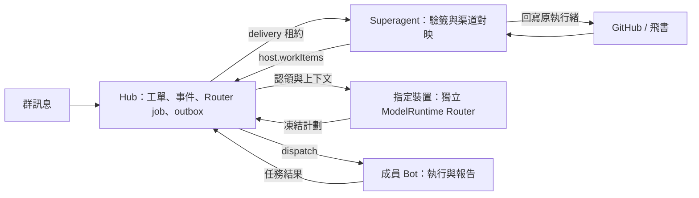

[English](./group-orchestration.en.md) · [简体中文](./group-orchestration.md) · **繁體中文**

# 群組獨立 AI Router 與 Superagent

群組 AI Router 負責理解訊息、選擇成員 Bot 和維護工單；Bot 負責在自己的裝置、工作區和執行約束下完成任務。Superagent 0.1.3 是 GitHub / 飛書的內建渠道模組：驗籤、轉換事件和回寫原執行緒，模型推理、任務執行和持久排程均由宿主提供。

本文對應當前原始碼實現。外部憑據和真實 GitHub / 飛書渠道未在本輪會話聯通，現有渠道驗證使用 mock，不代表真實渠道已上線或外掛已遠端釋出。

## 職責與部署邊界

| 層              | 負責的事情                                                                        | 邊界                                                                                                    |
| --------------- | --------------------------------------------------------------------------------- | ------------------------------------------------------------------------------------------------------- |
| Hub             | 賬號 / 群範圍校驗、持久化、事件去重、Router 租約與計劃結算、任務關聯、回寫 outbox | 可獨立部署且無須 SDK；不在 Hub 內呼叫模型或執行專案任務                                                 |
| Router 執行裝置 | 使用該群指定的裝置、模型、思考級別和工具生成計劃                                  | daemon 提供獨立 `ModelRuntime`，不依附瀏覽器 active session，不載入專案執行工具、專案資源或會話擴充套件 |
| 成員 Bot        | 按 dispatch 指令執行，返回任務狀態和報告                                          | 沿用 Bot 工作區、工具、任務租約、計劃守衛和結果結算；不會因 Router 派發繞過既有約束                     |
| Superagent      | 驗證渠道來源，按本地配置對映群組和授權，領取並回寫 delivery                       | 不自帶 LLM、執行器或第二套路由器；不能相信外部 payload 自報的授權、房間或執行配置                       |

執行裝置的模型認證與目錄由 daemon 的 `ModelRuntime` 提供，讀取該裝置 agent 目錄中的 `auth.json` / `models.json`。Router 呼叫指定 `provider/modelId`，不借用當前對話選擇的模型；瀏覽器未連線時仍可執行。Hub 與 Router 執行裝置可以分離，Hub 本身無須安裝模型 SDK。

Router 只可使用獨立配置中啟用的工具：

| 工具         | 計劃動作                                                           |
| ------------ | ------------------------------------------------------------------ |
| `reply`      | 在群內釋出 Router 訊息                                             |
| `dispatch`   | 給啟用的群成員 Bot 派發指令，可關聯工單及 `chat` / `code` 執行模式 |
| `work_items` | 按工單 `revision` 更新業務狀態或摘要                               |

工具呼叫只暫存計劃，完整推理成功並由 Hub 校驗後才應用。模型普通文本回答不會自動發到群內。Router 不能直接執行 bash、讀寫專案檔案，也不能聲稱暫存動作已經執行。

## 使用入口與基本流程

1. 在裝置中心準備可用裝置與群成員 Bot。Router 執行裝置需要自己的可用模型和憑據；執行任務的成員 Bot 可以位於其他裝置。
2. 開啟群組頂部 **AI Router**，啟用獨立 Router，選擇執行裝置、該裝置目錄中的模型（`provider/id`）、思考級別及 `reply` / `dispatch` / `work_items` 工具並儲存。切換裝置會重新查詢對應模型目錄。
3. 向群組傳送訊息，或由已配置渠道接收工單。Router 生成計劃，Hub 校驗和派發，Bot 執行後上報結果，Router 可繼續協調及更新工單。
4. 開啟群組頂部的**工單抽屜**，檢視最近工單、業務狀態、摘要、關聯任務和 Router 執行記錄，按需載入更多。失敗執行提供“重試 Router 執行”入口。

未啟用獨立 Router 的群組沿用 legacy 主 Bot（`primaryBotId`）協作規則；已有主 Bot 配置無需遷移。啟用後由獨立 Router 處理該群的路由觸發，Bot 承擔執行。

模型目錄載入失敗、裝置離線、缺少執行裝置 / 明確模型、模型不存在或推理失敗均應顯示或記錄明確錯誤，不靜默借用當前對話模型或切回主 Bot。執行裝置離線時無法領取 / 推進 Router job；恢復連線後按持久佇列和租約繼續。配置頁可重新整理模型目錄，失敗記錄用於定位後人工重試。停用所需工具也會限制 Router 的實際能力，例如關閉 `dispatch` 後不能派發 Bot。

## 工單、事件和執行的關係

> WAL / 事務 / 租約 / fence 的通用定義見 [`device-collaboration.md`](device-collaboration.md) §2 與 §7；本節只寫工單與 Router 的四個集合。

Hub 通過同一 WAL 事務體系持久化四個集合：

| 集合             | 持久事實                                                                   |
| ---------------- | -------------------------------------------------------------------------- |
| `workItems`      | 工單來源、初始描述、授權、業務狀態、摘要、業務 `revision` 與關聯 `taskIds` |
| `workItemEvents` | 外部每次事件的身份、作者、授權、來源驗證、`kind`、文本和 fingerprint       |
| `routerJobs`     | 觸發源、配置快照 / revision、租約、凍結計劃、動作結算進度和失敗            |
| `workItemOutbox` | 發往原渠道的回覆內容、領取租約、重試時間及確認結果                         |

工單是業務物件，一個工單可關聯多次 Bot 執行。工單狀態為 `open`、`running`、`waiting`、`blocked`、`completed`、`cancelled`，與 task 狀態獨立。Bot task 完成僅表示一次執行結束，不自動使業務工單完成；失敗也不應直接覆蓋業務判斷。

`revision` 是業務樂觀鎖：顯式狀態、摘要或授權變更按當前 revision 校驗，衝突拒絕。`taskIds` 僅記錄執行觀察，追加任務關聯不推進業務 revision，避免執行結果與業務更新相互制造假衝突。Router 在一次計劃中連續更新同一工單時，使用前一暫存更新返回的 `nextRevision`。

同一來源執行緒的後續訊息追加為事件，`workItem.text` 與初始作者保持初始描述。followup 不覆蓋初始文本、不隱式完成工單，也不因到達就改變業務 revision。Router 上下文提供當前 `workItemEvent.kind` 及事件內容，因此可區分 GitHub `closed`、`reopened`、`pull_request.merged` 等證據；這些證據仍需結合任務結果判斷，不自動認定業務完成。

外部事件以賬號、provider、channel 和 `eventId` 建立穩定去重身份；執行緒和房間等屬於 fingerprint 的校驗內容。相同事件同內容重放冪等，同身份不同 fingerprint 返回衝突（409），不能借重放更換房間、執行緒或提升許可權。

## 每個事件獨立授權

渠道 `observe` 僅記錄觀察；`auto` 也必須通過外掛本地配置的作者、渠道 / 倉庫和房間對映檢查。GitHub `allowAuthors` 使用數字使用者 ID，飛書使用 `open_id`，不是顯示名。未在作者白名單內的已對映訊息仍可留下觀察工單 / 事件。

授權同時檢查工單與當前外部事件：已有 auto 工單不等於同線程未來所有訊息均獲授權，未通過 `allowAuthors` 的 followup 不能借已有工單喚起執行。人工授權綁定當前最新事件的 `authorizedEventId`，不會自動授權未來到達的 observe 訊息。工單面板會展示最新事件及其作者，未授權的新留言顯示“授權最新事件”，已有工單授權仍可獨立撤銷。模型計劃準備及應用沿用宿主授權校驗；任務結果回撥也不能充當新的人工授權。

這些是現有實現的執行邊界；使用時通過已有 Superagent 工單管理操作授權或撤權，無額外確認流程。外部內容、群歷史、Bot 描述和報告均是資料，不能作為系統指令改寫許可權。

## Router 恢復、重試與群生命週期

每個 Router job 固定觸發身份和配置快照。執行裝置領取有時限的 lease，持續續租；配置 revision / fingerprint 與 lease token 共同 fence 舊執行，裝置繫結變化會關閉舊 worker，遲到結果不能推進新身份的任務。

Hub 先驗證並持久凍結完整 Router plan，再按順序應用。動作通過穩定 effect key、持久派發回執（effect receipts）與 `appliedActionCount` 恢復；已凍結計劃恢復時直接繼續結算，不再呼叫模型生成另一套動作。業務更新和相應動作進度在事務內推進；已產生的訊息或 task 通過持久回執複用，避免確認丟失後重復派發。

顯式失敗的 Router job 記錄原因，修復問題後人工重試；輪詢網路退避、過期租約接續和持久計劃恢復不等於無條件重跑失敗業務。重試仍受當前配置、授權和租約檢查，已失效的舊計劃不能借重試繞過 fence。

同一 Router 計劃內的多次派發共享任務根和派發預算；任務結果觸發的後續派發繼承原任務根及深度限制。

清空群聊會推進 Router 配置代次，fence 舊 plan，同時保留工單及其事件 / 回寫記錄。刪除群組會清理該群工單、事件、Router jobs 與 outbox 等域記錄。清空聊天不是刪除工單歷史。

## 分頁與上下文預算

工單列表按最近建立順序分頁，每頁最多 **30 條、96 KiB**，返回 `nextCursor`；游標過期明確報錯。列表為預覽，正文與摘要各截至 1,024 字元，關聯 task IDs 只帶最近 20 個並附總數；完整工單從詳情讀取。外掛當前 `host.workItems.list()` 返回首個有界列表，不承諾遍歷全部歷史。

Router 上下文優先包含觸發相關工單，工單預覽預算 40 KiB；群歷史使用 16 KiB 分頁預算，黑板、成員描述、事件、報告也分別截斷。當前事件文本最多 4,096 字元，任務報告最多 4,096 字元、錯誤最多 2,048 字元。完整 Router 輸入另有 **256 KiB** 硬限制；單次模型執行最多 8 輪工具互動、16 個動作，動作總量最多 64 KiB。歷史和列表有界，不能把未出現在上下文中的記錄當作不存在。

## 統一入口與 Superagent 0.1.3 配置

Superagent 隨主程式內建，首次啟動自動準備並載入，**無需額外安裝**。開啟 **裝置連線與跨平臺協作** 後，統一通過 **裝置與連線 / 群組與工單 / 外部渠道** 三個分割槽管理。群組列表可直接開啟 AI Router 與工單面板；外部渠道配置複用內建 Superagent 介面，不再提供獨立頂欄入口。預設觀察模式，填寫憑據和群組對映後接收外部事件。

內建渠道不作為使用者外掛展示：外掛市場、已安裝列表、外掛選單、佈局編輯、授權列表和數量統計均排除它，普通外掛安裝 / 更新 / 解除安裝入口也拒絕該模組。宿主分類的唯一源為 `server/builtin-modules.ts`，第三方 manifest 不能自報內建身份。

內部複用外掛宿主的隔離與路由能力，隨主程式同步程式碼並保留現有設定與金鑰。必需模組不依賴舊的 `<dataDir>/bundled-plugin-installs.json` 可選預裝記錄；舊解除安裝或外掛停用記錄不會阻止渠道載入，缺失檔案由宿主準備。普通可選預裝外掛仍保留使用者主動移除的選擇。具體宿主要求及欄位見 [Superagent README](../plugins/superagent/README.md)。

在 **裝置中心 → 外部渠道** 配置憑據、模式、作者白名單和房間對映（GitHub `owner/repo=roomId`，飛書 `chat_id=roomId`）。預設 observe；要自動排程，使用現有 auto 配置與允許名單，併為目標群啟用可用 Router。未知渠道返回 ignored，先配置對映。頁面提供工單列表 / 詳情、暫停 / 恢復 / 完成、人工授權 / 撤權及到期回寫重試。

憑據輸入使用保留 / 替換 / 清空語義，頁面不返回明文。配置修改、工單管理及手動回寫沿用外掛已有的 loopback socket 和同源 Origin 檢查；不信任轉發 IP 請求頭。遠端頁面可讀取列表，修改使用現有本機入口。

### Webhook 路徑、認證與遠端路徑基線

公開接收僅限下列精確 POST 路徑：

- `/api/superagent/webhooks/github`
- `/api/superagent/webhooks/feishu`

這兩條在主站認證之前轉發至外掛對應 webhook 路由，仍必須通過渠道驗籤，不是開放整個外掛 API。宿主儲存驗籤所需的原始位元組 Buffer（`req.rawBody`，rawBuffer 語義），請求上限 **1 MiB**；外掛不可用、原始位元組不可用或驗籤失敗時拒絕，不降級接收。配置、工單管理和手動回寫仍走 `/plugins-api/superagent/*` 的原有主站認證與外掛校驗。

以上是服務端路由表示。UI 請求遵循既有 `appUrl()` / 外掛 `apiBase()` 基線：遠端裝置頁面位於 `/device/<id>/` 等字首下時，保留當前應用根路徑及認證，不硬編碼瀏覽器 origin 根路徑。外部渠道的回撥 URL 使用 Superagent 頁面給出的可達地址，不能把某個遠端頁面的裸 `/api/...` 當作自動中轉承諾。通用群入站 / 出站 webhook 與這兩個渠道專用入口各有用途，參見 [裝置協作](device-collaboration.md#10-群組-webhook-整合)。

### GitHub

支援 Issues、Issue comments、Pull requests、PR reviews 和 PR review comments 的 README 所列動作。使用原始請求位元組校驗 `X-Hub-Signature-256`（HMAC-SHA256），`X-GitHub-Delivery` 作為事件 ID；Bot 事件及自身回寫標記不會重新建立工單。

回寫固定訪問 `https://api.github.com`，拒絕重定向，不使用 payload 中的任意 API 地址。每條評論含穩定 `<!-- pi-superagent:sha256(deliveryId) -->` marker，重試先分頁查詢已有標記，找到後只確認 delivery。最多檢查 2,000 條評論，超過範圍停止傳送並報錯。PR review 與行內評論的回覆統一寫入 PR 普通會話評論。

### 飛書

支援**有效簽名的明文或 AES 加密回撥**：URL challenge 與 v2 `im.message.receive_v1` 使用者 text 事件。先驗證原始密文位元組的 SHA256 簽名及時間窗，再按飛書官方格式解密並校驗 Token / App ID；損壞密文和錯誤金鑰拒絕。不支援富文本、圖片、卡片回撥或應用機器人訊息。需配置 Verification Token、Encrypt Key、App ID，外發另需 App Secret 和渠道許可權。

同時驗證 token、App ID、五分鐘簽名時間窗及 `SHA256(timestamp + nonce + EncryptKey + rawBody)`。只回復原執行緒，不接受 payload 指定其他收件目標。

每條 delivery 使用固定 UUID。傳送前持久記錄首次嘗試時間，取得訊息 ID 後先儲存回執，再確認 Hub 租約。無回執的網路失敗可能已經送達，僅在首次嘗試後 **45 分鐘內**自動沿用 UUID 重試；超過 45 分鐘仍無回執則停止自動傳送，報 `manual reconciliation`，需要人工核對飛書實際訊息。不能把渠道短期去重視窗當永久冪等，也不能清空嘗試記錄後盲目重發。

## 事實源與驗證範圍

- 工單領域、業務 revision、授權和 outbox：`server/device-center/work-items.ts`。
- Router 配置 / plan / lease / fence：`server/device-center/group-router.ts`；Hub 路由與上下文：`server/device-center/hub-orchestration.ts`。
- 模型工具迴圈：`server/device-center/group-router-runtime.ts`；輪詢、續租與恢復：`server/device-center/group-router-worker.ts`；daemon 模型入口：`server/agent-service-daemon.ts`。
- 本地 Hub 代理與 DTO 橋：`server/device-center/local.ts`；外掛契約：`plugin-sdk/index.d.ts`；註冊與公開入口：`server/plugins.ts`、`server/index.ts`。
- UI：統一入口 `web/src/components/DeviceCenter.tsx`，渠道內嵌 `DeviceChannels.tsx`，群組管理 `DeviceGroupManager.tsx`；複用 `GroupRouterSettings.tsx`、`GroupWorkItems.tsx` 及聊天入口 `GroupWorkspaceActions.tsx`；渠道適配與配置：[Superagent README](../plugins/superagent/README.md)。

對應單測包括 `group-router`、`group-router-runtime`、`group-router-worker`、`group-router-ui`、`work-items`、`hub-orchestration` 和 `superagent-plugin`。渠道測試注入 fetch、使用偽 host 觸發真實外掛路由，覆蓋驗籤、授權、重放、租約與回寫恢復；這些 mock 證據不能替代真實憑據、真實網路和渠道投遞驗證。本文僅補充文件，不宣告本輪重新執行過上述全部測試。真實憑據與公網回撥的人工驗收清單見 [`agent-bot-design.md`](agent-bot-design.md) 的「P2 驗收基線（渠道）」。
