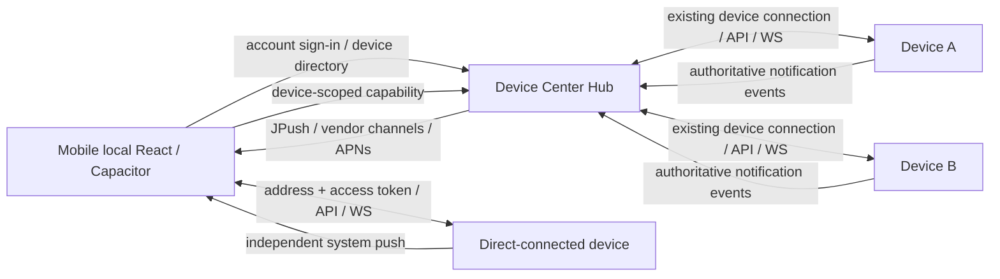

**English** · [简体中文](./mobile.md) · [繁體中文](./mobile.zh-TW.md)

# Mobile App: React + Capacitor

The mobile app uses a locally bundled React UI and Capacitor 8; the Android / iOS native projects live in `mobile/`. The entry screen offers two connection modes: sign in to a Device Center Hub account to manage multiple devices, or connect directly to a single device with its address and access token. Both modes use the local React UI to reach the remote HTTP / WebSocket, and tasks keep running on the original device.

## Sources of Truth

| Capability                                              | Implementation                                                                        |
| ------------------------------------------------------- | ------------------------------------------------------------------------------------- |
| Connection modes, authentication and credential restore | `mobile/src/ConnectionScreen.tsx`, `connections.ts`, `connection.ts`                  |
| Mobile entry, device selection and switching            | `mobile/src/main.tsx`, `hub.ts`                                                       |
| Notification state, permissions, subscriptions and taps | `mobile/src/push-controller.ts`, `Settings.tsx`                                       |
| Native push and secure storage                          | `mobile/native/push/`, exporting `PiPush` / `PiCredentials`                           |
| Local React using remote services                       | `web/src/mobile-runtime.ts`, `base-url.ts`, `auth-token.ts`                           |
| Hub sign-in, device directory and native capability     | `server/device-center/hub-mobile.ts`, `hub-auth.ts`, `relay.ts`                       |
| Authoritative server-side events                        | `server/mobile-notification-events.ts`, `agent-service.ts`, `agent-service-daemon.ts` |
| Reliable forwarding of device events to the Hub         | `server/device-center/mobile-notification-forwarder.ts`, `local.ts`                   |
| Central system push                                     | `server/mobile-push.ts`; Hub init and shutdown in `device-center/hub.ts`              |

## Connection Modes

The initial screen offers two entries: 「设备中心」(Device Center) and 「直连设备」(Direct device). KeyStore / Keychain stores the current mode, address and token; legacy credentials without a mode field are restored as Hub sign-in. One connection is used at a time; return to the entry screen via 「连接与通知 → 断开并更换连接方式」(Connection & notifications → Disconnect and change connection mode), which unbinds the old connection's notifications before switching credentials.

### Single-device direct connection

- Enter the target device's pi-web-ui address and access token (that device's configured `PI_WEB_TOKEN`). No Hub account is needed, and the device does not have to be bound to the center first. The server protocol and token are verified before connecting, then that device's workspace opens directly.
- Public networks require HTTPS; private IPv4 / IPv6, localhost and `.local` addresses may use HTTP. The address must not carry credentials, query parameters or conversation links; the token is sent only to the chosen address and redirects are not followed.
- The target server must have an access token enabled to accept native Origin; an empty password cannot bypass the native entry restriction.
- The push subscription lives on that device, and tapping a notification jumps straight to the original conversation; the Hub device directory and capabilities are not requested. Only notifications matching the current server instance are accepted, and notifications originating from a Hub source device are not opened as local ones.
- Opening another device from the Device Center entry requires switching to the matching Hub sign-in first; remote HTML is never opened inside the native shell.

### Device Center and multi-device connections



- In Hub mode only the Hub address and the installation's sign-in token are stored in KeyStore / Keychain; per-device local access passwords are not stored, and device capabilities are not persisted. Direct mode stores the target device address and its access token; the two credential kinds are never mixed.
- Account sessions are persisted on the Hub as a hash only, valid for 7 days. Native bearer tokens are isolated from browser Cookie sign-in and cannot be used as an admin Cookie.
- The mobile app first lists the devices owned by the account, then requests a fresh capability from the Hub when a device is selected. Offline or already-unbound devices do not switch to another device automatically.
- Switching devices reloads the **locally installed package** and re-establishes the connection to the target device; the device ID may be remembered locally, while the capability stays in memory only. Switching neither stops tasks on the original device nor unbinds the central notification subscription.
- A capability is valid for 8 hours and bound to the account, device, sign-in session and exact native Origin. Authorization is rechecked on every HTTP / WS handshake, and connected native WS checks for revocation periodically. Resuming after a long absence requests a new connection.
- Native Origin is limited to `capacitor://localhost` and `https://localhost`; native capabilities do not accept an opaque portal's `Origin: null`, and the original browser portal keeps its own boundary.
- The native relay serves the device API, WS, plus MIME-restricted theme CSS / fixed icons; it rejects remote HTML / JavaScript. Images and style resources use CORS explicitly; third-party images carry no Hub or device credentials.

The local React dynamically imports the shared UI only after `configureMobileRuntime` configures it. Native disables Service Worker, server buildId-driven page reloads, and downloading/executing remote plugin client / preload / renderer; server-side plugin capabilities keep running. Themes and attachments are accessed through safe resource URLs.

## Notification Pipeline and Guarantees

1. Authoritative events originate on the executing device, independent of WebSocket sinks; they enqueue even when the phone is off or no page is online.
2. In Device Center mode, the bound device persists a minimal event and then forwards it to the Hub. The Hub derives the account, device ID and device name from the device's real execution credentials and rejects devices that claim someone else's identity. In direct mode the target device handles its own authoritative events.
3. The Hub puts events into a per-account persistent outbox; a direct device uses the local outbox of the same push service. Both send system notifications to the installation's registration ID through the JPush REST API.
4. Android uses the `pi_tasks` (ordinary tasks) and `pi_attention` (questions / approvals / errors) notification channels; iOS shows visible notifications through APNs, without relying on background JavaScript or a persistent WebSocket.
5. On tap, the current server instance and connection mode are verified. Hub mode switches to the source device first when necessary; direct mode locates the original owner / conversation on the current device; the pending target across reloads is likewise bound to address, mode and instance. External execution sessions are viewed read-only through sharing, without reloading or seizing the original session; existing questionnaires and single-shot approval replies in pi sessions still go to the original owner. External native CLIs only show status and the native session ID, without attaching a PTY, registering a composer, or offering stop / reconnect controls; a CLI's native prompts and permission operations must still be handled in the writable window that owns that CLI. See [`architecture-terminal.md`](architecture-terminal.en.md).

Default text contains only the task state and the device display name; conversation bodies, working paths, tool arguments or user input are never uploaded to the push provider. Extras carry only event, instance, device, conversation and owner identifiers.

Permission and subscription are separate: a system notification grant does not mean subscribed. Enabling requires an explicit action; after a denial the user can grant in system settings and then come back to enable. Disabling stops the local SDK first and revokes the subscription on the current Hub or direct device; an offline disable saves a pending intent and finishes unbinding after recovery. Unbind the subscription before disconnecting the current connection or changing connection mode.

The notification settings entry supports refreshing state, per-event-type toggles, system settings and an explicit test notification. The test endpoint returns 「已排队」(queued), which is no proof that the device received anything.

### Queue Boundaries

- Device forwarding queue: separate `device-mobile-notifications.json`, at most 256 entries / 1 MiB, events valid for 24 hours, up to 32 attempts per entry, retries starting at 5 seconds and increasing to 1 hour, 15 seconds total limit per request.
- Hub / direct-device push: separate `mobile-push.json`, at most 1,000 devices, 2,000 outbox items, 4,096 dedupe records; events expire after 24 hours, devices expire after 30 days without a refresh, at most 5 deliveries per device.
- Files are written atomically with `0600` permissions; provider secrets and device execution credentials are never written into these queues.
- 429 / 5xx / network errors retry a bounded number of times; auth failures and permanent errors are not resent indefinitely. After a device rebind or a revoked UI grant, old queues are not sent to the new account.
- Dedupe is independent per account, source device and event; devices that succeeded are not retried again because another device failed.
- If the process crashes after the provider accepts but before the success state is persisted, a resend window remains. The system does not guarantee strict exactly-once, and a provider 2xx is not proof of device delivery.

The current authoritative lifecycle covers pi `ClientSession`, including final retry state, questionnaires, approvals and subtask completion; native CLIs hook into the same event interface. DSH / universal / durable still need each engine to implement equivalent authoritative hooks; listening to `run_end` alone cannot infer completion.

## Server Deployment

Device Center mode: deploy / update the Hub and the executing devices first, then bind the devices to the same account. The phone does not have to be on the same LAN as every device, but devices must be able to reach the Hub.

Direct mode: deploy / update pi-web-ui on the target device, configure `PI_WEB_TOKEN`, and make sure the phone can reach its address; no Hub is needed. Connections and conversations still work without push keys configured, but push configuration must be completed before notifications can be enabled.

Configure the following push parameters in **the server environment of the current Hub or direct device**. Every server serving the same mobile installation package must match that package's JPush AppKey; the MasterSecret always stays server-side only:

| Variable                       | Meaning                                                                                                |
| ------------------------------ | ------------------------------------------------------------------------------------------------------ |
| `PI_WEB_JPUSH_APP_KEY`         | JPush app AppKey, matching the installation package                                                    |
| `PI_WEB_JPUSH_MASTER_SECRET`   | REST MasterSecret, stored server-side only                                                             |
| `PI_WEB_JPUSH_APNS_PRODUCTION` | Must be explicitly `true` (production APNs) or `false` (development APNs); unset disables iOS delivery |

Do not put the MasterSecret in `mobile/.env`, front-end build parameters, the installation package or notification payloads. Executing devices hand notifications to the Hub through their existing binding, so no per-device JPush keys are needed; only devices that host push directly need their own configuration.

Reliable lockscreen / post-reclaim delivery on Chinese Android builds additionally requires configuring the matching vendor channels in the JPush console and integrating the corresponding SDK. The JPush own-channel connection alone cannot represent that every domestic phone still receives notifications after the app process is reclaimed. See [JPush Android vendor channel integration](https://docs.jiguang.cn/jpush/client/Android/android_3rd_guide).

## Installing Dependencies and Building

Root-level test type checks and mobile notification unit tests also reference the mobile subproject. After installing root dependencies, run `npm --prefix mobile ci` first, then run the root-level checks; CI installs both locked dependency sets and type-checks both the root project and the mobile subproject.

Full build flow for the mobile subproject:

```bash
npm --prefix mobile ci
npm --prefix mobile run typecheck
npm --prefix mobile run build
npm --prefix mobile run sync
npm --prefix mobile run native:check
```

`mobile/android` and `mobile/ios` already contain the platform projects. iOS explicitly uses **CocoaPods**; the current local JPush plugin does not support SPM. To regenerate a platform:

```bash
npm --prefix mobile run native:add -- ios --packagemanager CocoaPods
```

Do not re-run add directly against an existing platform directory; use sync for normal updates. `native:check` verifies the CocoaPods name, platform selection and Android plugin auto-registration; it cannot replace a native build.

### One-command APK

Artifacts land in the repository root, with ABI and runtime revision in the name (`pi-web-ui-mobile-<abi>-<revision>-debug.apk`):

```bash
npm --prefix mobile run apk          # package only the runtime already in assets (most common after editing web/src, ~30-40s)
npm --prefix mobile run apk:all      # one for real devices (arm64) + one for emulators (x86_64)
RUNTIME_REVISION=r8 npm --prefix mobile run apk:all:runtime   # rebuild every runtime in Docker first, then package
```

`assets/localengine` can hold only one runtime volume, so `apk:all` is “swap assets, package once”, restoring assets to the default ABI (arm64) when it finishes. Prerequisites are `JAVA_HOME` and `sdk.dir` in `mobile/android/local.properties` (that file is gitignored, so rebuild it on a new machine); when either is missing the script names it directly instead of dropping a bare `SDK location not found` on you.

`apk:all:runtime` runs `local-engine/runtime/build-runtime.sh` under Docker + qemu and requires `RUNTIME_REVISION` (written into `runtime.json`; the mobile app uses it to trigger a reinstall). Editing `web/src` only needs a repackaged APK; only native-layer changes or a new rootfs require it.

Release: pushing a `v*` tag triggers `.github/workflows/mobile-release.yml`, which builds the arm64 engine runtime in CI and packages the APK, attaching artifacts to a GitHub Release with the same name (`pi-web-ui-mobile-arm64-<版本>-debug.apk` + sha256). Signing and version injection are covered in [`release.md`](release.en.md) §8.6.

Development preview:

```bash
npm --prefix mobile run dev
```

Defaults to `http://127.0.0.1:8910`. A browser can be used to inspect the UI, but real Hub native sign-in and push must be verified in the installed package; the native Origin gate is not relaxed for browser preview.

### Native AppKey

Copy `mobile/.env.example` to `mobile/.env`, fill in `PI_MOBILE_JPUSH_APP_KEY`, then:

```bash
npm --prefix mobile run native:configure
```

The script generates the untracked `android/pi-push.properties` and iOS `NativeConfig.xcconfig`, without printing the AppKey. On Android the same-named environment variable can also be supplied directly to Gradle.

### Android

Use JDK 21, the Android SDK, and an Android Studio compatible with Capacitor 8:

```bash
npm --prefix mobile run android
```

- The SDK is not initialized until the user enables notifications; Android 13+ requests the system notification permission.
- Capacitor auto-registers `PiPushPlugin` and `PiCredentialsPlugin`; do not register them manually again in MainActivity.
- Vendor App ID / Key, the corresponding SDK, and repositories/configuration for Huawei / Honor and others are bound to the release package name / signature. Configure them per the vendor's official docs in the untracked `mobile/android/app/oem-push.gradle`; the host loads that file. The matching channels must also be enabled in the JPush console.
- Release signing for APK / AAB is configured by the deployer. Do not commit signing passwords and private keys to the repository.

### iOS

Install Xcode / CocoaPods on macOS, run sync, then:

```bash
npm --prefix mobile run ios
```

- Open `ios/App/App.xcworkspace` and select the development team, Bundle ID and signing.
- The host AppDelegate already forwards APNs registration success / failure and notification reception, while keeping Capacitor's forwarding.
- The APNs entitlement is configured; Debug uses `development` and Release uses `production`, consistent with the Hub's `PI_WEB_JPUSH_APNS_PRODUCTION` and the JPush APNs certificate / key environment.
- Complete Push Notifications and APNs auth key or certificate configuration on the Apple / JPush side.
- Credentials are stored in the system Keychain, not in plaintext Preferences.

## On-Device Acceptance

Cover at least an iPhone plus a domestic Android with the matching vendor channels configured:

- First-time allow, deny, and recovery from system settings; after disabling notifications, kill the process and relaunch — it must stay off.
- Task completed / failed / question / approval notifications while the screen is locked, in the background, and after the app process is reclaimed by the system.
- Two devices running at once: the phone still receives A's notifications while switched to B; tapping A's notification returns to A first, then opens the original task.
- Cold-start taps, repeated taps, and cases where the original task is closed / the device is offline / unbound / Hub sign-in expired.
- Network loss and reconnect, recovery of device events and the Hub outbox after a restart, registration ID rotation, unbinding on sign-out.
- Read-only viewing of an external session adds no prompt, opens no writable terminal and does not change the original device's owner; pi questionnaires and single-shot approvals reach the original task. External native CLIs send no terminal attach / resize and show no stop / reconnect controls; their native interaction is accepted in the owner's writable window.

This repository's unit tests verify the protocol, persistence, isolation and mocked provider requests; native project sync / plugin discovery does not mean Android / iOS compiled successfully, nor that real notifications were delivered. Platform SDKs, signing, vendor credentials, APNs and on-device delivery must each be accepted separately.
