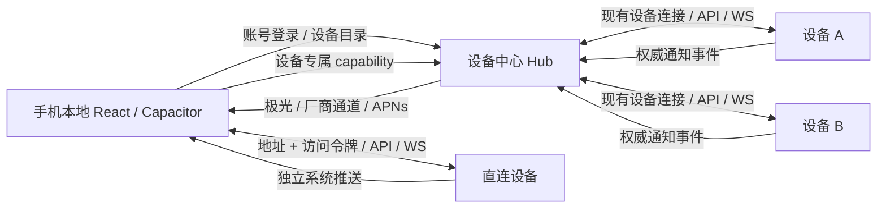

# 手机客户端：React + Capacitor

手机版使用本地打包的 React 界面和 Capacitor 8，Android / iOS 原生工程位于 `mobile/`。入口支持两种连接方式：登录设备中心 Hub 账号管理多台设备，或用设备地址和访问令牌直连单台设备。两种方式都使用本地 React 访问远端 HTTP / WebSocket，任务继续在原设备执行。

## 事实源

| 能力                                   | 实现                                                                                  |
| -------------------------------------- | ------------------------------------------------------------------------------------- |
| 连接方式、认证与凭据恢复               | `mobile/src/ConnectionScreen.tsx`、`connections.ts`、`connection.ts`                  |
| 手机入口、设备选择与切换               | `mobile/src/main.tsx`、`hub.ts`                                                       |
| 通知状态、权限、订阅与点击             | `mobile/src/push-controller.ts`、`Settings.tsx`                                       |
| 原生推送与安全存储                     | `mobile/native/push/`，导出 `PiPush` / `PiCredentials`                                |
| 本地 React 使用远端服务                | `web/src/mobile-runtime.ts`、`base-url.ts`、`auth-token.ts`                           |
| Hub 登录、设备目录及 native capability | `server/device-center/hub-mobile.ts`、`hub-auth.ts`、`relay.ts`                       |
| 服务端权威事件                         | `server/mobile-notification-events.ts`、`agent-service.ts`、`agent-service-daemon.ts` |
| 设备事件可靠转发到 Hub                 | `server/device-center/mobile-notification-forwarder.ts`、`local.ts`                   |
| 中央系统推送                           | `server/mobile-push.ts`；Hub 初始化和关闭在 `device-center/hub.ts`                    |

## 连接方式

初始页提供“设备中心”和“直连设备”两个入口。KeyStore / Keychain 保存当前连接的方式、地址与令牌；旧版无方式字段的凭据按 Hub 登录恢复。每次使用一个连接，通过“连接与通知 → 断开并更换连接方式”返回入口；先解绑原连接的通知，再切换凭据。

### 单设备直连

- 输入目标设备的 pi-web-ui 地址与访问令牌（该设备配置的 `PI_WEB_TOKEN`），不需要 Hub 账号，也不要求设备先绑定中心。连接前验证服务端协议与令牌，直接进入该设备工作区。
- 公网要求 HTTPS；私有 IPv4 / IPv6、localhost 与 `.local` 地址可用 HTTP。地址不能带账号、查询参数或会话链接；令牌仅发到选定地址，不跟随重定向。
- 目标服务必须启用访问令牌才能接受 native Origin，不能用空口令绕过原生入口限制。
- 推送订阅位于该设备，通知点击直接定位原会话；不请求 Hub 设备目录或 capability。只接收与当前服务器实例匹配的通知，不把 Hub 来源设备通知作为本机通知打开。
- 从设备中心入口打开其他设备时，需先换成对应的 Hub 登录；不在原生壳里打开远端 HTML。

### 设备中心与多设备连接



- Hub 模式下仅在 KeyStore / Keychain 保存 Hub 地址和安装登录 token，不保存各设备的本地访问口令，也不持久化设备 capability。直连模式保存目标设备地址及其访问令牌，两类凭据不混用。
- 账号会话只在 Hub 持久化 hash，有效期 7 天。native bearer 与浏览器 Cookie 登录隔离，不可作为管理员 Cookie 使用。
- 手机先列出账号拥有的设备，选设备时向 Hub 申请新的 capability。离线或已解绑设备不自动切换到其他设备。
- 切换设备重载**本地安装包**，重新建立目标设备的连接；设备 ID 可本地记住，capability 只留在内存。切换不会停止原设备上的任务，也不会解绑中央通知订阅。
- capability 有效期 8 小时，绑定账号、设备、登录会话和精确 native Origin。HTTP / WS 握手重新检查授权，已连接 native WS 定期检查撤销。长时间离开后恢复时重新申请连接。
- native Origin 仅 `capacitor://localhost` 和 `https://localhost`；native capability 不接受 opaque portal 的 `Origin: null`，原浏览器 portal 的边界保持独立。
- native 中继提供设备 API、WS，以及受 MIME 限制的主题 CSS / 固定图标；拒绝远端 HTML / JavaScript。图片和样式资源显式使用 CORS；第三方图片不附带 Hub 或设备凭据。

本地 React 使用 `configureMobileRuntime` 配置后才动态导入共享 UI。native 禁用 Service Worker、服务端 buildId 驱动的页面刷新，以及远端插件 client / preload / renderer 的下载执行；服务端插件能力继续运行。主题和附件通过安全资源 URL 访问。

## 通知链路与保证

1. 权威事件产生于执行设备，独立于 WebSocket sinks；手机关闭或没有页面在线也能入队。
2. 设备中心模式下，绑定设备将最小事件持久化后转发到 Hub。Hub 使用设备真实执行凭据确定账号、设备 ID 和设备名，拒绝设备自行指定他人身份。直连模式由目标设备处理自己的权威事件。
3. Hub 将事件放入账号隔离的持久 outbox；直连设备使用同一推送服务的本机 outbox。两者都通过极光 REST API 对安装设备的 registration ID 发送系统通知。
4. Android 使用 `pi_tasks`（普通任务）和 `pi_attention`（问题 / 审批 / 错误）通知通道；iOS 通过 APNs 显示可见通知，不依赖后台 JavaScript 或持续 WebSocket。
5. 点击后校验当前服务器实例与连接方式。Hub 模式必要时先切到来源设备，直连模式在当前设备定位原 owner / conversation；重载时的待打开目标同样绑定地址、方式和实例。外部执行会话使用只读共享查看，不重新加载或抢占原会话；pi 会话的既有问卷和单次审批答复仍发给原 owner。外部原生 CLI 仅展示状态与原生会话 ID，不挂接 PTY、注册 composer 或提供停止 / 重连控制；CLI 原生提问和权限操作仍需回到拥有该 CLI 的可写窗口处理，详见 [`architecture-terminal.md`](architecture-terminal.md)。

默认文案只有任务状态与设备显示名；不会上传对话正文、工作路径、工具参数或用户输入到推送供应商。extras 仅携带事件、实例、设备、会话与 owner 标识。

权限和订阅分开：系统允许通知并不代表已订阅。开启需显式操作；拒绝后可进入系统设置授权，再回应用开启。关闭先停止本机 SDK，并撤销当前 Hub 或直连设备上的订阅；离线关闭保存待同步意图，恢复后补做解绑。断开当前连接或更换连接方式前完成订阅解绑。

通知设置入口支持刷新状态、事件种类开关、系统设置和显式测试通知。测试接口返回“已排队”，不能据此宣称设备已收到。

### 队列边界

- 设备转发队列：独立 `device-mobile-notifications.json`，最多 256 条 / 1 MiB，事件有效期 24 小时，每条最多 32 次尝试，重试 5 秒递增至 1 小时，单次总请求时限 15 秒。
- Hub / 直连设备推送：独立 `mobile-push.json`，设备最多 1,000 个、outbox 最多 2,000 项、去重记录最多 4,096 条；事件 24 小时过期，设备 30 天不刷新则过期，单设备投递最多 5 次。
- 文件原子写入且权限为 `0600`；供应商密钥和设备执行凭据不写入这些队列。
- 429 / 5xx / 网络错误有限重试；认证失效和永久错误不无限重发。设备换绑或 UI 授权撤销后，旧队列不发送到新账号。
- 每个账户、来源设备和事件独立去重；成功设备不随失败设备重复重试。
- 供应商接收后、成功状态落盘前进程崩溃，仍存在重发窗口。系统不保证严格恰好一次，也不把供应商 2xx 当作设备送达证明。

当前权威生命周期覆盖 pi `ClientSession`，包括重试最终状态、问卷、审批和子任务完成；原生 CLI 沿用同一事件接口接入。DSH / universal / durable 仍需各引擎实现同等权威 hook，不能仅监听 `run_end` 推断完成。

## 服务器部署

设备中心模式：先部署 / 更新 Hub 与执行设备，再将设备绑定到同一账号。手机不必与每台设备处于同一局域网，设备需能连接 Hub。

直连模式：部署 / 更新目标设备的 pi-web-ui，配置 `PI_WEB_TOKEN`，保证手机能访问其地址；不需要部署 Hub。未配置推送密钥仍可连接和对话，开启通知前需补齐推送配置。

在 **当前 Hub 或直连设备的服务端环境**配置下列推送参数。所有使用同一手机安装包的服务端都需匹配该包的极光 AppKey；MasterSecret 始终只留在服务端：

| 变量                           | 含义                                                                       |
| ------------------------------ | -------------------------------------------------------------------------- |
| `PI_WEB_JPUSH_APP_KEY`         | 极光应用 AppKey，与安装包对应                                              |
| `PI_WEB_JPUSH_MASTER_SECRET`   | 仅服务端保存的 REST MasterSecret                                           |
| `PI_WEB_JPUSH_APNS_PRODUCTION` | 必须明确 `true`（生产 APNs）或 `false`（开发 APNs）；未设置不启用 iOS 投递 |

不要把 MasterSecret 放入 `mobile/.env`、前端构建参数、安装包或通知载荷。执行设备通过现有绑定将通知交给 Hub，不需要每台配置极光密钥；仅直接部署设备推送时才需要设备自己的配置。

国内 Android 的锁屏 / 进程回收投递还需要在极光控制台配置对应厂商通道，并集成相应 SDK。只有极光自有连接不能代表所有国产手机在应用被回收后仍可靠收到。参考[极光 Android 厂商通道集成](https://docs.jiguang.cn/jpush/client/Android/android_3rd_guide)。

## 安装依赖与构建

根目录的测试类型检查和手机通知单元测试也引用手机子工程。安装根项目依赖后，先执行 `npm --prefix mobile ci`，再运行根目录检查；CI 会同时安装两组锁定依赖，并检查根项目与手机子工程的类型。

手机子工程的完整构建流程：

```bash
npm --prefix mobile ci
npm --prefix mobile run typecheck
npm --prefix mobile run build
npm --prefix mobile run sync
npm --prefix mobile run native:check
```

`mobile/android`、`mobile/ios` 已包含平台工程。iOS 明确使用 **CocoaPods**，当前本地极光插件不支持 SPM；重新生成平台时用：

```bash
npm --prefix mobile run native:add -- ios --packagemanager CocoaPods
```

不要在已有平台目录直接重复执行 add；正常更新用 sync。`native:check` 检查 CocoaPods 名称、平台选择和 Android 插件自动注册，不能替代原生编译。

### 一键出 APK

产物落到仓库根目录，名字带 ABI 与运行时 revision（`pi-web-ui-mobile-<abi>-<revision>-debug.apk`）：

```bash
npm --prefix mobile run apk          # 只打 assets 里现成那套运行时（改 web/src 后最常用，约 30-40 秒）
npm --prefix mobile run apk:all      # 真机 arm64 + 模拟器 x86_64 各打一个
RUNTIME_REVISION=r8 npm --prefix mobile run apk:all:runtime   # 先用 Docker 重建全部运行时再打
```

`assets/localengine` 只能放一套运行时分卷，所以 `apk:all` 是「换一次 assets 打一次包」，结束会把 assets 恢复成默认 ABI（arm64）。前置条件是 `JAVA_HOME` 与 `mobile/android/local.properties` 里的 `sdk.dir`（该文件被 gitignore，换机器要重建）；缺了脚本会直接点名，不会丢给你一句 `SDK location not found`。

`apk:all:runtime` 用 Docker + qemu 跑 `local-engine/runtime/build-runtime.sh`，需要 `RUNTIME_REVISION`（写进 `runtime.json`，手机端据此触发重装）；改 `web/src` 只需重打 APK，只有改原生层或换 rootfs 才需要它。

发布：推 `v*` tag 会触发 `.github/workflows/mobile-release.yml`，在 CI 里构建 arm64 引擎运行时并打 APK，产物挂到同名 GitHub Release（`pi-web-ui-mobile-arm64-<版本>-debug.apk` + sha256）。签名与版本号注入见 [`release.md`](release.md) §8.6。

开发预览：

```bash
npm --prefix mobile run dev
```

默认 `http://127.0.0.1:8910`。浏览器可检查界面，真实 Hub native 登录与推送应在安装包中验证；不为浏览器预览放宽 native Origin 门禁。

### 原生 AppKey

将 `mobile/.env.example` 复制为 `mobile/.env` 并填写 `PI_MOBILE_JPUSH_APP_KEY`，然后：

```bash
npm --prefix mobile run native:configure
```

脚本生成未入库的 `android/pi-push.properties` 和 iOS `NativeConfig.xcconfig`，不输出 AppKey。Android 也可直接通过同名环境变量供 Gradle 使用。

### Android

使用 JDK 21、Android SDK 与兼容 Capacitor 8 的 Android Studio：

```bash
npm --prefix mobile run android
```

- SDK 在用户开启通知前不初始化；Android 13+ 请求系统通知权限。
- Capacitor 自动注册 `PiPushPlugin` 和 `PiCredentialsPlugin`，不要在 MainActivity 重复手工注册。
- 厂商 App ID / Key、对应 SDK、Huawei / Honor 等仓库和配置与发布包名 / 签名绑定。可在未入库的 `mobile/android/app/oem-push.gradle` 中按厂商官方文档配置，宿主会加载该文件；极光控制台也需开启匹配通道。
- APK / AAB 发布签名由部署方配置。不要把签名口令和私钥提交到仓库。

### iOS

在 macOS 安装 Xcode / CocoaPods，执行 sync 后：

```bash
npm --prefix mobile run ios
```

- 打开 `ios/App/App.xcworkspace`，选择开发团队、Bundle ID 和签名。
- 宿主 AppDelegate 已转发 APNs 注册成功 / 失败与通知接收，并保留 Capacitor 转发。
- 已配置 APNs entitlement；Debug 为 `development`，Release 为 `production`，与 Hub 的 `PI_WEB_JPUSH_APNS_PRODUCTION` 及极光 APNs 证书 / Key 环境保持一致。
- 在 Apple / 极光侧完成 Push Notifications、APNs 认证密钥或证书配置。
- 凭据通过系统 Keychain 保存，不使用明文 Preferences。

## 真机验收

至少覆盖 iPhone，以及已配置相应厂商通道的国产 Android：

- 首次允许、拒绝、系统设置恢复；关闭通知后杀进程再启动仍保持关闭。
- 锁屏、切到后台、应用进程被系统回收时的任务完成 / 失败 / 问题 / 审批通知。
- 两台设备同时运行，手机切到 B 时仍收到 A 通知；点击 A 通知先回 A，再打开原任务。
- 冷启动点击、重复点击、原任务已关闭 / 设备离线 / 已解绑 / Hub 登录过期。
- 断网重连、设备事件与 Hub outbox 重启恢复、registration ID 轮转、退出账号解绑。
- 外部会话只读查看不会新增 prompt、打开可写终端或改变原设备 owner；pi 问卷和单次审批能返回原任务。外部原生 CLI 不发送终端 attach / resize，也不显示停止 / 重连等控制；其原生交互在 owner 可写窗口验收。

本仓库单测可验证协议、持久化、隔离和模拟供应商请求；原生工程同步 / 插件发现不等于 Android / iOS 编译成功，也不等于真实通知已送达。平台 SDK、签名、厂商凭据、APNs 与真机投递必须分别验收。
