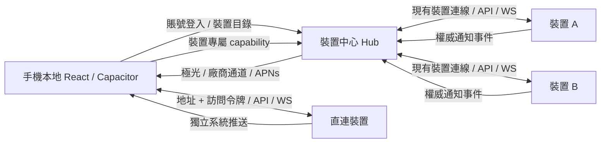

[English](./mobile.en.md) · [简体中文](./mobile.md) · **繁體中文**

# 手機客戶端：React + Capacitor

手機版使用本地打包的 React 介面和 Capacitor 8，Android / iOS 原生工程位於 `mobile/`。入口支援兩種連線方式：登入裝置中心 Hub 賬號管理多臺裝置，或用裝置地址和訪問令牌直連單臺裝置。兩種方式都使用本地 React 訪問遠端 HTTP / WebSocket，任務繼續在原裝置執行。

## 事實源

| 能力                                   | 實現                                                                                  |
| -------------------------------------- | ------------------------------------------------------------------------------------- |
| 連線方式、認證與憑據恢復               | `mobile/src/ConnectionScreen.tsx`、`connections.ts`、`connection.ts`                  |
| 手機入口、裝置選擇與切換               | `mobile/src/main.tsx`、`hub.ts`                                                       |
| 通知狀態、許可權、訂閱與點選           | `mobile/src/push-controller.ts`、`Settings.tsx`                                       |
| 原生推送與安全儲存                     | `mobile/native/push/`，匯出 `PiPush` / `PiCredentials`                                |
| 本地 React 使用遠端服務                | `web/src/mobile-runtime.ts`、`base-url.ts`、`auth-token.ts`                           |
| Hub 登入、裝置目錄及 native capability | `server/device-center/hub-mobile.ts`、`hub-auth.ts`、`relay.ts`                       |
| 服務端權威事件                         | `server/mobile-notification-events.ts`、`agent-service.ts`、`agent-service-daemon.ts` |
| 裝置事件可靠轉發到 Hub                 | `server/device-center/mobile-notification-forwarder.ts`、`local.ts`                   |
| 中央系統推送                           | `server/mobile-push.ts`；Hub 初始化和關閉在 `device-center/hub.ts`                    |

## 連線方式

初始頁提供“裝置中心”和“直連裝置”兩個入口。KeyStore / Keychain 儲存當前連線的方式、地址與令牌；舊版無方式欄位的憑據按 Hub 登入恢復。每次使用一個連線，通過“連線與通知 → 斷開並更換連線方式”返回入口；先解綁原連線的通知，再切換憑據。

### 單裝置直連

- 輸入目標裝置的 pi-web-ui 地址與訪問令牌（該裝置配置的 `PI_WEB_TOKEN`），不需要 Hub 賬號，也不要求裝置先繫結中心。連線前驗證服務端協議與令牌，直接進入該裝置工作區。
- 公網要求 HTTPS；私有 IPv4 / IPv6、localhost 與 `.local` 地址可用 HTTP。地址不能帶賬號、查詢引數或會話連結；令牌僅發到選定地址，不跟隨重定向。
- 目標服務必須啟用訪問令牌才能接受 native Origin，不能用空口令繞過原生入口限制。
- 推送訂閱位於該裝置，通知點選直接定位原會話；不請求 Hub 裝置目錄或 capability。只接收與當前伺服器例項匹配的通知，不把 Hub 來源裝置通知作為本機通知開啟。
- 從裝置中心入口開啟其他裝置時，需先換成對應的 Hub 登入；不在原生殼裡開啟遠端 HTML。

### 裝置中心與多裝置連線



- Hub 模式下僅在 KeyStore / Keychain 儲存 Hub 地址和安裝登入 token，不儲存各裝置的本地訪問口令，也不持久化裝置 capability。直連模式儲存目標裝置地址及其訪問令牌，兩類憑據不混用。
- 賬號會話只在 Hub 持久化 hash，有效期 7 天。native bearer 與瀏覽器 Cookie 登入隔離，不可作為管理員 Cookie 使用。
- 手機先列出賬號擁有的裝置，選裝置時向 Hub 申請新的 capability。離線或已解綁裝置不自動切換到其他裝置。
- 切換裝置過載**本地安裝包**，重新建立目標裝置的連線；裝置 ID 可本地記住，capability 只留在記憶體。切換不會停止原裝置上的任務，也不會解綁中央通知訂閱。
- capability 有效期 8 小時，繫結賬號、裝置、登入會話和精確 native Origin。HTTP / WS 握手重新檢查授權，已連線 native WS 定期檢查撤銷。長時間離開後恢復時重新申請連線。
- native Origin 僅 `capacitor://localhost` 和 `https://localhost`；native capability 不接受 opaque portal 的 `Origin: null`，原瀏覽器 portal 的邊界保持獨立。
- native 中繼提供裝置 API、WS，以及受 MIME 限制的主題 CSS / 固定圖示；拒絕遠端 HTML / JavaScript。圖片和樣式資源顯式使用 CORS；第三方圖片不附帶 Hub 或裝置憑據。

本地 React 使用 `configureMobileRuntime` 配置後才動態匯入共享 UI。native 停用 Service Worker、服務端 buildId 驅動的頁面重新整理，以及遠端外掛 client / preload / renderer 的下載執行；服務端外掛能力繼續執行。主題和附件通過安全資源 URL 訪問。

## 通知鏈路與保證

1. 權威事件產生於執行裝置，獨立於 WebSocket sinks；手機關閉或沒有頁面線上也能入隊。
2. 裝置中心模式下，繫結裝置將最小事件持久化後轉發到 Hub。Hub 使用裝置真實執行憑據確定賬號、裝置 ID 和裝置名，拒絕裝置自行指定他人身份。直連模式由目標裝置處理自己的權威事件。
3. Hub 將事件放入賬號隔離的持久 outbox；直連裝置使用同一推送服務的本機 outbox。兩者都通過極光 REST API 對安裝裝置的 registration ID 傳送系統通知。
4. Android 使用 `pi_tasks`（普通任務）和 `pi_attention`（問題 / 審批 / 錯誤）通知通道；iOS 通過 APNs 顯示可見通知，不依賴後臺 JavaScript 或持續 WebSocket。
5. 點選後校驗當前伺服器例項與連線方式。Hub 模式必要時先切到來源裝置，直連模式在當前裝置定位原 owner / conversation；過載時的待開啟目標同樣繫結地址、方式和例項。外部執行會話使用只讀共享檢視，不重新載入或搶佔原會話；pi 會話的既有問卷和單次審批答覆仍發給原 owner。外部原生 CLI 僅展示狀態與原生會話 ID，不掛接 PTY、註冊 composer 或提供停止 / 重連控制；CLI 原生提問和許可權操作仍需回到擁有該 CLI 的可寫視窗處理，詳見 [`architecture-terminal.md`](architecture-terminal.zh-TW.md)。

預設文案只有任務狀態與裝置顯示名；不會上傳對話正文、工作路徑、工具引數或使用者輸入到推送供應商。extras 僅攜帶事件、例項、裝置、會話與 owner 標識。

許可權和訂閱分開：系統允許通知並不代表已訂閱。開啟需顯式操作；拒絕後可進入系統設定授權，再回應用開啟。關閉先停止本機 SDK，並撤銷當前 Hub 或直連裝置上的訂閱；離線關閉儲存待同步意圖，恢復後補做解綁。斷開當前連線或更換連線方式前完成訂閱解綁。

通知設定入口支援重新整理狀態、事件種類開關、系統設定和顯式測試通知。測試介面返回“已排隊”，不能據此宣稱裝置已收到。

### 佇列邊界

- 裝置轉發佇列：獨立 `device-mobile-notifications.json`，最多 256 條 / 1 MiB，事件有效期 24 小時，每條最多 32 次嘗試，重試 5 秒遞增至 1 小時，單次總請求時限 15 秒。
- Hub / 直連裝置推送：獨立 `mobile-push.json`，裝置最多 1,000 個、outbox 最多 2,000 項、去重記錄最多 4,096 條；事件 24 小時過期，裝置 30 天不重新整理則過期，單裝置投遞最多 5 次。
- 檔案原子寫入且許可權為 `0600`；供應商金鑰和裝置執行憑據不寫入這些佇列。
- 429 / 5xx / 網路錯誤有限重試；認證失效和永久錯誤不無限重發。裝置換綁或 UI 授權撤銷後，舊佇列不傳送到新賬號。
- 每個賬戶、來源裝置和事件獨立去重；成功裝置不隨失敗裝置重複重試。
- 供應商接收後、成功狀態落盤前程序崩潰，仍存在重發視窗。系統不保證嚴格恰好一次，也不把供應商 2xx 當作裝置送達證明。

當前權威生命週期覆蓋 pi `ClientSession`，包括重試最終狀態、問卷、審批和子任務完成；原生 CLI 沿用同一事件介面接入。DSH / universal / durable 仍需各引擎實現同等權威 hook，不能僅監聽 `run_end` 推斷完成。

## 伺服器部署

裝置中心模式：先部署 / 更新 Hub 與執行裝置，再將裝置繫結到同一賬號。手機不必與每臺裝置處於同一區域網，裝置需能連線 Hub。

直連模式：部署 / 更新目標裝置的 pi-web-ui，配置 `PI_WEB_TOKEN`，保證手機能訪問其地址；不需要部署 Hub。未配置推送金鑰仍可連線和對話，開啟通知前需補齊推送配置。

在 **當前 Hub 或直連裝置的服務端環境**配置下列推送引數。所有使用同一手機安裝包的服務端都需匹配該包的極光 AppKey；MasterSecret 始終只留在服務端：

| 變數                           | 含義                                                                       |
| ------------------------------ | -------------------------------------------------------------------------- |
| `PI_WEB_JPUSH_APP_KEY`         | 極光應用 AppKey，與安裝包對應                                              |
| `PI_WEB_JPUSH_MASTER_SECRET`   | 僅服務端儲存的 REST MasterSecret                                           |
| `PI_WEB_JPUSH_APNS_PRODUCTION` | 必須明確 `true`（生產 APNs）或 `false`（開發 APNs）；未設定不啟用 iOS 投遞 |

不要把 MasterSecret 放入 `mobile/.env`、前端構建引數、安裝包或通知載荷。執行裝置通過現有繫結將通知交給 Hub，不需要每臺配置極光金鑰；僅直接部署裝置推送時才需要裝置自己的配置。

國內 Android 的鎖屏 / 程序回收投遞還需要在極光控制台配置對應廠商通道，並整合相應 SDK。只有極光自有連線不能代表所有國產手機在應用被回收後仍可靠收到。參考[極光 Android 廠商通道整合](https://docs.jiguang.cn/jpush/client/Android/android_3rd_guide)。

## 安裝依賴與構建

根目錄的測試型別檢查和手機通知單元測試也引用手機子工程。安裝根專案依賴後，先執行 `npm --prefix mobile ci`，再執行根目錄檢查；CI 會同時安裝兩組鎖定依賴，並檢查根專案與手機子工程的型別。

手機子工程的完整構建流程：

```bash
npm --prefix mobile ci
npm --prefix mobile run typecheck
npm --prefix mobile run build
npm --prefix mobile run sync
npm --prefix mobile run native:check
```

`mobile/android`、`mobile/ios` 已包含平臺工程。iOS 明確使用 **CocoaPods**，當前本地極光外掛不支援 SPM；重新生成平臺時用：

```bash
npm --prefix mobile run native:add -- ios --packagemanager CocoaPods
```

不要在已有平臺目錄直接重複執行 add；正常更新用 sync。`native:check` 檢查 CocoaPods 名稱、平臺選擇和 Android 外掛自動註冊，不能替代原生編譯。

### 一鍵出 APK

產物落到倉庫根目錄，名字帶 ABI 與執行時 revision（`pi-web-ui-mobile-<abi>-<revision>-debug.apk`）：

```bash
npm --prefix mobile run apk          # 只打 assets 裡現成那套執行時（改 web/src 後最常用，約 30-40 秒）
npm --prefix mobile run apk:all      # 真機 arm64 + 模擬器 x86_64 各打一個
RUNTIME_REVISION=r8 npm --prefix mobile run apk:all:runtime   # 先用 Docker 重建全部執行時再打
```

`assets/localengine` 只能放一套執行時分卷，所以 `apk:all` 是「換一次 assets 打一次包」，結束會把 assets 恢復成預設 ABI（arm64）。前置條件是 `JAVA_HOME` 與 `mobile/android/local.properties` 裡的 `sdk.dir`（該檔案被 gitignore，換機器要重建）；缺了指令碼會直接點名，不會丟給你一句 `SDK location not found`。

`apk:all:runtime` 用 Docker + qemu 跑 `local-engine/runtime/build-runtime.sh`，需要 `RUNTIME_REVISION`（寫進 `runtime.json`，手機端據此觸發重灌）；改 `web/src` 只需重打 APK，只有改原生層或換 rootfs 才需要它。

釋出：推 `v*` tag 會觸發 `.github/workflows/mobile-release.yml`，在 CI 裡構建 arm64 引擎執行時並打 APK，產物掛到同名 GitHub Release（`pi-web-ui-mobile-arm64-<版本>-debug.apk` + sha256）。簽名與版本號注入見 [`release.md`](release.zh-TW.md) §8.6。

開發預覽：

```bash
npm --prefix mobile run dev
```

預設 `http://127.0.0.1:8910`。瀏覽器可檢查介面，真實 Hub native 登入與推送應在安裝包中驗證；不為瀏覽器預覽放寬 native Origin 門禁。

### 原生 AppKey

將 `mobile/.env.example` 複製為 `mobile/.env` 並填寫 `PI_MOBILE_JPUSH_APP_KEY`，然後：

```bash
npm --prefix mobile run native:configure
```

指令碼生成未入庫的 `android/pi-push.properties` 和 iOS `NativeConfig.xcconfig`，不輸出 AppKey。Android 也可直接通過同名環境變數供 Gradle 使用。

### Android

使用 JDK 21、Android SDK 與相容 Capacitor 8 的 Android Studio：

```bash
npm --prefix mobile run android
```

- SDK 在使用者開啟通知前不初始化；Android 13+ 請求系統通知許可權。
- Capacitor 自動註冊 `PiPushPlugin` 和 `PiCredentialsPlugin`，不要在 MainActivity 重複手工註冊。
- 廠商 App ID / Key、對應 SDK、Huawei / Honor 等倉庫和配置與釋出包名 / 簽名繫結。可在未入庫的 `mobile/android/app/oem-push.gradle` 中按廠商官方文件配置，宿主會載入該檔案；極光控制台也需開啟匹配通道。
- APK / AAB 釋出簽名由部署方配置。不要把簽名口令和私鑰提交到倉庫。

### iOS

在 macOS 安裝 Xcode / CocoaPods，執行 sync 後：

```bash
npm --prefix mobile run ios
```

- 開啟 `ios/App/App.xcworkspace`，選擇開發團隊、Bundle ID 和簽名。
- 宿主 AppDelegate 已轉發 APNs 註冊成功 / 失敗與通知接收，並保留 Capacitor 轉發。
- 已配置 APNs entitlement；Debug 為 `development`，Release 為 `production`，與 Hub 的 `PI_WEB_JPUSH_APNS_PRODUCTION` 及極光 APNs 證書 / Key 環境保持一致。
- 在 Apple / 極光側完成 Push Notifications、APNs 認證金鑰或證書配置。
- 憑據通過系統 Keychain 儲存，不使用明文 Preferences。

## 真機驗收

至少覆蓋 iPhone，以及已配置相應廠商通道的國產 Android：

- 首次允許、拒絕、系統設定恢復；關閉通知後殺程序再啟動仍保持關閉。
- 鎖屏、切到後臺、應用程序被系統回收時的任務完成 / 失敗 / 問題 / 審批通知。
- 兩臺裝置同時執行，手機切到 B 時仍收到 A 通知；點選 A 通知先回 A，再開啟原任務。
- 冷啟動點選、重複點選、原任務已關閉 / 裝置離線 / 已解綁 / Hub 登入過期。
- 斷網重連、裝置事件與 Hub outbox 重啟恢復、registration ID 輪轉、退出賬號解綁。
- 外部會話只讀檢視不會新增 prompt、開啟可寫終端或改變原裝置 owner；pi 問卷和單次審批能返回原任務。外部原生 CLI 不傳送終端 attach / resize，也不顯示停止 / 重連等控制；其原生互動在 owner 可寫視窗驗收。

本倉庫單測可驗證協議、持久化、隔離和模擬供應商請求；原生工程同步 / 外掛發現不等於 Android / iOS 編譯成功，也不等於真實通知已送達。平臺 SDK、簽名、廠商憑據、APNs 與真機投遞必須分別驗收。
