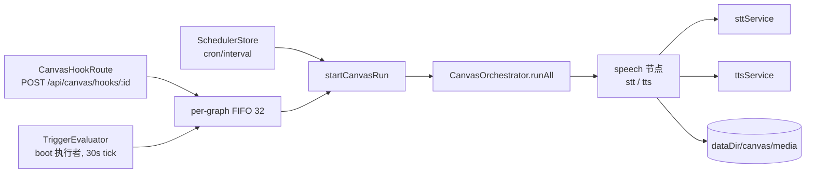

# Canvas 音频节点与自动触发（issue #950）落地方案

> **一句话**：Canvas 的**数据通道只有一条**（`artifact.text` → `edge.lastHandoffSummary`），**时间触发的底座已经有了**（`SchedulerStore` 的 `target: "canvas"`），**TTS 中心已经能进程内复用**（`ttsService`）；真正缺的是三件东西——一个**确定性音频节点**、一个**进程内 STT 服务**、以及一个**图外的事件触发层 + 去重键**。
>
> 本文只讲设计与边界，不含实现，不改任何源码。所有「现状」断言都带 `file:line` 或文档锚点。

---

## 0. 结论先行

| 需求（issue #950）                         | 现状                                                                                                                                   | 本次结论                                                                                                                                 | 主证据                                                                                                                                           |
| ------------------------------------------ | -------------------------------------------------------------------------------------------------------------------------------------- | ---------------------------------------------------------------------------------------------------------------------------------------- | ------------------------------------------------------------------------------------------------------------------------------------------------ |
| STT 节点（音频→文字，可选 provider/model） | 只有**插件侧**能力：`voice-input` 的 `transcribe_audio` AI 工具 + 插件自己的 `POST /transcribe` 路由；**没有进程内服务、没有宿主 API** | 新增 `server/stt-service.ts`（照 `TtsService` 的形状）+ SDK 新增 `host.stt.registerEngine`，`voice-input` 注册 `local`/`remote` 两个引擎 | `plugins/voice-input/index.mjs:769`、`:728`、`plugin-sdk/index.d.ts:451`（只有 `host.tts`，无 `host.stt`）                                       |
| TTS 节点（文字→语音，可选 provider/model） | **已经可复用**：`ttsService` 是模块级单例，引擎注册表、音色、串行队列、限流全在服务端                                                  | 零改造，画布节点直接调 `ttsService.synthesize()`                                                                                         | `server/tts-service.ts:157`、`:61`、`:105`、`:121`-`:139`                                                                                        |
| 音频/文本产物传给下游                      | 下游只能拿到**文本**（`artifact.text`）；`CanvasArtifact` 无媒体字段                                                                   | 新增 `CanvasArtifact.media`（一个引用），并把媒体写成文件；文本摘要仍走原通道                                                            | `server/canvas/canvas-orchestrator.ts:913`、`server/protocol.ts:1140`-`:1152`                                                                    |
| 定时执行（时刻/间隔/cron）                 | **已实现**：`SchedulerTask.target: "canvas"` + `graphId`，面板与 `schedule` 工具共用存储                                               | **零新增语义**；只补「从画布侧新建定时任务」的入口                                                                                       | `server/scheduler-tasks.ts:33`-`:54`、`server/canvas/canvas-scheduled-task.ts:24`、`web/src/components/SchedulerPanel.tsx:170`-`:190`            |
| 事件触发（新文件 / HTTP / 资源变化）       | **完全没有**：`webhook` / `cron` / `memory` / `subflow` 四个角色被显式标记为「仅说明节点，已禁用运行」                                 | 新增图外**触发源存储** + 单一运行入口 `startCanvasRun()`；`webhook`/`cron` 角色改为**指向触发源**，不再假装执行                          | `web/src/components/canvas/CanvasTypes.ts:1056`、`web/src/i18n/messages/canvas/zh.json:532`、`server/canvas/canvas-orchestrator.ts:1486`-`:1499` |
| 事件数据作为工作流输入                     | 只有 `initialPrompt`，且它会**覆盖根节点的 instruction**；无结构化事件、无文件、无去重                                                 | 新增 `CanvasRunInput` 挂在 `graph.run.input`；根节点保留自身 instruction，输入以独立块注入                                               | `server/canvas/canvas-orchestrator.ts:458`-`:459`、`:835`、`:1159`                                                                               |
| 去重 / 防重复执行                          | 无。调度器只有「同任务不并发」的顺延逻辑                                                                                               | 三种键：webhook 幂等键、文件指纹+游标、条件**上升沿**；有界 `seen` 集合                                                                  | `server/scheduler-tasks.ts:630`-`:638`、`server/device-center/hub.ts:2811`-`:2837`（现成指纹范式）                                               |
| 后台无人值守                               | 有 `BackgroundExecutorRegistry` 契约与 `alwaysOn`                                                                                      | 触发层注册成一个 `kind: "boot"` 执行者；重启后从磁盘恢复源，不复活已删除的图                                                             | `server/background-executors.ts:22`-`:40`、`server/index.ts:2545`、`server/canvas/canvas-store.ts:278`                                           |

**三条边界（本文的取舍）**：① 不新建调度框架——时间触发**只有一个** `SchedulerStore`，事件源只做「到期评估」的单循环；② 不扩 DAG 语义——不加新边类型、不加数据通道，事件数据仍是**文本 + 文件路径**；③ 不让画布依赖某个插件——STT 走宿主服务注册表，插件被禁用时是**可诊断失败**，不是静默降级。

---

## 1. 现状盘点

### 1.1 节点类型与执行入口

| 项                   | 事实                                                                                                                         | 证据                                                                                                                                              |
| -------------------- | ---------------------------------------------------------------------------------------------------------------------------- | ------------------------------------------------------------------------------------------------------------------------------------------------- |
| 角色枚举             | 29 个角色（`architect`…`skill`），含 `cron` / `webhook` / `transform` / `memory` / `loop`                                    | `server/protocol.ts:1107`、`server/canvas/canvas-validation.ts:5`-`:32`                                                                           |
| 引擎枚举             | 只有 5 个 **LLM** 引擎：`pi`/`dsh`/`codex`/`claude`/`durable`                                                                | `server/protocol.ts:1106`、`server/canvas/canvas-validation.ts:36`                                                                                |
| 节点必填             | `engine` 必须在引擎集合内、`model` 必须是 string、`config` 只能是 `string`/有限 `number`/`boolean`（**嵌套对象与数组非法**） | `server/canvas/canvas-validation.ts:73`、`:77`、`:80`-`:89`                                                                                       |
| 角色三处联动         | 协议类型 + 校验 Set + AI 工具 `VALID_ROLES`                                                                                  | `server/protocol.ts:1107`、`server/canvas/canvas-validation.ts:5`、`server/canvas/canvas-agent-tool.ts:75`                                        |
| 前端第四处           | `getRoleMetas` + `getRoleFields` + `PASSTHROUGH_ROLES` + `LLM_ROLES` + `UNIMPLEMENTED_ROLES`                                 | `web/src/components/canvas/CanvasTypes.ts:400`、`:417`、`:591`、`:1056`                                                                           |
| 真正「非 LLM」的执行 | 只有 `transform`：本地同步执行，`config.mode` 分 `text2json`/`json2text`                                                     | `server/canvas/canvas-orchestrator.ts:560`-`:590`、`:1502`                                                                                        |
| 直通角色             | `condition`/`loop`/`human`/`merge`/`memory`/`end`/`trigger`/`cron`/`webhook`：不调模型，只拼一段摘要                         | `server/canvas/canvas-orchestrator.ts:1486`-`:1499`、`:1554`                                                                                      |
| 未实现角色           | `cron`/`webhook`/`memory`/`subflow`：UI 显示「仅说明节点…已禁用运行」，运行按钮 disabled，DAG 导入时被过滤                   | `web/src/components/canvas/CanvasTypes.ts:1056`、`web/src/i18n/messages/canvas/zh.json:532`、`CanvasNodeCard.tsx:726`、`:762`、`canvas-dag.ts:84` |
| 执行入口             | `runAll(graph, initialPrompt?, runBase?)`；只有**根节点**拿到 `initialPrompt`，下游用各自 `instruction`                      | `server/canvas/canvas-orchestrator.ts:795`、`:835`、`:459`                                                                                        |
| 并发与死线           | 队列并发 4；整轮 **30 分钟**硬死线，超时 `stopAll` + `error`                                                                 | `server/canvas/canvas-orchestrator.ts:64`、`:217`-`:236`                                                                                          |
| 重入保护             | 同图运行中再 `runAll` 直接抛 `Canvas graph already running`                                                                  | `server/canvas/canvas-orchestrator.ts:798`-`:801`                                                                                                 |

### 1.2 产物与数据通道

- 图**内联**存 `<dataDir>/canvas/<graphId>.json`，运行态字段（`status`/`artifact`/`runId`/…）由 `RUNTIME_FIELDS` 在保存时**保留磁盘值**，拓扑才推进 `rev`（`server/canvas/canvas-store.ts:186`-`:243`、`:206`-`:221`）。→ **任何运行期新字段都必须进 `RUNTIME_FIELDS`，否则会被旧浏览器快照抹掉**。
- 节点产物 `CanvasArtifact` 有 `summary`/`text`/`files`/`patchPath`/`workspace`（`server/protocol.ts:1140`-`:1152`），**没有媒体字段**。
- 下游拿到的**唯一**东西：`edge.lastHandoffSummary = completedNode.artifact.text`（`server/canvas/canvas-orchestrator.ts:913`），再拼成 `contractContext`（`:442`-`:457`）。→ 音频要传给下游，**只能是文本里的一个路径**，或新增字段。
- 工作区隔离产物是 patch/tree（`docs/architecture-canvas.md#git-隔离与产物`），不是媒体存储。
- 节点日志落在 `<dataDir>/canvas/logs/<graphId>__<nodeId>.json`，单条截断 2000 字符（`server/canvas/canvas-orchestrator.ts:101`、`:139`）。
- **没有**运行历史：`CanvasRun` 只有当前一条（`server/protocol.ts:1159`）。

### 1.3 定时触发：已可用，缺入口

| 事实                                                                                                  | 证据                                                                                                           |
| ----------------------------------------------------------------------------------------------------- | -------------------------------------------------------------------------------------------------------------- |
| 任务模型支持 `target: "canvas"` + `graphId` + `kind: cron\|interval` + `spec` + `catchUp` + `oneShot` | `server/scheduler-tasks.ts:6`-`:7`、`:33`-`:54`                                                                |
| 触发时**重读最新图**并跑 `runAll`，`task.prompt` 当本轮输入、`task.cwd` 当运行根                      | `server/canvas/canvas-scheduled-task.ts:24`-`:44`                                                              |
| 图结构在保存任务前校验（`assertCanvasGraph`）                                                         | `server/canvas/canvas-scheduled-task.ts:9`-`:22`                                                               |
| tick = 10s；上一轮还在跑就顺延到下个周期（不并发）                                                    | `server/scheduler-tasks.ts:90`、`:616`-`:638`                                                                  |
| `oneShot` 触发后 `remove(id)`，防止每 tick 重复执行                                                   | `server/scheduler-tasks.ts:697`                                                                                |
| 历史只留 20 条 `SchedulerRunRecord`（含 `graphId`/`runId`）                                           | `server/scheduler-tasks.ts:92`、`:56`-`:67`、`:739`                                                            |
| 面板已能选 `target: "canvas"` + graphId                                                               | `web/src/components/SchedulerPanel.tsx:170`-`:190`                                                             |
| 运行形态：调度器本身是 `boot` 后台执行者                                                              | `server/index.ts:2545`-`:2556`、`docs/unattended-operation.md#22-backgroundexecutorregistry谁负责把它们拉起来` |
| `schedule` AI 工具只能建 cron/interval，**没有事件源**                                                | `server/schedule-agent-tool.ts:147`-`:158`                                                                     |

**结论**：issue 的「定时（时刻/间隔/cron）」**不需要新机制**，缺的只是「从画布节点抽屉点一下建定时任务」的入口，以及下面 §2 里的输入形状。

### 1.4 事件入口：只有「群房间 webhook」，与画布无关

| 事实                                                                                  | 证据                                                                                  |
| ------------------------------------------------------------------------------------- | ------------------------------------------------------------------------------------- |
| 入站 webhook 唯一路径 `POST /api/rooms/:id/webhooks/incoming/:webhookId`              | `server/device-center/hub-webhooks.ts:155`-`:157`、`server/device-center/hub.ts:1427` |
| 凭据单源：query `token` / `Authorization: Bearer` / `x-webhook-token` / body `token`  | `server/device-center/hub-webhooks.ts:165`-`:172`                                     |
| 全局认证**只**对这一条精确路径放行（自带 token 严格比对），不放宽到整个 `/api/rooms`  | `server/index.ts:559`-`:561`、`hub-webhooks.ts:178`-`:183`                            |
| 已有「幂等键 + 指纹」范式：`hashSecret(JSON.stringify(fields))`，键复用不同指纹 → 409 | `server/device-center/hub.ts:2811`-`:2837`、`:2890`-`:2902`                           |
| 语义是「往群房间投一条消息给 Bot」，不是「跑画布」                                    | `server/device-center/hub.ts:1495`-`:1520`                                            |
| 服务端**能**在进程内调插件 HTTP 处理器（已有先例）                                    | `server/index.ts:521`                                                                 |

**结论**：事件入口的**鉴权与去重范式可以抄**，但**投递目标不能复用**——画布需要一个自己的钩子路由。

### 1.5 STT 现状：能力在插件里，画布够不着

| 项       | 事实                                                                                                                | 证据                                                    |
| -------- | ------------------------------------------------------------------------------------------------------------------- | ------------------------------------------------------- |
| 引擎     | 本地 Whisper（`@huggingface/transformers@2.17.2`，`tiny`/`base`/`small`）+ 远端 OpenAI 兼容 `/audio/transcriptions` | `plugins/voice-input/index.mjs:11`-`:18`、`:535`-`:561` |
| 对外形态 | ①AI 工具 `transcribe_audio(path, lang)` ②插件 HTTP `POST /plugins-api/voice-input/transcribe` ③浏览器 🎤 直写输入框 | `:769`-`:830`、`:728`、`manifest.json` 的 `ui.composer` |
| 输入约束 | 只收**工作区内**路径；本地只解 WAV；非 WAV 必须远端                                                                 | `:783`-`:800`、`:806`-`:812`                            |
| 本地上限 | 480s（`16000*480` 采样）截断 + 超 8 分钟切远端兜底                                                                  | `:509`、`:688`                                          |
| 远端上限 | 25 MiB                                                                                                              | `:8`                                                    |
| 并发     | 全局单飞 `transcribeBusy`，忙则切远端                                                                               | `:693`-`:711`                                           |
| 首次成本 | `host.ensureDeps` 安装 transformers（需网络）+ 首次下载模型                                                         | `:397`                                                  |
| 宿主 API | 插件只能拿 `host.tts`，**没有** `host.stt`                                                                          | `plugin-sdk/index.d.ts:451`                             |

**结论**：画布节点**不能**把「插件内部函数」当 API；也不能接受「插件被关掉就整条流水线消失」。必须先把 STT 提成宿主服务（形状与 TTS 中心一致，见 `docs/architecture-tts.md#注册与调用`）。

### 1.6 TTS 现状：可直接复用

| 项           | 事实                                                                                 | 证据                                                                |
| ------------ | ------------------------------------------------------------------------------------ | ------------------------------------------------------------------- |
| 单例         | `export const ttsService = new TtsService()`，`builtin` 由宿主自注册                 | `server/tts-service.ts:157`-`:163`                                  |
| 注册         | `registerEngine(owner, engine)`，同名禁止覆盖，返回取消函数（卸载即 abort 在场调用） | `:61`-`:92`                                                         |
| 限额         | 正文 ≤6000 字、音频 ≤16 MiB、合成 90s、音色查询 15s、语速 0.5–2                      | `:121`、`:139`、`:125`、`:105`、`:128`                              |
| 并发         | **按引擎串行**（`entry.tail`），不同引擎可并行                                       | `:130`-`:147`                                                       |
| 输出         | `{buffer: Uint8Array, format: wav\|mp3\|aac\|ogg\|pcm\|silk}`；系统语音输出 WAV      | `server/tts-service.ts:24`-`:33`、`server/tts-system.ts:107`-`:110` |
| 引擎来源     | `builtin`（系统语音）+ TTS 插件注册的 `doubao-tts`/`deepseek-tts`                    | `server/tts-service.ts:161`、`plugins/tts/manifest.json`            |
| 现成 AI 工具 | 插件 `tts`（`action: list` / 合成），工具名 `doubao_tts` 只作历史别名留在禁用名单里  | `plugins/tts/index.mjs:666`-`:667`、`server/client-state.ts:627`    |

**结论**：TTS 节点 = **零新增服务**，只需要在编排器里 await 一次 `ttsService.synthesize()`。

### 1.7 无人值守现状（可直接挂靠）

- 执行者契约：`id`/`kind: boot|on-demand`/`start`/`health`，失败隔离、60s 探针、默认 `restart: never`（`server/background-executors.ts:22`-`:60`）。
- `health` 会进 `/api/health`，且必须用 `snapshotLive()`（`docs/unattended-operation.md#3-观测apihealth`）。
- 已知无人值守坑：`host.requestPermission` 无浏览器时一律 `false`（`docs/unattended-operation.md#5-还没做的`）→ 首次装依赖/下载模型在后台跑会失败，必须前置或给可诊断错误。
- 重启恢复：`markInterruptedCanvasRuns` 把磁盘上 `running`/`queued` 标 `paused`（`server/canvas/canvas-store.ts:278`-`:303`）。

---

## 2. 缺口分析

| #   | 缺口                           | 现在会怎样                                                                                             | 最小补法                                                                                           | 期                                    |
| --- | ------------------------------ | ------------------------------------------------------------------------------------------------------ | -------------------------------------------------------------------------------------------------- | ------------------------------------- |
| G1  | **没有确定性音频节点**         | `transform` 之外所有节点都要 LLM；`tool`/`code`/`api` 也只是「让智能体按指令去调工具」，不可靠、不可测 | 新角色 `speech`（`config.mode: stt\|tts`），走 `transform` 同款确定性分支                          | P1                                    |
| G2  | **媒体产物无位置**             | `CanvasArtifact` 只有文本/patch；音频只能靠 base64 塞进文本（64KB 红线、2000 字符日志截断）            | `CanvasArtifact.media` 引用 + `<dataDir>/canvas/media/…` 文件 + 一个只读路由                       | P1                                    |
| G3  | **STT 不是宿主服务**           | 画布依赖插件内部实现，插件禁用即功能消失，且无 provider/model 选择                                     | `server/stt-service.ts` + `host.stt.registerEngine` + `voice-input` 注册两个引擎                   | P2                                    |
| G4  | **触发源无抽象**               | 只有「时间」一种入口，`cron`/`webhook` 节点是装饰                                                      | 图外 `CanvasTriggerSource` 存储 + 单一入口 `startCanvasRun()`                                      | P1                                    |
| G5  | **事件数据没有输入通道**       | `initialPrompt` 会覆盖根节点 instruction，且只能传字符串                                               | `graph.run.input: CanvasRunInput` + 根节点独立注入块                                               | P1                                    |
| G6  | **没有去重键**                 | 目录扫描/重试 webhook 会把同一事件跑 N 次；条件满足期间每 tick 都跑                                    | 三种键（幂等 / 指纹+游标 / 上升沿）+ 有界 `seen`                                                   | P1（webhook+file）、P3（poll）        |
| G7  | **图重入是硬错误**             | 事件在运行中到达 → `Canvas graph already running`，事件直接丢                                          | 每图 FIFO（上限 32）+ 运行结束排空，丢弃计数可观测                                                 | P1                                    |
| G8  | **没有目录/资源监听**          | 仓库里**没有任何** `chokidar`/`fs.watch`（`grep -rn "chokidar\|fs.watch" server/` 空结果）             | 轮询式扫描（不引依赖），由同一个评估循环驱动                                                       | P3                                    |
| G9  | **无人值守的失败面没账**       | 30 分钟死线、审批节点永久 `waiting_approval`、依赖安装被权限卡死，都只是「运行失败」                   | 触发源级 `retry` 退避 + `lastError` + `history` + health 汇总                                      | P4                                    |
| G10 | **四个未实现角色的语义要收口** | `cron`/`webhook` 节点既不能跑也不能配真东西                                                            | 改为「触发源锚点」：字段变成「跳到触发器面板/新建」，`UNIMPLEMENTED_ROLES` 只留 `memory`/`subflow` | P1（角色说明）、P3（节点↔源双向跳转） |

---

## 3. 设计

### 3.1 总览：一个入口，三种源，两个确定性节点



**设计原则**（每条都能在仓库里找到先例）：

1. **触发源住在图外**。图节点 `config` 只能存扁平标量（`server/canvas/canvas-validation.ts:80`），且图保存会重算 `rev`、只保留 `RUNTIME_FIELDS`（`canvas-store.ts:206`-`:221`）；把游标/指纹/密码放进图里，必然被旧浏览器快照或冲突回执抹掉。→ 新文件 `dataDir/canvas/triggers.json`，`writeJsonAtomicSync` 落盘（`canvas-store.ts:9`）。
2. **时间触发不搬家**。`SchedulerStore` 已经是唯一时间源，有 catchUp/oneShot/历史/顺延（§1.3）。事件源**不注册自己的定时器**，只被一个「到期评估」循环扫。
3. **数据通道不扩**。事件输入 → 触发节点 `artifact.text`（人读）+ `graph.run.input`（机读）；音频 → 文件 + `artifact.media` 引用。下游拿到的仍是文本 + 路径，`handleDownstreamEdges` 一行都不用改。
4. **确定性优先**。`speech` 节点不经过 LLM：能落成「同样的输入 → 同样的输出」才谈得上无人值守与可测（对照 `transform`：`canvas-orchestrator.ts:560`-`:590`）。

### 3.2 数据形状

**① 运行输入**（`server/protocol.ts` 新增，挂 `CanvasRun`）：

```ts
interface CanvasRunInput {
	source: "manual" | "schedule" | "webhook" | "watch" | "poll";
	triggerId?: string;
	dedupeKey?: string; // 已命中的去重键（可观测）
	at: number;
	text?: string; // 人类可读载荷（webhook body / 文件名 / 条件说明），≤8000 字
	data?: Record<string, string | number | boolean>; // 扁平，≤64 键，值 ≤2000 字
	files?: Array<{ path: string; bytes?: number; mime?: string }>; // 工作区/绝对路径，≤20 项
	eventId?: string; // 源侧 ID（webhook 的 Idempotency-Key、文件名）
}
```

**② 触发源**（`dataDir/canvas/triggers.json`，一个文件一个数组）：

```ts
interface CanvasTriggerSource {
	id: string; // /^[A-Za-z0-9_-]{1,64}$/，与 SCHEDULER_ID_RE 对齐
	graphId: string;
	name: string;
	kind: "webhook" | "watch" | "poll";
	enabled: boolean;
	entryNodeId?: string; // 从哪个节点进图；缺省=图根
	cwd: string; // 运行根（写进 runBase）
	// —— webhook
	hook?: { method: "POST" | "GET"; token: string; maxBodyBytes: number };
	// —— watch
	watch?: { dir: string; pattern: string; recursive: boolean; stableMs: number; contentHash: boolean };
	// —— poll
	poll?: {
		probe: "http-status" | "http-json" | "file-exists" | "file-size-gte";
		url?: string;
		path?: string;
		expect?: string;
	};
	// —— 公共
	checkEverySec: number; // ≥60，默认 60（与 SCHEDULER_MIN_INTERVAL_MS 对齐）
	minGapMs: number; // 两次触发最小间隔，默认 5000
	coalesce: "queue" | "drop" | "latest"; // 运行中的到达策略，默认 queue
	retry: { attempts: number; backoffSec: number[] }; // 默认 2 次、[30, 120]
	createdAt: number;
	updatedAt: number;
	runtime: CanvasTriggerRuntime; // 只由服务端写
}

interface CanvasTriggerRuntime {
	lastCheckAt?: number;
	lastFireAt?: number;
	lastRunId?: string;
	lastFingerprint?: string;
	lastError?: string; // ≤500 字
	cursor?: string; // watch：已处理的最大 (mtime,path) 水位
	seen: Array<{ key: string; at: number }>; // 有界：200 条 / 7 天
	fired: number;
	skipped: number; // 去重命中数（关键可观测指标）
	history: Array<{ at: number; ok: boolean; runId?: string; durationMs: number; error?: string }>; // 20 条
}
```

**③ 去重键的三条规则**（这是 issue 里「防止重复执行」的全部答案）：

| 源      | 键                                                                                                    | 窗口                        | 命中行为                                                                             |
| ------- | ----------------------------------------------------------------------------------------------------- | --------------------------- | ------------------------------------------------------------------------------------ |
| webhook | `sha256(triggerId + path + (Idempotency-Key ?? sha256(body)))`（照 `hub.ts:2811`-`:2831` 的字段拼法） | 24h                         | **200** `{duplicate:true, runId:上次}`（不 409：webhook 发送方会重试，重放必须幂等） |
| watch   | `sha256(relPath + ":" + size + ":" + mtimeMs)`；开 `contentHash` 时追加 `sha256(前 1 MiB)`            | 游标 `cursor` + 7 天 `seen` | 跳过并 `skipped += 1`，不建运行                                                      |
| poll    | **上升沿**：`stateHash` 变化且新状态满足条件才触发（不是「条件为真就触发」）                          | 状态机（`lastFingerprint`） | 条件持续为真 → 只在第一个 tick 触发一次                                              |

**④ 媒体引用**（`CanvasArtifact` 新增字段；必须同时进 `RUNTIME_FIELDS`）：

```ts
interface CanvasMediaRef {
	kind: "audio";
	path: string; // 绝对路径，位于 <dataDir>/canvas/media/<graphId>/<runId>/ 或工作区内
	mime: string; // audio/wav | audio/mpeg | …
	bytes: number;
	sha256: string;
	durationMs?: number;
	text?: string; // stt 时的转写结果（同时写进 artifact.text）
}
```

`artifact.text` 里同时写一行机器可读标注 `[audio] <path> (wav, 12.3s, sha256:…)`，**让不想读 `media` 字段的下游节点（包括 LLM 节点）也能凭路径工作**——这是「不扩数据通道」的兜底。

### 3.3 统一运行入口 `startCanvasRun`

新增 `server/canvas/canvas-triggers.ts`，只放编排：

```ts
async function startCanvasRun(opts: {
	graphId: string;
	input: CanvasRunInput;
	cwd?: string;
	origin: "schedule" | "webhook" | "watch" | "poll" | "manual";
}): Promise<{ runId?: string; queued?: boolean; duplicate?: boolean; error?: string }>;
```

职责（**唯一**允许写 `graph.run.input` 的地方）：

1. **取图**：`loadCanvasGraph` + `assertCanvasGraph`（`canvas-store.ts:171`、`canvas-validation.ts:59`）；图不存在 → 明确失败，不复活 `default`（对照 `canvas-scheduled-task.ts:10`-`:13`）。
2. **去重**：按 §3.2③ 算键，命中即返回 `{duplicate:true}`。
3. **排队**：图在跑（`canvas-orchestrator.ts:798`）→ 入 per-graph FIFO（上限 32）并按 `coalesce` 处理；返回 `{queued:true}`。
4. **执行**：`orchestrator.runAll(graph, input.text, cwd, input)`，等结果，写 `runtime.history` 与 `lastRunId`。
5. **`runAll` 的第四参**：`input?: CanvasRunInput` → 赋给 `graph.run.input`；`runNode` 里**只对根节点**追加一个 `[Trigger input]` 块（在 `canvas-orchestrator.ts:442`-`:457` 拼 `contractContext` 的同一处），**不覆盖** `node.instruction`（对比 `:459` 现在的 `initialPrompt ||` 行为）。

> **为什么不让定时也走这条入口**：定时已有自己的执行器与历史（`canvas-scheduled-task.ts:24`），改它会把两个契约搅在一起。定时的 `task.prompt` 继续走 `initialPrompt`（旧行为不变）；等 P2 稳定后，可选地把定时也改成 `input.source = "schedule"`（**待确认**，见 §6-Q3）。

### 3.4 触发源存储与评估循环

`server/canvas/canvas-trigger-store.ts`（新增，仿 `canvas-store.ts` 的极简风格）：

| 函数                                                    | 语义                                                                                                          |
| ------------------------------------------------------- | ------------------------------------------------------------------------------------------------------------- |
| `loadTriggers(dataDir)` / `saveTriggers(dataDir, list)` | 全文件原子读写；坏 JSON → 空表 + `lastError`（不抛给启动）                                                    |
| `upsertTrigger` / `removeTrigger` / `setTriggerEnabled` | 校验 `id` 正则、`graphId` 存在、`kind` 枚举、`checkEverySec ≥ 60`；`watch.dir` 必须在工作区根内（防路径逃逸） |
| `noteFire(id, {runId, ok, error, fingerprint})`         | 维护 `runtime`（`fired`/`skipped`/`history`/`seen` 裁剪）                                                     |
| `dueSources(list, now)`                                 | 纯函数，返回 `now >= lastCheckAt + checkEverySec*1000` 的源                                                   |

`server/canvas/canvas-trigger-poller.ts`（新增，注册进 `backgroundExecutors`）：

- `id: "canvas-triggers"`、`kind: "boot"`、`restart: "never"`（与 `scheduler` 一致，`server/index.ts:2545`）。
- 30s tick + `unref()`（远小于 6h 分片门槛，见 `server/background-executors.ts` 头注释红线）。
- 每个到期源：`evaluate()` → 得到 `{hit, dedupeKey, input}` → 命中才 `startCanvasRun`。
- `health()`：`{ok: 无 disabled 图/无连续失败≥3 的源, detail: "N sources, M enabled, K skipped", stats:{...}}`，进 `/api/health`（`docs/unattended-operation.md#3-观测apihealth`）。

**不引文件监听依赖**：`grep -rn "chokidar\|fs.watch" server/` 为空。轮询 `readdir` + `stat` 在「每分钟一次、目录几千文件」量级完全够用，且游标天然幂等、重启不丢；`fs.watch` 在 Windows/网络盘上丢事件是已知的，反而更难保证。

### 3.5 webhook 入口

新增 `server/canvas/canvas-hooks.ts`，注册（紧挨 `registerTtsRoutes`，`server/index.ts:593`）：

- `POST|GET /api/canvas/hooks/:triggerId`，token 从 query `token` / `Authorization: Bearer` / `x-webhook-token` **三处同源**取（直接复用 `incomingWebhookToken` 的取值顺序，`hub-webhooks.ts:165`-`:172`），`timingSafeEqual` 比对（`hub-webhooks.ts:185`-`:190`）。
- body 上限 64 KiB；`data` 取顶层标量 + `text` 取 `body.text ?? body.message ?? JSON.stringify(body)`（≤8000 字）。
- 响应：`202 {runId}` / `202 {queued:true}` / `200 {duplicate:true, runId}` / `404`（源不存在或禁用）/ `401`。
- **鉴权面改动是本方案风险最高的一处**：必须在 `server/index.ts:559`-`:561` 的放行条件里加**第二个精确路径判定**（`isCanvasHookRequest`），并加单测断言「除这两条精确路径外，`/api/canvas/**` 一律不走 token 旁路」。红线依据：`docs/agent-rules.md#一通信协议与数据安全`。

### 3.6 `speech` 节点

**角色新增（一处枚举，四处联动，14 份字典）**——成本必须算清：

| 位置                                               | 改动                                                                                                                                                 |
| -------------------------------------------------- | ---------------------------------------------------------------------------------------------------------------------------------------------------- |
| `server/protocol.ts:1107`                          | `CanvasNodeRole` 加 `"speech"`                                                                                                                       |
| `server/canvas/canvas-validation.ts:5`             | roles Set 加 `"speech"`                                                                                                                              |
| `server/canvas/canvas-agent-tool.ts:75`            | `VALID_ROLES` 加 `"speech"`                                                                                                                          |
| `web/src/components/canvas/CanvasTypes.ts`         | `getRoleMetas` 加 meta（`group: "data"`、`needsLlm: false`）；`getRoleFields` 加字段；**不进** `PASSTHROUGH_ROLES`/`LLM_ROLES`/`UNIMPLEMENTED_ROLES` |
| `web/src/i18n/messages/canvas/*.json`              | 14 份字典各加 1 个 role label + blurb + 字段 label（`npm run i18n:sync`，`docs/i18n.md:40`）                                                         |
| `tests/unit/canvas-frontend-contracts.test.ts:161` | **必须同批改**：P1 把 `cron`/`webhook` 从「未实现角色」断言列表里移除，否则 `isRoleImplemented` 断言会红                                             |

**为什么是「一个角色 + mode」而不是两个角色**：`transform` 已经证明「同角色按 `config.mode` 分支」可用（`canvas-orchestrator.ts:1502`-`:1516`），而抽屉字段本来就支持按 `showIf` 切换（`CanvasTypes.ts:1043`-`:1051`）。两个角色 = 两倍枚举与 28 份字典条目，换来的是极小的可读性收益。

**字段**（全部落 `config`，保持扁平；`node.engine`/`node.model` 保持原值不参与语义，真实 provider/model 记进 `actualModel` 供观测）：

| key              | 类型                       | 适用 | 说明                                                             |
| ---------------- | -------------------------- | ---- | ---------------------------------------------------------------- |
| `mode`           | `stt`\|`tts`               | 两者 | 必填，决定分支                                                   |
| `provider`       | string                     | 两者 | STT：`local`/`remote`/**引擎 id**；TTS：`builtin`/`doubao-tts`/… |
| `model`          | string                     | stt  | `whisper-1`（远端）/ `base`（本地）；留空取 provider 默认        |
| `lang`           | string                     | stt  | `zh-CN` 等                                                       |
| `voice` / `rate` | string / number            | tts  | 引擎音色 id；语速 0.5–2                                          |
| `format`         | `wav`\|`mp3`\|`aac`\|`ogg` | tts  | 与引擎能力求交，不匹配明确失败                                   |
| `inputPath`      | string                     | stt  | 留空=取上游 `artifact.media.path` 或文本里第一个 `[audio]` 路径  |
| `outPath`        | string                     | tts  | 留空=`dataDir/canvas/media/.../node.<format>`                    |

**执行分支**（`server/canvas/canvas-orchestrator.ts`，紧贴 `transform` 分支 `:560`-`:590` 之后，同一处 `await` 骨架）：取上游媒体 → 调服务 → 写文件 → 写 `artifact`+`media`+`lastOutputSummary` → `saveCanvasRuntimeState` → `broadcast` → `handleDownstreamEdges`。**必须**照抄 transform 分支里的 `isCurrent()` 检查、`releaseCapacity()`、`activeExecutions.delete`、`settleGraph` 顺序（`:568`-`:590`），否则取消/删除后仍会派发下游。

**明确不做**：speech 节点**不**跑 LLM、**不**自动重试（重试属于触发源层）、**不**静默切换到别的引擎（对照红线「引擎或模型不可用应明确失败」，`docs/architecture-canvas.md#每轮执行`）。

### 3.7 STT 服务与宿主 API

`server/stt-service.ts`（新增，形状对齐 `server/tts-service.ts`）：

```ts
interface SttEngine {
	id: string; // "local" | "remote" | 插件自定义
	label: string;
	listModels?(): Promise<{ id: string; label: string }[]>;
	transcribe(req: {
		audio: Uint8Array;
		mime: string;
		model?: string;
		lang?: string;
		signal: AbortSignal;
	}): Promise<{ text: string; engine: string; model?: string }>;
}
class SttService {
	registerEngine(owner: string, engine: SttEngine): () => void;
	listEngines(): { id: string; label: string }[];
	transcribe(req): Promise<{ text: string; engine: string }>;
}
export const sttService = new SttService();
```

限额（与现有实现对齐，不新造数字）：音频 ≤25 MiB（`plugins/voice-input/index.mjs:8`）、单次 ≤180s 超时、结果 ≤200k 字符、按引擎串行（同 `tts-service.ts:130`-`:147`）。

`plugin-sdk/index.d.ts` 在 `tts`（`:451`）旁新增 `stt: SttClient & { registerEngine(engine: SttEngine): () => void }`；`voice-input` 把已有的 `transcribeLocal`/`transcribeRemote`（`:494`、`:535`）包成两个引擎注册，工具与 HTTP 路由保持原样（`transcribe_audio` 工具改为调 `host.stt`，行为不变）。

**不做的替代方案**：进程内伪造 `req/res` 调 `pluginMgr.handleHttp("voice-input","POST","/transcribe", …)`（先例在 `server/index.ts:521`）。它把「二进制 body + Express Response」当函数签名用，且插件禁用时错误形态不可控——列为 §6-Q1 的备选，不推荐。

### 3.8 无人值守生命周期清单

| 场景              | 行为                                                                                                                               | 依据                                                                           |
| ----------------- | ---------------------------------------------------------------------------------------------------------------------------------- | ------------------------------------------------------------------------------ |
| 服务重启          | 触发源从 `triggers.json` 恢复；`markInterruptedCanvasRuns` 把上次跑挂的图标 `paused`，**不自动重跑**（显式重跑，避免重复处理音频） | `canvas-store.ts:278`、`docs/architecture-canvas.md#每轮执行`                  |
| 图被删除          | 源 `enabled` 置 `false` + `lastError = graph not found`，不复活 `default`                                                          | `canvas-scheduled-task.ts:10`-`:13`                                            |
| 运行中又来了事件  | 入 FIFO（32）按 `coalesce` 处理；丢弃计数进 `skipped`，不静默                                                                      | `canvas-orchestrator.ts:798`                                                   |
| 审批节点          | 触发源创建时**检测**图内 `human` 节点并回执警告；触发产生的运行遇审批仍如实 `waiting_approval`，最终按 30 分钟死线失败             | `canvas-orchestrator.ts:221`-`:236`、`docs/architecture-canvas.md#定时触发`    |
| 30 分钟死线       | 首版不改；`history.error` 记录原文并计入 health。**若 P2 实测音频流水线常撞线**，再评估「按源声明 `maxRunMinutes`」（**待确认**）  | `canvas-orchestrator.ts:235`                                                   |
| 依赖/模型首次下载 | 不允许在无人值守运行里下载：`speech` 用本地引擎且模型未就绪 → 明确失败「需要先在插件设置里安装本地语音运行时」                     | `plugins/voice-input/index.mjs:397`、`docs/unattended-operation.md#5-还没做的` |
| 权限弹窗          | 后台无浏览器 → `requestPermission` 恒 false，因此 STT/TTS **不申请任何新权限**                                                     | `docs/unattended-operation.md#5-还没做的`                                      |

### 3.9 失败重试与观测

- **重试只在触发源层**，只重试「拿事件」不重试「跑图」：`retry.attempts` × `backoffSec[]`，用 `armDelay` 分片（远期定时器红线，`docs/agent-rules.md#四架构与运行态约束`）。
- **观测三处，不新建账本**：① `triggers.json` 的 `runtime.history`（20 条）；② `/api/health` 里的 `canvas-triggers` 执行者快照；③ 复用画布节点日志（`canvas-orchestrator.ts:130`-`:162`）与 `graph.run`。
- 明确失败 vs 静默成功：无 STT 引擎、无 TTS 引擎、格式不支持、文件超限 → **节点 `error` + 可诊断文案**，不假装完成（红线，`docs/architecture-canvas.md#每轮执行`）。

### 3.10 新增 / 改造最小集合

| 类型 | 文件                                                                                                                                              | 内容                                                                                                                     |
| ---- | ------------------------------------------------------------------------------------------------------------------------------------------------- | ------------------------------------------------------------------------------------------------------------------------ |
| 新增 | `server/canvas/canvas-triggers.ts`                                                                                                                | `startCanvasRun()`、per-graph FIFO、`CanvasRunInput` 落盘                                                                |
| 新增 | `server/canvas/canvas-trigger-store.ts`                                                                                                           | `triggers.json` 读写、校验、`runtime` 维护、`dueSources`                                                                 |
| 新增 | `server/canvas/canvas-trigger-poller.ts`                                                                                                          | 评估循环（`backgroundExecutors.register`）                                                                               |
| 新增 | `server/canvas/canvas-hooks.ts`                                                                                                                   | `/api/canvas/hooks/:id` 路由 + `isCanvasHookRequest`                                                                     |
| 新增 | `server/canvas/canvas-media.ts`                                                                                                                   | 媒体落盘/读取/`sha256`/`mime` 白名单/只读路由                                                                            |
| 新增 | `server/stt-service.ts`                                                                                                                           | STT 引擎注册表（P2）                                                                                                     |
| 改造 | `server/protocol.ts`                                                                                                                              | `CanvasNodeRole + "speech"`、`CanvasRun.input`、`CanvasArtifact.media`                                                   |
| 改造 | `server/canvas/canvas-validation.ts`                                                                                                              | roles Set + speech 的 `config.mode` 必填校验                                                                             |
| 改造 | `server/canvas/canvas-store.ts`                                                                                                                   | `RUNTIME_FIELDS` 加 `media`/`input`（否则被旧快照抹掉）                                                                  |
| 改造 | `server/canvas/canvas-orchestrator.ts`                                                                                                            | `runAll` 第四参、根节点 `[Trigger input]` 块、speech 确定性分支                                                          |
| 改造 | `server/canvas/canvas-agent-tool.ts`                                                                                                              | `VALID_ROLES` + 让 AI 能读写触发源（`action: "trigger_list"/"trigger_save"`）                                            |
| 改造 | `server/index.ts`                                                                                                                                 | 注册 hooks/media 路由（`:593` 旁）、注册 `canvas-triggers` 执行者（`:2545` 旁）、**认证旁路的精确路径**（`:559`-`:561`） |
| 改造 | `plugin-sdk/index.d.ts`、`plugins/voice-input/*`                                                                                                  | `host.stt` + 注册 `local`/`remote` 引擎（P2，需递增插件版本号）                                                          |
| 改造 | `web/src/components/canvas/CanvasTypes.ts`、`CanvasNodeDrawer.tsx`、`SchedulerPanel.tsx`                                                          | speech 字段、`cron`/`webhook` 节点改为「触发源锚点」、从画布建定时任务                                                   |
| 改造 | `web/src/i18n/messages/canvas/*.json`（14 份）+ `canvas-runtime/*`                                                                                | 全部新文案                                                                                                               |
| 不动 | `server/scheduler-tasks.ts`、`server/schedule-agent-tool.ts`、`server/device-center/*`、`server/tts-service.ts`、`server/background-executors.ts` | 时间触发/hub webhook/TTS 中心/执行者契约**零改动**                                                                       |

---

## 4. 分期落地

> 验收谓词全部**可执行**（命令能跑）或**可观察**（文件/HTTP/health 能查）。测试规范按 `docs/development.md`：端口 ≥8900、`dataDir` 用 `mkdtemp`、禁 `pkill -f`。

### P1 · 触发底座 + TTS 节点（旗舰用例的「后半段」先通）

**范围**：`CanvasRunInput`、`startCanvasRun`、FIFO、`triggers.json`、hooks 路由、webhook 源、`speech` 角色（**仅 tts**）、`canvas-media`、`cron`/`webhook` 节点改文案。

| 验收谓词                                                                                        | 怎么验                                                                                     |
| ----------------------------------------------------------------------------------------------- | ------------------------------------------------------------------------------------------ |
| A1 同一 `Idempotency-Key` 连打两次 hooks → 第二次 `200 {duplicate:true}` 且 `graph.run.id` 不变 | `curl` ×2 + `jq` 读 `dataDir/canvas/triggers.json` 的 `runtime.skipped === 1`              |
| A2 运行中再打 hook → `202 {queued:true}`，运行结束自动排空                                      | 起一个长节点，第二次 curl，轮询 `triggers.json.history` 长度 2                             |
| A3 `speech(tts)` 节点产出 `artifact.media`（含 `sha256`、`bytes`）且文件可下载                  | `GET /api/canvas/media/<g>/<run>/<f>` 返回 `audio/wav` 且 `Content-Length` 与 `bytes` 一致 |
| A4 引擎不可用 → 节点 `error` 含 `tts engine unavailable`，不写 `media`                          | 单测断言 `status === "error"`                                                              |
| A5 未授权路径不放行                                                                             | 单测：`/api/canvas/graphs`、`/api/canvas/media/...` 在无 token 下 401                      |
| A6 服务重启后源仍在                                                                             | 重建 store 后 `list()` 长度不变、`enabled` 保留                                            |

**文件**：§3.10 中 P1 行（`canvas-triggers.ts`/`canvas-trigger-store.ts`/`canvas-trigger-poller.ts`/`canvas-hooks.ts`/`canvas-media.ts` + protocol/validation/store/orchestrator/index/CanvasTypes/字典）。
**测试**：`tests/unit/canvas-trigger-store.test.ts`、`canvas-hooks-route.test.ts`、`canvas-speech-node.test.ts`、`canvas-media-store.test.ts`。
**可并行**：媒体层（`protocol.media` + `canvas-media.ts` + speech tts 分支）与触发层（store/hooks/FIFO）文件集不重叠，可两人并行；接口先冻结 `CanvasRunInput` 与 `CanvasMediaRef`。
**风险**：① 认证旁路（最大风险，见 §3.5）；② `RUNTIME_FIELDS` 漏字段 → 旧浏览器一存图就抹掉 `media`；③ 改 `CanvasTypes` 会让 `canvas-frontend-contracts.test.ts:161` 的角色断言失败，必须同批改。

### P2 · STT 服务 + `stt` 模式（旗舰用例闭环）

**范围**：`server/stt-service.ts`、`plugin-sdk` 的 `host.stt`、`voice-input` 注册 `local`/`remote` 引擎（递增 manifest 版本）、`speech(stt)` 分支、`transcribe_audio` 工具改走 `host.stt`。

| 验收谓词                                                                                              | 怎么验                                                                                      |
| ----------------------------------------------------------------------------------------------------- | ------------------------------------------------------------------------------------------- |
| B1 `GET /api/health` 无 STT 引擎时，speech(stt) 节点失败文案含 `stt engine unavailable`（不静默成功） | 单测 + 隔离服务 curl                                                                        |
| B2 未装本地运行时且远端未配 → 明确失败文案指向插件设置                                                | 清空插件设置后跑节点，断言 `error` 含插件名                                                 |
| B3 远端引擎：给定 200 字节假 WAV + mock 端点 → `artifact.text` 等于 mock 返回                         | 单测（不发真实网络）                                                                        |
| B4 本地引擎：`transcribe` 并发两次 → 串行（第二次等待），且超 8 分钟样本给出截断提示                  | 单测假时钟                                                                                  |
| B5 插件禁用后：STT 引擎消失，`transcribe_audio` 工具同批下线，画布节点失败但**不崩**                  | 启停插件后重跑 B1                                                                           |
| B6 端到端：目录放 1 个 WAV → 1 次运行 → `speech(stt)` → LLM 节点 → `speech(tts)` → 产物齐全           | `node tests/canvas-speech-e2e.mjs`（照 `tests/canvas-browser-test.mjs` 的自起隔离服务模式） |

**文件**：`server/stt-service.ts`、`plugin-sdk/index.d.ts`、`plugins/voice-input/index.mjs` + `manifest.json`（版本号）、`server/canvas/canvas-orchestrator.ts`（stt 分支）、`server/tts-service.ts`（不动）。
**测试**：`tests/unit/stt-service.test.ts`、`tests/unit/canvas-speech-stt.test.ts`、`tests/canvas-speech-e2e.mjs`。
**可并行**：与 P3 **完全可并行**（P3 只碰 `canvas-trigger-*`，P2 只碰 `stt-*`/`speech` 分支）；与 P1 串行（依赖 `speech` 角色与 `media`）。
**风险**：① 首次本地模型下载在无人值守下失败（§3.8）；② 单飞锁 `transcribeBusy` 让并发画布运行串行 → 长音频拖累其它图；③ 8 分钟截断会**静默丢内容**，必须在 `artifact.text` 里显式写「已截断」；④ 插件版本号必须递增（红线 `plugin-version-bump-guard`）。

### P3 · 目录监听 + 条件轮询（`watch` / `poll` 源）

**范围**：`watch` 源（轮询 + 游标 + 指纹）、`poll` 源（四种 probe + 上升沿）、画布侧触发器面板与 `cron`/`webhook` 节点↔源跳转、`schedule` 工具扩展 `action: trigger_*`。

| 验收谓词                                                             | 怎么验                                                      |
| -------------------------------------------------------------------- | ----------------------------------------------------------- |
| C1 目录依次放 3 个不同 WAV → 恰好 3 次运行                           | `triggers.json.runtime.fired === 3`、`history.length === 3` |
| C2 同名同内容文件重复写入 → `skipped += 1`、运行数不变               | 重放同文件 3 次，断言 `fired` 不变                          |
| C3 改名（内容同、路径变）开 `contentHash` 时**不**重跑               | `mv a.wav b.wav`，断言 `fired` 不变                         |
| C4 非匹配扩展名/超 `maxBodyBytes`/目录不存在 → 明确错误，不触发      | 单测 3 例                                                   |
| C5 poll 条件持续为真 10 个 tick → 只触发 1 次；假→真→真→假→真 → 2 次 | 假时钟单测                                                  |
| C6 `checkEverySec < 60` 被拒                                         | 校验单测                                                    |
| C7 图删除后源自动禁用，重启不复活                                    | 重建 poller 后断言 `enabled === false`                      |

**文件**：`server/canvas/canvas-trigger-poller.ts`（评估器扩展）、`canvas-trigger-store.ts`（`watch`/`poll` 校验）、`server/schedule-agent-tool.ts`（新增 action）、`web/src/components/canvas/{CanvasTypes,CanvasNodeDrawer,CanvasStudio}.tsx`、`web/src/components/TriggersPanel.tsx`（新）、14 份字典。
**可并行**：与 P2 并行；内部 `watch` 与 `poll` 可拆两个任务（store 校验函数各自独立，接口冻结 `evaluate()` 返回形状）。
**风险**：① 大目录 `readdir` 成本（需上限：单次 ≤5000 项、单层 vs 递归可配）；② 网络盘 `mtime` 精度导致漏判（默认开 `contentHash` 兜底）；③ poll 误判「资源变化」为电平触发 → 必须有 C5 这类守卫测试。

### P4 · 无人值守收口（可观测 / 重试 / 文档）

**范围**：触发源级重试退避、health 汇总、运行记录面板、`docs/architecture-canvas.md` 增补「触发」小节、`AGENTS.md` 映射表加一行、`docs/architecture-tts.md` 提一句画布复用。

| 验收谓词                                                                                                         | 怎么验                                                                            |
| ---------------------------------------------------------------------------------------------------------------- | --------------------------------------------------------------------------------- |
| D1 连续失败 3 次 → `lastError` 可读、`/api/health` 的 `canvas-triggers.ok === false`，且退避到上限后不再自动重试 | 假时钟 + health 快照                                                              |
| D2 `kill -9` 后重启：源 `enabled`、`lastRunId` 保留、上次 `running` 的图标 `paused` 且**不自动重跑**             | 冒烟脚本                                                                          |
| D3 文档守卫全绿                                                                                                  | `npx vitest run tests/unit/docs-index.test.ts tests/unit/agents-md.test.ts`       |
| D4 三连验                                                                                                        | `npx prettier --check <改动文件>`、`npm run typecheck`、`npx vitest run canvas-*` |

**文件**：`server/canvas/canvas-trigger-poller.ts`、`web/src/components/TriggersPanel.tsx`、`docs/architecture-canvas.md`、`docs/architecture-tts.md`、`AGENTS.md`。
**可并行**：与 P2/P3 尾部重叠即可开始（只碰文档与 health）。
**风险**：① 改 `AGENTS.md` 会触发 `tests/unit/agents-md.test.ts` 的体积/死链守卫；② health 必须用 `snapshotLive()`（`docs/unattended-operation.md#3-观测apihealth` 的假故障教训）。

### 依赖与并行总表

| 期  | 依赖                   | 可并行对象                 | 关键风险                                        |
| --- | ---------------------- | -------------------------- | ----------------------------------------------- |
| P1  | 无                     | P1 内部（媒体层 ∥ 触发层） | 认证旁路、`RUNTIME_FIELDS` 漏字段、前端角色断言 |
| P2  | P1（`speech`+`media`） | **P3**                     | 本地模型下载/权限、单飞锁、8 分钟截断           |
| P3  | P1                     | **P2**                     | 目录规模、mtime 精度、poll 电平误判             |
| P4  | P1（P2/P3 尾部）       | P2/P3 尾部                 | 文档守卫、health 缓存假故障                     |

---

## 5. 反向清单（本次明确不做）

| 不做                                     | 为什么                                                                                                                                                                                 |
| ---------------------------------------- | -------------------------------------------------------------------------------------------------------------------------------------------------------------------------------------- |
| **不新建调度框架**                       | 时间触发只有 `SchedulerStore`（`server/scheduler-tasks.ts`）；事件源只加一个「到期评估」循环并注册进既有 `backgroundExecutors`（`server/background-executors.ts:22`），不是第二套 cron |
| **不扩任意 DAG 语义**                    | 不加新边类型、不加节点间二进制数据通道、不加子图携带媒体。`CanvasEdgeType` 保持 8 种（`server/protocol.ts:1168`）                                                                      |
| **不改 `initialPrompt` 断路器**          | 定时任务现有的「prompt 覆盖根节点 instruction」行为保持原样；事件输入走**新字段**，不动旧语义                                                                                          |
| **不让画布依赖某个插件**                 | STT 走宿主 `host.stt` 注册表；插件缺失是可诊断失败，不内置某插件的私有实现                                                                                                             |
| **不伪造 Express req/res 调插件路由**    | `pluginMgr.handleHttp`（`server/index.ts:521`）先例存在，但把二进制 body 当函数参数用会让错误形态不可控，只在 §6-Q1 列为备选                                                           |
| **不引入 `chokidar` / `fs.watch`**       | 仓库现无（`grep` 空），轮询 + 游标在目标量级足够且重启幂等                                                                                                                             |
| **不新建运行账本**                       | 复用 `SchedulerRunRecord` 形状 + `graph.run` + `/api/health`；`CanvasRun` 仍只有当前一条                                                                                               |
| **不做无限重试 / 死信队列**              | 触发源级有界退避（默认 2 次）即止，失败进 `lastError` + history，人看得见                                                                                                              |
| **不在无人值守运行中下载依赖或申请权限** | `requestPermission` 无浏览器恒 false（`docs/unattended-operation.md#5-还没做的`）；下载属交互式动作                                                                                    |
| **不改 30 分钟运行死线**                 | P1-P3 不改；只有实测撞线才评估按源可配（§6-Q2）                                                                                                                                        |
| **不做视频 / 图片 / 通用媒体管道**       | issue 只要音频。`CanvasMediaRef.kind` 先只开 `"audio"`，其余等需求                                                                                                                     |
| **不做画布内联音频播放器**               | 只提供媒体下载路由 + 节点抽屉里的 `<audio src>`；不做波形、不剪裁、不做标注（标注属附件体系，见 `docs/architecture-attachments.md`）                                                   |
| **不改设备中心 webhook 语义**            | 群房间 webhook 仍是「投递消息给 Bot」；画布钩子是**另一条**路径，只借它的 token 取值顺序与指纹范式                                                                                     |
| **不做触发源的跨设备同步**               | 源存在本机 `dataDir`；跨设备/分布式触发属设备中心范畴，不在本期                                                                                                                        |

---

## 6. 待确认

| #   | 问题                                                                                                                                             | 影响                                                                                                       |
| --- | ------------------------------------------------------------------------------------------------------------------------------------------------ | ---------------------------------------------------------------------------------------------------------- |
| Q1  | STT 宿主 API 走 `host.stt.registerEngine`（推荐）还是复用 `pluginMgr.handleHttp` 进程内调用？                                                    | 前者要改 SDK + 插件（版本号递增），后者零插件改动但错误形态不可控。**倾向前者**                            |
| Q2  | 30 分钟运行死线（`canvas-orchestrator.ts:235`）是否需要按触发源可配 `maxRunMinutes`？                                                            | 长音频 + `small` 模型在慢 CPU 上可能撞线；改它就是改整轮语义，需单独评审                                   |
| Q3  | 定时任务是否在 P2 后改为也走 `startCanvasRun(input.source="schedule")`？                                                                         | 统一后只有一条入口，但会改变已发布行为（prompt 覆盖根 instruction），需确认无外部依赖                      |
| Q4  | `speech` 节点的 provider/model 是否应该复用节点顶部现有的「引擎/模型」选择器（`CanvasEngineId` 只有 5 个 LLM 引擎，`server/protocol.ts:1106`）？ | 复用需要给 `CanvasEngineId` 加非 LLM 值，波及全部角色 meta 与 14 份字典；本文选择放 `config`，需产品面确认 |
| Q5  | `cron`/`webhook` 角色的最终形态：保留为空壳「触发源锚点」，还是直接删除并在面板里只留触发器？                                                    | 删除会破坏已保存的图（`roles` Set 校验失败，`canvas-validation.ts:73`），需迁移策略                        |
| Q6  | 文件源是否需要在 P3 就支持远程（SFTP/设备中心）目录？                                                                                            | 本期只做本机绝对/工作区相对路径，远程目录没有 `mtime` 语义保证                                             |

---

## 7. 证据索引

| 主题                                                | 位置                                                                                                                                                                                                  |
| --------------------------------------------------- | ----------------------------------------------------------------------------------------------------------------------------------------------------------------------------------------------------- |
| 画布总览（编辑/运行/产物/定时）                     | `docs/architecture-canvas.md`、`#定时触发`、`#每轮执行`、`#git-隔离与产物`                                                                                                                            |
| TTS 中心（唯一注册表/限额/路由）                    | `docs/architecture-tts.md#注册与调用`、`#http-与网页`、`server/tts-service.ts:61`-`:163`                                                                                                              |
| 无人值守（alwaysOn / 执行者注册表 / health / 缺口） | `docs/unattended-operation.md#21-manifestalwayson声明谁该常驻`、`#22-backgroundexecutorregistry谁负责把它们拉起来`、`#3-观测apihealth`、`#5-还没做的`                                                 |
| 插件形态与宿主扩展点                                | `docs/architecture-plugins.md#宿主扩展点`、`plugin-sdk/index.d.ts:384`、`:451`、`:454`                                                                                                                |
| 角色/节点/产物/运行类型                             | `server/protocol.ts:1106`-`:1218`、`:1273`-`:1287`                                                                                                                                                    |
| 角色校验与配置扁平约束                              | `server/canvas/canvas-validation.ts:5`-`:36`、`:73`-`:89`                                                                                                                                             |
| 确定性执行先例（transform）                         | `server/canvas/canvas-orchestrator.ts:560`-`:590`、`:1502`                                                                                                                                            |
| 直通角色与摘要拼装                                  | `server/canvas/canvas-orchestrator.ts:1486`-`:1499`、`:1554`-`:1584`                                                                                                                                  |
| 运行入口/根节点输入/下游交接                        | `server/canvas/canvas-orchestrator.ts:795`-`:837`、`:458`-`:459`、`:897`-`:913`                                                                                                                       |
| 运行并发与死线                                      | `server/canvas/canvas-orchestrator.ts:64`、`:217`-`:236`                                                                                                                                              |
| 图存储/运行态合并/中断恢复                          | `server/canvas/canvas-store.ts:186`-`:243`、`:206`-`:221`、`:278`-`:303`                                                                                                                              |
| 定时任务模型与执行器                                | `server/scheduler-tasks.ts:6`-`:90`、`:245`、`:616`-`:700`、`:739`；`server/canvas/canvas-scheduled-task.ts:9`-`:44`                                                                                  |
| `schedule` 工具形状                                 | `server/schedule-agent-tool.ts:147`-`:158`、`:203`-`:261`                                                                                                                                             |
| 调度器接线与后台执行者                              | `server/index.ts:2292`、`:2545`-`:2556`                                                                                                                                                               |
| 入站 webhook 鉴权单源                               | `server/device-center/hub-webhooks.ts:155`-`:189`、`server/index.ts:559`-`:561`                                                                                                                       |
| 幂等键 + 指纹范式                                   | `server/device-center/hub.ts:1458`-`:1469`、`:2811`-`:2837`、`:2890`-`:2902`                                                                                                                          |
| STT 现状（工具/路由/限额/单飞/依赖）                | `plugins/voice-input/index.mjs:8`、`:397`、`:494`、`:509`、`:535`、`:688`-`:711`、`:728`、`:769`-`:830`                                                                                               |
| TTS 工具与历史别名                                  | `plugins/tts/index.mjs:666`、`server/client-state.ts:627`                                                                                                                                             |
| 后台执行者契约                                      | `server/background-executors.ts:22`-`:60`                                                                                                                                                             |
| 未实现角色（UI 断言）                               | `web/src/components/canvas/CanvasTypes.ts:1056`、`web/src/i18n/messages/canvas/zh.json:532`、`CanvasNodeCard.tsx:726`、`:762`、`canvas-dag.ts:84`、`tests/unit/canvas-frontend-contracts.test.ts:161` |
| 角色字段按 mode 切换机制                            | `web/src/components/canvas/CanvasTypes.ts:1043`-`:1051`、`:591`-`:630`                                                                                                                                |
| 测试规范 / i18n 同步 / 红线                         | `docs/development.md`、`docs/i18n.md:40`、`docs/agent-rules.md#一通信协议与数据安全`、`#四架构与运行态约束`                                                                                           |
